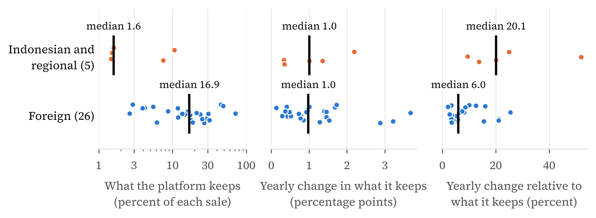

# Full redline: the thesis as sent on 24 October against the thesis now

Prepared 25 October 2026. **BEFORE** = commit `a1f1af2` (the text sent to Prof. Kong, her Chapter 1 edits ported in). **AFTER** = the current text. This file contains **both complete texts in one stream**: unchanged text is printed as it is, ~~deleted~~ words are <del>struck through in red</del>, <ins>added words are underlined in blue</ins>, and whole paragraphs, tables, equations or figures that exist on one side only sit in a red (removed) or blue (added) box. Each changed block has an ID such as <span class="cid">C012</span>; the index below lists them all, with my reading of why each changed (my mapping to her comment items, not hers). Nothing here has been sent to her.

**Totals.** 89 changed blocks, 68 added, 45 removed; about 3,575 words deleted and 7,899 added inside or between them.

| Part | Changed | Added | Removed | Words touched |
|---|---:|---:|---:|---:|
| Abstract | 1 | 0 | 0 | 34 |
| Symbols and Abbreviations (page removed) | 0 | 0 | 5 | 403 |
| Chapter 1. Introduction | 5 | 0 | 0 | 51 |
| Chapter 2. Literature review | 3 | 0 | 3 | 303 |
| Chapter 3. Framework and hypotheses | 13 | 13 | 13 | 1,730 |
| Chapter 4. Data and methods | 14 | 8 | 11 | 1,467 |
| Chapter 5. Results | 21 | 27 | 13 | 4,314 |
| Chapter 6. Discussion and policy implications | 7 | 2 | 0 | 126 |
| Chapter 7. Conclusion | 7 | 1 | 0 | 377 |
| Appendices | 14 | 15 | 0 | 2,530 |
| References | 4 | 2 | 0 | 139 |

## Change index

| ID | Type | Part | Section | Why (my mapping) | Starts with |
|---|---|---|---|---|---|
| C001 | changed | Abstract | Abstract | H1 result restated (growth test, 3.6 times) | In 2023, three major platforms kept about US$3 billion of the US$43 billion that passed th |
| C002 | removed | Symbols and Abbreviations (page removed) | Symbols and Abbreviations (page removed) | Symbols page dropped (her item 1); symbols now in Appendix A | # Symbols and Abbreviations |
| C003 | removed | Symbols and Abbreviations (page removed) | Symbols and Abbreviations (page removed) | Symbols page dropped (her item 1); symbols now in Appendix A | Each symbol is defined in Chapter 3, where it first appears in a formula. The subscripts i |
| C004 | removed | Symbols and Abbreviations (page removed) | Symbols and Abbreviations (page removed) | Symbols page dropped (her item 1); symbols now in Appendix A | [table] Symbol / Meaning / First defined |
| C005 | removed | Symbols and Abbreviations (page removed) | Symbols and Abbreviations (page removed) | Symbols page dropped (her item 1); symbols now in Appendix A | The text spells out most names. These abbreviations remain. |
| C006 | removed | Symbols and Abbreviations (page removed) | Symbols and Abbreviations (page removed) | Symbols page dropped (her item 1); symbols now in Appendix A | [table] Abbreviation / Meaning |
| C007 | changed | Chapter 1. Introduction | Chapter 1. Introduction | Abbreviations at first use (item 1, comment 23); comment 26; H1 result restated | Over the past decade, digital commerce has changed how goods and services are bought and s |
| C008 | changed | Chapter 1. Introduction | Chapter 1. Introduction | Abbreviations at first use (item 1, comment 23); comment 26; H1 result restated | Indonesia in 2023 offers a striking example, as its figures moved away from the commerce t |
| C009 | changed | Chapter 1. Introduction | Chapter 1. Introduction | Abbreviations at first use (item 1, comment 23); comment 26; H1 result restated | There are three reasons why this thesis focuses on Indonesia. First, Indonesia allows the  |
| C010 | changed | Chapter 1. Introduction | 1.1 Research question and objectives | Abbreviations at first use (item 1, comment 23); comment 26; H1 result restated | The analysis begins by measuring the invisible wedge. In 2023, three major platforms in In |
| C011 | changed | Chapter 1. Introduction | 1.2 Contributions | Abbreviations at first use (item 1, comment 23); comment 26; H1 result restated | Third, for tax authorities and regulators, the thesis measures how far rules based on plat |
| C012 | changed | Chapter 2. Literature review | 2.3 Digital records and third-party information | Table 1 dropped; gaps stated in the list (item 2) | Tax research explains why such records matter. Reports from third parties improve complian |
| C013 | removed | Chapter 2. Literature review | 2.4 Research gap | Table 1 dropped; gaps stated in the list (item 2) | The shortfalls identified in Sections 2.1 to 2.3 define the research gap. Table 2.1 sets t |
| C014 | removed | Chapter 2. Literature review | 2.4 Research gap | Table 1 dropped; gaps stated in the list (item 2) | **Table 2.1. What the literature establishes and where it stops** |
| C015 | removed | Chapter 2. Literature review | 2.4 Research gap | Table 1 dropped; gaps stated in the list (item 2) | [table] Section / What it establishes / Main sources / Where it stops |
| C016 | changed | Chapter 2. Literature review | 2.4 Research gap | Table 1 dropped; gaps stated in the list (item 2) | The shortfalls identified in Sections 2.1 to 2.3 define the research gap, and each becomes |
| C017 | changed | Chapter 2. Literature review | 2.4 Research gap | Table 1 dropped; gaps stated in the list (item 2) | 1. **How large is the difference between transaction value and revenue, and does it last?* |
| C018 | changed | Chapter 3. Framework and hypotheses | Chapter 3. Framework and hypotheses | Chapter 3 restructure (items 2 and 4) | 1. **How large the difference between transaction value and revenue is, and whether it las |
| C019 | added | Chapter 3. Framework and hypotheses | 3.1 Terms and rules for comparison | Table 2 (terms) became prose; symbols to Appendix A (items 1, 2) | Six terms recur throughout the thesis. Transaction value, V, is everything bought through  |
| C020 | added | Chapter 3. Framework and hypotheses | 3.1 Terms and rules for comparison | Table 2 (terms) became prose; symbols to Appendix A (items 1, 2) | An online seller is a business that BPS counts as selling online; the text also calls it a |
| C021 | removed | Chapter 3. Framework and hypotheses | 3.1 Terms and rules for comparison | Table 2 (terms) became prose; symbols to Appendix A (items 1, 2) | Table 3.1 defines the terms used throughout the thesis, each once, with the symbol used in |
| C022 | removed | Chapter 3. Framework and hypotheses | 3.1 Terms and rules for comparison | Table 2 (terms) became prose; symbols to Appendix A (items 1, 2) | **Table 3.1. Terms and symbols** |
| C023 | removed | Chapter 3. Framework and hypotheses | 3.1 Terms and rules for comparison | Table 2 (terms) became prose; symbols to Appendix A (items 1, 2) | [table] Term / Symbol / Meaning |
| C024 | changed | Chapter 3. Framework and hypotheses | 3.2 Three measures | Take-rate identity moved here; Table 9 cited as the example (item 2) | where m_it = R_it / V_it is the take rate, the share of each sale that the platform keeps. |
| C025 | added | Chapter 3. Framework and hypotheses | 3.2 Three measures | Take-rate identity moved here; Table 9 cited as the example (item 2) | The take rate itself has two parts: |
| C026 | removed | Chapter 3. Framework and hypotheses | 3.3 Tracing a movement | Section 3.3 replaced by the direct tests (items 2 and 4) | ## 3.3 Tracing a movement |
| C027 | removed | Chapter 3. Framework and hypotheses | 3.3 Tracing a movement | Section 3.3 replaced by the direct tests (items 2 and 4) | A large divergence calls for an explanation, and the same definitions supply it. Measured  |
| C028 | removed | Chapter 3. Framework and hypotheses | 3.3 Tracing a movement | Section 3.3 replaced by the direct tests (items 2 and 4) | [equation] Δln R_it = Δln V_it + Δln m_it                        (5) |
| C029 | removed | Chapter 3. Framework and hypotheses | 3.3 Tracing a movement | Section 3.3 replaced by the direct tests (items 2 and 4) | where Δln X is the change in the natural logarithm of X from one year to the next. The fir |
| C030 | changed | Chapter 3. Framework and hypotheses | 3.3 Tracing a movement | Section 3.3 replaced by the direct tests (items 2 and 4) | [equation] m_it = f_it − s_it                                    (5) |
| C031 | removed | Chapter 3. Framework and hypotheses | 3.3 Tracing a movement | Section 3.3 replaced by the direct tests (items 2 and 4) | Equations (5) and (6) together divide a movement in revenue into more commerce, higher fee |
| C032 | changed | Chapter 3. Framework and hypotheses | 3.3 Tracing a movement | Section 3.3 replaced by the direct tests (items 2 and 4) | Equation (5) also shows where a rule acts. A cap on commissions acts on the fee rate, and  |
| C033 | added | Chapter 3. Framework and hypotheses | 3.3 What changes the wedge and the ecosystem ratio | Section 3.3 replaced by the direct tests (items 2 and 4) | ## 3.3 What changes the wedge and the ecosystem ratio |
| C034 | added | Chapter 3. Framework and hypotheses | 3.3 What changes the wedge and the ecosystem ratio | Section 3.3 replaced by the direct tests (items 2 and 4) | Equations (1) to (4) define the wedge and the ecosystem ratio. They do not say what moves  |
| C035 | added | Chapter 3. Framework and hypotheses | 3.3 What changes the wedge and the ecosystem ratio | Section 3.3 replaced by the direct tests (items 2 and 4) | Revenue grows in proportion to transaction value when a 1 percent rise in transaction valu |
| C036 | added | Chapter 3. Framework and hypotheses | 3.3 What changes the wedge and the ecosystem ratio | Section 3.3 replaced by the direct tests (items 2 and 4) | [equation] g(R_it) = a + b g(V_it) + c Indonesia_i + d (Indonesia_i × g |
| C037 | added | Chapter 3. Framework and hypotheses | 3.3 What changes the wedge and the ecosystem ratio | Section 3.3 replaced by the direct tests (items 2 and 4) | where Indonesia_i equals one for the Indonesian and regional platforms and zero for the fo |
| C038 | added | Chapter 3. Framework and hypotheses | 3.3 What changes the wedge and the ecosystem ratio | Section 3.3 replaced by the direct tests (items 2 and 4) | The second test regresses the wedge and the ecosystem ratio on the features of a platform  |
| C039 | added | Chapter 3. Framework and hypotheses | 3.3 What changes the wedge and the ecosystem ratio | Section 3.3 replaced by the direct tests (items 2 and 4) | [equation] Y_it = α + β1 Indonesia_i + β2 ln(1 + Listed_it) + β3 ln(Ass |
| C040 | added | Chapter 3. Framework and hypotheses | 3.3 What changes the wedge and the ecosystem ratio | Section 3.3 replaced by the direct tests (items 2 and 4) | where Y_it is the natural logarithm of the wedge in US dollars, or the ecosystem ratio. Li |
| C041 | added | Chapter 3. Framework and hypotheses | 3.3 What changes the wedge and the ecosystem ratio | Section 3.3 replaced by the direct tests (items 2 and 4) | The take rate and its parts do not appear on the right-hand side. The ecosystem ratio equa |
| C042 | changed | Chapter 3. Framework and hypotheses | 3.4 Hypotheses | Hypotheses table dropped; H1 tests restated; H2 in simple growth (items 2 and 4) | Two hypotheses follow from the research question. H1 asks whether revenue follows the comm |
| C043 | removed | Chapter 3. Framework and hypotheses | 3.4 Hypotheses | Hypotheses table dropped; H1 tests restated; H2 in simple growth (items 2 and 4) | **Table 3.2. Hypotheses, tests and what would count against them** |
| C044 | removed | Chapter 3. Framework and hypotheses | 3.4 Hypotheses | Hypotheses table dropped; H1 tests restated; H2 in simple growth (items 2 and 4) | [table] Test / What it asks / Main test / What would count against it |
| C045 | changed | Chapter 3. Framework and hypotheses | 3.4 Hypotheses | Hypotheses table dropped; H1 tests restated; H2 in simple growth (items 2 and 4) | H1 is tested in two ways. The first is equation (6), an ordinary least squares (OLS) regre |
| C046 | changed | Chapter 3. Framework and hypotheses | 3.4 Hypotheses | Hypotheses table dropped; H1 tests restated; H2 in simple growth (items 2 and 4) | BPS publishes both the number of businesses selling online, N, and their total online sale |
| C047 | added | Chapter 3. Framework and hypotheses | 3.4 Hypotheses | Hypotheses table dropped; H1 tests restated; H2 in simple growth (items 2 and 4) | [equation] 1 + g(Y_t) = (1 + g(N_t)) × (1 + g(Y_t / N_t))               |
| C048 | removed | Chapter 3. Framework and hypotheses | 3.4 Hypotheses | Hypotheses table dropped; H1 tests restated; H2 in simple growth (items 2 and 4) | [equation] Δln Y_t = Δln N_t + Δln (Y_t / N_t)                   (7) |
| C049 | changed | Chapter 3. Framework and hypotheses | 3.4 Hypotheses | Hypotheses table dropped; H1 tests restated; H2 in simple growth (items 2 and 4) | where g(N) is the growth in the number of businesses, the extensive margin, and g(Y/N) the |
| C050 | changed | Chapter 3. Framework and hypotheses | 3.6 Further analyses | Further-analyses table dropped; market-value test keeps its registered logs; equations renumbered | Four further analyses complete the framework without forming hypotheses of their own. Each |
| C051 | removed | Chapter 3. Framework and hypotheses | 3.6 Further analyses | Further-analyses table dropped; market-value test keeps its registered logs; equations renumbered | **Table 3.3. Further analyses** |
| C052 | removed | Chapter 3. Framework and hypotheses | 3.6 Further analyses | Further-analyses table dropped; market-value test keeps its registered logs; equations renumbered | [table] Analysis / What it asks / Main evidence |
| C053 | changed | Chapter 3. Framework and hypotheses | 3.6 Further analyses | Further-analyses table dropped; market-value test keeps its registered logs; equations renumbered | Tracing large movements asks what moved revenue when it parted from transaction value. Whe |
| C054 | changed | Chapter 3. Framework and hypotheses | 3.6 Further analyses | Further-analyses table dropped; market-value test keeps its registered logs; equations renumbered | The market-value analysis asks whether investors, who price revenue (Section 2.1), treat i |
| C055 | changed | Chapter 3. Framework and hypotheses | 3.6 Further analyses | Further-analyses table dropped; market-value test keeps its registered logs; equations renumbered | [equation] Δln MV_it = β_V Δln V_it + β_m Δln m_it + year effect + erro |
| C056 | changed | Chapter 3. Framework and hypotheses | 3.6 Further analyses | Further-analyses table dropped; market-value test keeps its registered logs; equations renumbered | where β_V shows how market value moves with transaction value, and β_m how it moves with t |
| C057 | changed | Chapter 4. Data and methods | 4.1 The platform data | Table 4.1 moved to Appendix B (item 2) | Two groups of platforms are compared. The Indonesian and regional group has five platforms |
| C058 | removed | Chapter 4. Data and methods | 4.1 The platform data | Table 4.1 moved to Appendix B (item 2) | **Table 4.1. The Indonesian and regional group of platforms** |
| C059 | removed | Chapter 4. Data and methods | 4.1 The platform data | Table 4.1 moved to Appendix B (item 2) | [table] Platform series / What it covers / Years / Yearly pairs / How it is la |
| C060 | changed | Chapter 4. Data and methods | 4.1 The platform data | Table 4.1 moved to Appendix B (item 2) | Appendix B states the scope of each series because the series differ, and only Tokopedia i |
| C061 | changed | Chapter 4. Data and methods | 4.1 The platform data | Table 4.1 moved to Appendix B (item 2) | Two platforms sit close to that line. Zalando is one of the eight and sells part of what i |
| C062 | added | Chapter 4. Data and methods | 4.3 Testing H1 | H1 tests: growth regression added; simple percentage change (item 4) | The test of H1 has two parts, run on the same 32 platforms: the five Indonesian and region |
| C063 | added | Chapter 4. Data and methods | 4.3 Testing H1 | H1 tests: growth regression added; simple percentage change (item 4) | The first part is equation (6). Each observation is a pair of consecutive years of one pla |
| C064 | removed | Chapter 4. Data and methods | 4.3 Testing H1 | H1 tests: growth regression added; simple percentage change (item 4) | The test of H1 asks how far each platform's take rate moves from one year to the next. For |
| C065 | changed | Chapter 4. Data and methods | 4.3 Testing H1 | H1 tests: growth regression added; simple percentage change (item 4) | The second part asks how far each platform's take rate moves from one year to the next. Fo |
| C066 | changed | Chapter 4. Data and methods | 4.3 Testing H1 | H1 tests: growth regression added; simple percentage change (item 4) | Appendix C lists the checks on this test. Some change the sample. They drop each platform  |
| C067 | added | Chapter 4. Data and methods | 4.4 What explains the wedge and the ecosystem rati | New: data and variables of the regressions (item 4) | ## 4.4 What explains the wedge and the ecosystem ratio |
| C068 | added | Chapter 4. Data and methods | 4.4 What explains the wedge and the ecosystem rati | New: data and variables of the regressions (item 4) | Equation (7) is estimated on a panel of 213 platform-years for the same 32 platforms, 20 o |
| C069 | added | Chapter 4. Data and methods | 4.4 What explains the wedge and the ecosystem rati | New: data and variables of the regressions (item 4) | Size is the platform's total assets, taken from annual reports filed with the US Securitie |
| C070 | added | Chapter 4. Data and methods | 4.4 What explains the wedge and the ecosystem rati | New: data and variables of the regressions (item 4) | The home market is the country of the platform's main market. It is the United States for  |
| C071 | added | Chapter 4. Data and methods | 4.4 What explains the wedge and the ecosystem rati | New: data and variables of the regressions (item 4) | Growth rates and the ecosystem ratio are capped at their 5th and 95th percentiles across a |
| C072 | removed | Chapter 4. Data and methods | 4.4 Tracing the moves | New: data and variables of the regressions (item 4) | ## 4.4 Tracing the moves |
| C073 | removed | Chapter 4. Data and methods | 4.4 Tracing the moves | New: data and variables of the regressions (item 4) | The second objective, to reconcile large movements in revenue with disclosed changes in fe |
| C074 | changed | Chapter 4. Data and methods | 4.4 Tracing the moves | New: data and variables of the regressions (item 4) | The second objective, to reconcile large movements in revenue with disclosed changes in fe |
| C075 | removed | Chapter 4. Data and methods | 4.4 Tracing the moves | New: data and variables of the regressions (item 4) | The sources differ by company. Tokopedia's audited segment note gives gross revenue, incen |
| C076 | changed | Chapter 4. Data and methods | 4.4 Tracing the moves | New: data and variables of the regressions (item 4) | The sources differ by company. Tokopedia's audited segment note gives gross revenue, incen |
| C077 | changed | Chapter 4. Data and methods | 4.5 Market values | LSEG spelled out; equation renumbered | The market-value analysis of Section 3.6 uses year-end market values from the data service |
| C078 | changed | Chapter 4. Data and methods | 4.5 Market values | LSEG spelled out; equation renumbered | Equation (9) is estimated with a fixed effect for each year, which removes what all platfo |
| C079 | changed | Chapter 4. Data and methods | 4.6 The survey files and H2 | Table 4.2 became a footnote (item 2); equation renumbered | H2 uses the published figures and the split of equation (8). BPS prints two counts of busi |
| C080 | changed | Chapter 4. Data and methods | 4.6 The survey files and H2 | Table 4.2 became a footnote (item 2); equation renumbered | The published figures cannot tell a new seller from one counted for the first time, but th |
| C081 | added | Chapter 4. Data and methods | 4.6 The survey files and H2 | Table 4.2 became a footnote (item 2); equation renumbered | [^files]: The files hold 11,848, 31,724 and 39,736 rows. Each weighted total is within 0.1 |
| C082 | removed | Chapter 4. Data and methods | 4.6 The survey files and H2 | Table 4.2 became a footnote (item 2); equation renumbered | **Table 4.2. The three BPS survey files** |
| C083 | removed | Chapter 4. Data and methods | 4.6 The survey files and H2 | Table 4.2 became a footnote (item 2); equation renumbered | [table] Survey round / Activity year / Rows / Weighted total / BPS count |
| C084 | removed | Chapter 4. Data and methods | 4.6 The survey files and H2 | Table 4.2 became a footnote (item 2); equation renumbered | *Implied by the published count for 2023 and its published growth of 27.4 percent. |
| C085 | changed | Chapter 4. Data and methods | 4.9 Comparing national figures | Table 4.3 moved to Appendix A (item 2) | The third objective, to compare the platform evidence with national and payment figures, r |
| C086 | removed | Chapter 4. Data and methods | 4.9 Comparing national figures | Table 4.3 moved to Appendix A (item 2) | **Table 4.3. Sources compared in Objective 3** |
| C087 | removed | Chapter 4. Data and methods | 4.9 Comparing national figures | Table 4.3 moved to Appendix A (item 2) | [table] Source / What it covers / How it counts |
| C088 | changed | Chapter 4. Data and methods | 4.10 Labels, traceability and licensed data | Public inputs added | The thesis also separates tests by when they were written. A registered test was written d |
| C089 | changed | Chapter 4. Data and methods | 4.10 Labels, traceability and licensed data | Public inputs added | The World Bank indicators, the Bank for International Settlements policy rates and the tot |
| C090 | changed | Chapter 5. Results | Chapter 5. Results | Table 5.1 dropped (item 2); wedge table renumbered | Every result in this chapter carries one of the three labels of Section 4.10: registered,  |
| C091 | removed | Chapter 5. Results | Chapter 5. Results | Table 5.1 dropped (item 2); wedge table renumbered | **Table 5.1. Main results and the evidence behind them** |
| C092 | removed | Chapter 5. Results | Chapter 5. Results | Table 5.1 dropped (item 2); wedge table renumbered | [table] Result / Label / Main checks / Section |
| C093 | changed | Chapter 5. Results | 5.1 How much revenue leaves out | Wedge table renumbered; table caption | Revenue showed only a small part of what Indonesia's major platforms carried. In 2023, Tok |
| C094 | changed | Chapter 5. Results | 5.1 How much revenue leaves out | Wedge table renumbered; table caption | **Table 5.1. The invisible wedge of three platforms, 2023 (US$ billion)** |
| C095 | added | Chapter 5. Results | 5.1 How much revenue leaves out | Wedge table renumbered; table caption | This table reports transaction value, revenue, the wedge (transaction value less revenue)  |
| C096 | changed | Chapter 5. Results | 5.1 How much revenue leaves out | Wedge table renumbered; table caption | The size of the wedge does not depend on the assumed rates. A take rate for Shopee between |
| C097 | added | Chapter 5. Results | 5.2 Testing H1 | Summary statistics, correlations and the H1 growth test (item 4); Figure panels (item 2) | Revenue followed transaction value abroad and did not in Indonesia and the region, so the  |
| C098 | added | Chapter 5. Results | 5.2 Testing H1 | Summary statistics, correlations and the H1 growth test (item 4); Figure panels (item 2) | **Table 5.2. Summary statistics and correlations** |
| C099 | added | Chapter 5. Results | 5.2 Testing H1 | Summary statistics, correlations and the H1 growth test (item 4); Figure panels (item 2) | This table reports summary statistics and pairwise correlations for the panel of 213 platf |
| C100 | added | Chapter 5. Results | 5.2 Testing H1 | Summary statistics, correlations and the H1 growth test (item 4); Figure panels (item 2) | *Panel A. Summary statistics* |
| C101 | added | Chapter 5. Results | 5.2 Testing H1 | Summary statistics, correlations and the H1 growth test (item 4); Figure panels (item 2) | [table] Variable / Indonesian and regional /  /  /  / Foreign /  /  /  |
| C102 | added | Chapter 5. Results | 5.2 Testing H1 | Summary statistics, correlations and the H1 growth test (item 4); Figure panels (item 2) | *Panel B. Pairwise correlations* |
| C103 | added | Chapter 5. Results | 5.2 Testing H1 | Summary statistics, correlations and the H1 growth test (item 4); Figure panels (item 2) | [table] Variables / (1) / (2) / (3) / (4) / (5) / (6) / (7) / (8) / (9) |
| C104 | added | Chapter 5. Results | 5.2 Testing H1 | Summary statistics, correlations and the H1 growth test (item 4); Figure panels (item 2) | *Note:* Inflation and household spending growth are left out of Panel B to fit the page; t |
| C105 | added | Chapter 5. Results | 5.2 Testing H1 | Summary statistics, correlations and the H1 growth test (item 4); Figure panels (item 2) | Across all platforms, revenue growth and transaction value growth have a correlation of 0. |
| C106 | added | Chapter 5. Results | 5.2 Testing H1 | Summary statistics, correlations and the H1 growth test (item 4); Figure panels (item 2) | Table 5.3 tests H1 in growth rates. Abroad, a rise of 1 percentage point in the growth of  |
| C107 | added | Chapter 5. Results | 5.2 Testing H1 | Summary statistics, correlations and the H1 growth test (item 4); Figure panels (item 2) | **Table 5.3. Revenue growth and transaction value growth** |
| C108 | added | Chapter 5. Results | 5.2 Testing H1 | Summary statistics, correlations and the H1 growth test (item 4); Figure panels (item 2) | This table reports OLS estimates of equation (6). The dependent variable is the growth of  |
| C109 | added | Chapter 5. Results | 5.2 Testing H1 | Summary statistics, correlations and the H1 growth test (item 4); Figure panels (item 2) | [table] *Dependent variable* / g(R) / g(R) / g(R) |
| C110 | added | Chapter 5. Results | 5.2 Testing H1 | Summary statistics, correlations and the H1 growth test (item 4); Figure panels (item 2) | *Note:* The slope on g(V) is 1 if revenue grows in proportion to transaction value. Source |
| C111 | removed | Chapter 5. Results | 5.2 Testing H1 | Summary statistics, correlations and the H1 growth test (item 4); Figure panels (item 2) | Revenue did not keep pace with transaction value at the Indonesian and regional platforms, |
| C112 | removed | Chapter 5. Results | 5.2 Testing H1 | Summary statistics, correlations and the H1 growth test (item 4); Figure panels (item 2) | **Table 5.3. The test of H1** |
| C113 | removed | Chapter 5. Results | 5.2 Testing H1 | Summary statistics, correlations and the H1 growth test (item 4); Figure panels (item 2) | [table] Test / Method / Indonesian and regional group / Foreign group / p-valu |
| C114 | removed | Chapter 5. Results | 5.2 Testing H1 | Summary statistics, correlations and the H1 growth test (item 4); Figure panels (item 2) | *Note:* Group values are medians of each platform's median yearly change. Appendix B lists |
| C115 | changed | Chapter 5. Results | 5.2 Testing H1 | Summary statistics, correlations and the H1 growth test (item 4); Figure panels (item 2) | The earlier test of the size of take-rate moves points the same way. At the typical Indone |
| C116 | changed | Chapter 5. Results | 5.2 Testing H1 | Summary statistics, correlations and the H1 growth test (item 4); Figure panels (item 2) | The test of the size of moves was set up after a first, narrower test, so it is explorator |
| C117 | changed | Chapter 5. Results | 5.2 Testing H1 | Summary statistics, correlations and the H1 growth test (item 4); Figure panels (item 2) | Both tests of the size of moves ask about their size, not their direction, and direction i |
| C118 | changed | Chapter 5. Results | 5.2 Testing H1 | Summary statistics, correlations and the H1 growth test (item 4); Figure panels (item 2) | Age does not explain the result. The Indonesian and regional platforms made their largest  |
| C119 | removed | Chapter 5. Results | 5.2 Testing H1 | Summary statistics, correlations and the H1 growth test (item 4); Figure panels (item 2) | The thin take rate of Indonesian and regional platforms explains much of the threefold dif |
| C120 | changed | Chapter 5. Results | 5.2 Testing H1 | Summary statistics, correlations and the H1 growth test (item 4); Figure panels (item 2) | The thin take rate of Indonesian and regional platforms explains much of the threefold dif |
| C121 | changed | Chapter 5. Results | 5.2 Testing H1 | Summary statistics, correlations and the H1 growth test (item 4); Figure panels (item 2) | [figure] figures/fig5_1_thin_slice.png |
| C122 | changed | Chapter 5. Results | 5.2 Testing H1 | Summary statistics, correlations and the H1 growth test (item 4); Figure panels (item 2) | **Figure 5.1. The thin take rate.** Each dot is one platform's median over its years. Pane |
| C123 | changed | Chapter 5. Results | 5.3 What explains the wedge and the ecosystem rati | OLS of the wedge and the ecosystem ratio; economic implications (items 4 and 5) | ## 5.3 What explains the wedge and the ecosystem ratio |
| C124 | added | Chapter 5. Results | 5.3 What explains the wedge and the ecosystem rati | OLS of the wedge and the ecosystem ratio; economic implications (items 4 and 5) | Size explains the wedge, and pricing explains the ecosystem ratio. Table 5.4 regresses eac |
| C125 | added | Chapter 5. Results | 5.3 What explains the wedge and the ecosystem rati | OLS of the wedge and the ecosystem ratio; economic implications (items 4 and 5) | **Table 5.4. What explains the wedge and the ecosystem ratio** |
| C126 | added | Chapter 5. Results | 5.3 What explains the wedge and the ecosystem rati | OLS of the wedge and the ecosystem ratio; economic implications (items 4 and 5) | This table reports OLS estimates of equation (7). The dependent variable is the natural lo |
| C127 | added | Chapter 5. Results | 5.3 What explains the wedge and the ecosystem rati | OLS of the wedge and the ecosystem ratio; economic implications (items 4 and 5) | [table] *Dependent variable* / ln(Wedge) / ln(Wedge) / ln(Wedge) / Ecosystem r |
| C128 | added | Chapter 5. Results | 5.3 What explains the wedge and the ecosystem rati | OLS of the wedge and the ecosystem ratio; economic implications (items 4 and 5) | *Note:* The take rate and its parts are not regressors, because the ecosystem ratio is one |
| C129 | added | Chapter 5. Results | 5.3 What explains the wedge and the ecosystem rati | OLS of the wedge and the ecosystem ratio; economic implications (items 4 and 5) | The wedge scales with the size of the platform. A 1 percent rise in total assets goes with |
| C130 | added | Chapter 5. Results | 5.3 What explains the wedge and the ecosystem rati | OLS of the wedge and the ecosystem ratio; economic implications (items 4 and 5) | The ecosystem ratio is different. The Indonesian and regional platforms have a ratio 13 to |
| C131 | added | Chapter 5. Results | 5.3 What explains the wedge and the ecosystem rati | OLS of the wedge and the ecosystem ratio; economic implications (items 4 and 5) | The result for the Indonesian and regional platforms survives the checks of Appendix C. Th |
| C132 | removed | Chapter 5. Results | 5.3 What explains the wedge and the ecosystem rati | OLS of the wedge and the ecosystem ratio; economic implications (items 4 and 5) | Pricing, not more commerce, moved revenue at the Indonesian and regional platforms. Pricin |
| C133 | removed | Chapter 5. Results | 5.3 What explains the wedge and the ecosystem rati | OLS of the wedge and the ecosystem ratio; economic implications (items 4 and 5) | Where companies disclose both their fees and their incentives, equation (6) splits the gro |
| C134 | removed | Chapter 5. Results | 5.3 What explains the wedge and the ecosystem rati | OLS of the wedge and the ecosystem ratio; economic implications (items 4 and 5) | **Table 5.4. What moved revenue in seven Indonesian and regional windows (share of the gro |
| C135 | removed | Chapter 5. Results | 5.3 What explains the wedge and the ecosystem rati | OLS of the wedge and the ecosystem ratio; economic implications (items 4 and 5) | [table] Platform and window / Growth of revenue / More commerce / Higher fees  |
| C136 | removed | Chapter 5. Results | 5.3 What explains the wedge and the ecosystem rati | OLS of the wedge and the ecosystem ratio; economic implications (items 4 and 5) | *Note:* Shares are rounded, so a row can add to 99 or 101. Source: company filings; author |
| C137 | changed | Chapter 5. Results | 5.3 What explains the wedge and the ecosystem rati | OLS of the wedge and the ecosystem ratio; economic implications (items 4 and 5) | The regression does not say how a platform moved its take rate. Company reports do, for th |
| C138 | removed | Chapter 5. Results | 5.3 What explains the wedge and the ecosystem rati | OLS of the wedge and the ecosystem ratio; economic implications (items 4 and 5) | Three series need a note. GoTo's 2022 transaction value is an estimate. Blibli does not re |
| C139 | changed | Chapter 5. Results | 5.3 What explains the wedge and the ecosystem rati | OLS of the wedge and the ecosystem ratio; economic implications (items 4 and 5) | Tokopedia can be read in two ways, and both point to pricing. Its incentives fell by about |
| C140 | added | Chapter 5. Results | 5.3 What explains the wedge and the ecosystem rati | OLS of the wedge and the ecosystem ratio; economic implications (items 4 and 5) | The ecosystem ratio matters for three groups. For investors, a high ratio means that small |
| C141 | added | Chapter 5. Results | 5.3 What explains the wedge and the ecosystem rati | OLS of the wedge and the ecosystem ratio; economic implications (items 4 and 5) | For sellers and drivers, a high ratio means that most of each sale goes to them and not to |
| C142 | added | Chapter 5. Results | 5.3 What explains the wedge and the ecosystem rati | OLS of the wedge and the ecosystem ratio; economic implications (items 4 and 5) | For policy, the wedge is the base that revenue-based rules do not reach. A rule that acts  |
| C143 | changed | Chapter 5. Results | 5.4 What markets valued | Equation renumbered | Across 28 listed platforms and 138 platform-years, market value moved with transaction val |
| C144 | changed | Chapter 5. Results | 5.5 The platforms and the sellers in 2023 | Chapter 5 changes | **Figure 5.3. Growth in 2023 (percent).** Blue bars show measures of buying; orange bars s |
| C145 | changed | Chapter 5. Results | 5.6 H2 and the entry test | H2 restated in simple percentage change (item 4) | H2 holds on BPS's published figures, but the registered entry test shows that first-time e |
| C146 | changed | Chapter 5. Results | 5.6 H2 and the entry test | H2 restated in simple percentage change (item 4) | H2 holds again from 2023 to 2024. Value grew by 17 percent, the number of businesses by 15 |
| C147 | added | Chapter 5. Results | 5.7 What the rise in the count contains | H2 coverage readings restated in simple percentage change (item 4) | This table splits the rise in the number of online sellers between the weighted totals of  |
| C148 | changed | Chapter 5. Results | 5.7 What the rise in the count contains | H2 coverage readings restated in simple percentage change (item 4) | H2 holds on the published series, but it sits right on its threshold once the extra count  |
| C149 | changed | Chapter 5. Results | 5.10 Why the national figures disagree | QRIS spelled out (item 1) | In 2024 the figures divide by coverage. Those that cover mainly platforms grew by 5 to 7 p |
| C150 | changed | Chapter 5. Results | 5.10 Why the national figures disagree | QRIS spelled out (item 1) | Payment figures grew faster than any of these from 2023 to 2024. E-money shopping grew by  |
| C151 | added | Chapter 6. Discussion and policy implications | 6.1 The rules and what each acts on | Equation renumbered; table reference; national identity number | This table lists each recent Indonesian rule that bears on the figures in Chapters 4 and 5 |
| C152 | changed | Chapter 6. Discussion and policy implications | 6.1 The rules and what each acts on | Equation renumbered; table reference; national identity number | [table] Rule / What it does / What it acts on / Measured in / Status of the te |
| C153 | changed | Chapter 6. Discussion and policy implications | 6.1 The rules and what each acts on | Equation renumbered; table reference; national identity number | Equation (5) shows where the first two rules act. The take rate is the fee rate less the i |
| C154 | changed | Chapter 6. Discussion and policy implications | 6.2 What the commission cap and the discount rule  | Equation renumbered; table reference; national identity number | The discount rule acts on the lever that moved take rates most often. Lower incentives wer |
| C155 | changed | Chapter 6. Discussion and policy implications | 6.3 How far the marketplace tax reaches | Equation renumbered; table reference; national identity number | The record reaches further than the tax. Every domestic seller on a designated marketplace |
| C156 | added | Chapter 6. Discussion and policy implications | 6.5 What the registered predictions test | Equation renumbered; table reference; national identity number | This table lists the registered predictions on the 2026 rules. For each prediction it give |
| C157 | changed | Chapter 6. Discussion and policy implications | 6.5 What the registered predictions test | Equation renumbered; table reference; national identity number | *Note:* Ranges as registered; registration dates are in Appendix D. A tenth prediction, th |
| C158 | changed | Chapter 6. Discussion and policy implications | 6.5 What the registered predictions test | Equation renumbered; table reference; national identity number | > **[Results slot]** To be written after the GoTo results (late October), the BPS national |
| C159 | changed | Chapter 6. Discussion and policy implications | 6.6 Beyond Indonesia | Equation renumbered; table reference; national identity number | Commission caps have been tried elsewhere as well. Fourteen US cities and states capped th |
| C160 | changed | Chapter 7. Conclusion | 7.1 The answer to the research question | Answer restated with the new tests | The answer to the second half differs by link. On the inner link, the choice of revenue ch |
| C161 | changed | Chapter 7. Conclusion | 7.1 The answer to the research question | Answer restated with the new tests | On the outer link, H2 holds on BPS's published figures: more businesses account for most o |
| C162 | changed | Chapter 7. Conclusion | 7.2 What the thesis adds | Investor implications restated (item 5) | For investors, the thesis adds a check that can be run on any platform that reports both a |
| C163 | changed | Chapter 7. Conclusion | 7.3 Predictions that failed | Conclusion restated | Appendix D lists every registered test with its outcome. The predictions on the 2026 rules |
| C164 | changed | Chapter 7. Conclusion | 7.4 Limits of the evidence | Limits of the new tests added | The invisible wedge is the part of each sale that a platform passes on to sellers, drivers |
| C165 | changed | Chapter 7. Conclusion | 7.4 Limits of the evidence | Limits of the new tests added | The tests of H1 are one-sided, because each asks whether the Indonesian and regional group |
| C166 | added | Chapter 7. Conclusion | 7.4 Limits of the evidence | Limits of the new tests added | The new regressions are exploratory and rest on few platforms. The growth test for Indones |
| C167 | changed | Chapter 7. Conclusion | 7.4 Limits of the evidence | Limits of the new tests added | Foreign platforms also differ in how they book shopper discounts. Eight of the 27 record t |
| C168 | added | Appendices | Appendix A. Definition of variables | New Appendix A (variables), relettering A to B, B.5, C.3 (items 1, 3) | ## Appendix A. Definition of variables |
| C169 | added | Appendices | Appendix A. Definition of variables | New Appendix A (variables), relettering A to B, B.5, C.3 (items 1, 3) | ### A.1 Variables |
| C170 | added | Appendices | Appendix A. Definition of variables | New Appendix A (variables), relettering A to B, B.5, C.3 (items 1, 3) | Every variable and symbol used in the empirical analyses is listed with its definition and |
| C171 | added | Appendices | Appendix A. Definition of variables | New Appendix A (variables), relettering A to B, B.5, C.3 (items 1, 3) | [table] Variable / Definition / Source |
| C172 | added | Appendices | Appendix A. Definition of variables | New Appendix A (variables), relettering A to B, B.5, C.3 (items 1, 3) | ### A.2 Sources compared in Objective 3 |
| C173 | added | Appendices | Appendix A. Definition of variables | New Appendix A (variables), relettering A to B, B.5, C.3 (items 1, 3) | [table] Source / What it covers / How it counts |
| C174 | changed | Appendices | Appendix B. Platforms, windows and the wedge by ye | New Appendix A (variables), relettering A to B, B.5, C.3 (items 1, 3) | ## Appendix B. Platforms, windows and the wedge by year |
| C175 | changed | Appendices | Appendix B. Platforms, windows and the wedge by ye | New Appendix A (variables), relettering A to B, B.5, C.3 (items 1, 3) | ### B.1 The foreign group (27 platforms) |
| C176 | changed | Appendices | Appendix B. Platforms, windows and the wedge by ye | New Appendix A (variables), relettering A to B, B.5, C.3 (items 1, 3) | Pairs are consecutive years that pass the rules of Chapter 4, section 4.1: for the platfor |
| C177 | changed | Appendices | Appendix B. Platforms, windows and the wedge by ye | New Appendix A (variables), relettering A to B, B.5, C.3 (items 1, 3) | ### B.2 The Indonesian and regional group |
| C178 | added | Appendices | Appendix B. Platforms, windows and the wedge by ye | New Appendix A (variables), relettering A to B, B.5, C.3 (items 1, 3) | [table] Platform series / What it covers / Years / Yearly pairs / How it is la |
| C179 | changed | Appendices | Appendix B. Platforms, windows and the wedge by ye | New Appendix A (variables), relettering A to B, B.5, C.3 (items 1, 3) | ### B.3 The seven windows traced |
| C180 | changed | Appendices | Appendix B. Platforms, windows and the wedge by ye | New Appendix A (variables), relettering A to B, B.5, C.3 (items 1, 3) | Shares are of the log growth of revenue, because the split into more commerce, higher fees |
| C181 | changed | Appendices | Appendix B. Platforms, windows and the wedge by ye | New Appendix A (variables), relettering A to B, B.5, C.3 (items 1, 3) | ### B.4 Wedge and ecosystem ratio by platform-year, Indonesian series |
| C182 | added | Appendices | Appendix B. Platforms, windows and the wedge by ye | New Appendix A (variables), relettering A to B, B.5, C.3 (items 1, 3) | ### B.5 Classification of the platforms in the regressions |
| C183 | added | Appendices | Appendix B. Platforms, windows and the wedge by ye | New Appendix A (variables), relettering A to B, B.5, C.3 (items 1, 3) | The type, the main market and the listing year are the author's classification from public |
| C184 | added | Appendices | Appendix B. Platforms, windows and the wedge by ye | New Appendix A (variables), relettering A to B, B.5, C.3 (items 1, 3) | [table] Platform / Group / Type / Main market / Reporting currency / Listed |
| C185 | changed | Appendices | Appendix C. The checks on the tests of H1 and on t | New Appendix A (variables), relettering A to B, B.5, C.3 (items 1, 3) | ## Appendix C. The checks on the tests of H1 and on the regressions |
| C186 | changed | Appendices | Appendix C. The checks on the tests of H1 and on t | New Appendix A (variables), relettering A to B, B.5, C.3 (items 1, 3) | ### C.1 The checks |
| C187 | changed | Appendices | Appendix C. The checks on the tests of H1 and on t | New Appendix A (variables), relettering A to B, B.5, C.3 (items 1, 3) | The main test is described in Section 5.2. This appendix keeps its first measure, the abso |
| C188 | changed | Appendices | Appendix C. The checks on the tests of H1 and on t | New Appendix A (variables), relettering A to B, B.5, C.3 (items 1, 3) | The four rows marked 22 Oct 2026 were added after all other results were known, so they ar |
| C189 | changed | Appendices | Appendix C. The checks on the tests of H1 and on t | New Appendix A (variables), relettering A to B, B.5, C.3 (items 1, 3) | ### C.2 Where the 2023 break sits (exploratory) |
| C190 | added | Appendices | Appendix C. The checks on the tests of H1 and on t | New Appendix A (variables), relettering A to B, B.5, C.3 (items 1, 3) | ### C.3 Checks on the growth test and on the regressions (exploratory, 25 Oct 2026) |
| C191 | added | Appendices | Appendix C. The checks on the tests of H1 and on t | New Appendix A (variables), relettering A to B, B.5, C.3 (items 1, 3) | The first table repeats the test of the size of take-rate moves with other measures of the |
| C192 | added | Appendices | Appendix C. The checks on the tests of H1 and on t | New Appendix A (variables), relettering A to B, B.5, C.3 (items 1, 3) | [table] Measure of the yearly change in the take rate / Indonesian and regiona |
| C193 | added | Appendices | Appendix C. The checks on the tests of H1 and on t | New Appendix A (variables), relettering A to B, B.5, C.3 (items 1, 3) | [table] Sample / Correlation, capped / Correlation, not capped / Rank correlat |
| C194 | added | Appendices | Appendix C. The checks on the tests of H1 and on t | New Appendix A (variables), relettering A to B, B.5, C.3 (items 1, 3) | [table] Check / Dependent variable / IndonesiaRegion / p / Wild-bootstrap p /  |
| C195 | changed | Appendices | Appendix D. Registered tests and their outcomes | New Appendix A (variables), relettering A to B, B.5, C.3 (items 1, 3) | ## Appendix D. Registered tests and their outcomes |
| C196 | changed | Appendices | Appendix E. The values behind Figures 5.3 to 5.5 | New Appendix A (variables), relettering A to B, B.5, C.3 (items 1, 3) | ## Appendix E. The values behind Figures 5.3 to 5.5 |
| C197 | changed | References | References | Sources added or generalised | Bank for International Settlements. (2026). *Central bank policy rates* [Data set, WS_CBPO |
| C198 | added | References | References | Sources added or generalised | Barrios, J. M., Hochberg, Y. V., & Yi, H. (2022). Launching with a parachute: The gig econ |
| C199 | changed | References | References | Sources added or generalised | Cameron, A. C., Gelbach, J. B., & Miller, D. L. (2008). Bootstrap-based improvements for i |
| C200 | added | References | References | Sources added or generalised | Denes, M. R., Lagaras, S., & Tsoutsoura, M. (2025). Entrepreneurship and the gig economy:  |
| C201 | changed | References | References | Sources added or generalised | UNCTAD. (2024). *Business e-commerce sales and the role of online platforms*. United Natio |
| C202 | changed | References | References | Sources added or generalised | World Bank. (2026). *World development indicators* [GDP growth, consumer-price inflation,  |

<div class="pagebreak"></div>


<div class="filehead">Abstract</div>

# Abstract

**The Invisible Ledger: Quantifying the Invisible Wedge in Indonesia's Platform Economy**

A platform's revenue stands for the commerce it carries, and a survey's count of sellers stands for the businesses selling online. This thesis asks how much activity remains invisible when platforms are measured through their revenue, and when that choice changes the conclusion about growth. It studies Indonesia, using platform reports, a national survey of online sellers and national figures.

<span class="cid">C001</span> In 2023, three major platforms kept about US$3 billion of the US$43 billion that passed through them. <del>Indonesian</del> <ins>Abroad, revenue grew in proportion to transaction value. In Indonesia</ins> and <del>regional</del> <ins>the region it did not:</ins> platforms changed the share of each sale they kept <del>about three</del> <ins>3.6</ins> times as much as 27 platforms abroad, mostly between 2022 and <del>2024. So the</del> <ins>2024, so that</ins> hypothesis <del>that revenue grows in proportion to the commerce</del> is rejected.

The count of online sellers rose by 27 percent in 2023. A test registered in advance finds too few new sellers to produce that rise, and a later, exploratory count shows that first-time entry explains only about half of it. If the rest is read as wider survey coverage, the finding that more businesses drive growth sits on its threshold. The new marketplace tax can collect from at most about 1 in 20 online sellers.

**Keywords:** digital platforms; take rate; e-commerce measurement; transaction value; online sellers; Indonesia

*[Chinese abstract (中文摘要), Chinese keywords and the Chinese title page are required by YZU and are left for the researcher. The proposal's Chinese title was 隱形帳簿：量化印尼平台經濟中的隱形缺口.]*


<div class="filehead">Symbols and Abbreviations (page removed)</div>

::: {.del}
<span class="cid">C002</span> # Symbols and Abbreviations
:::

::: {.del}
<span class="cid">C003</span> Each symbol is defined in Chapter 3, where it first appears in a formula. The subscripts i and t mark the platform and the year.
:::

::: {.del}
<span class="cid">C004</span> *removed*

| Symbol | Meaning | First defined |
|---|---|---|
| V | Transaction value: everything bought through a platform in a period | Table 3.1 |
| R | Revenue: what the platform records as its own income | Table 3.1 |
| m | Take rate, R divided by V: the share of each sale the platform keeps | Table 3.1 |
| f | Fee rate: revenue before customer incentives, divided by V | Table 3.1 |
| s | Incentive rate: customer incentives divided by V | Table 3.1 |
| W | Invisible wedge, V minus R: what a revenue figure leaves out | Equation (1) |
| E | Ecosystem ratio, W divided by R, equal to 1/m − 1 (the author's own measure) | Equation (2) |
| g(·) | Growth from one year to the next, as a share of the first year | Table 3.1 |
| D | Growth divergence, g(R) minus g(V) | Equation (3) |
| Δln X | Change in the natural logarithm of X from one year to the next | Equation (5) |
| N | BPS's count of businesses selling online | Equation (7) |
| Y | BPS's total online sales value | Equation (7) |
| MV | A listed platform's market value | Equation (8) |
| β_V, β_m | How market value moves with transaction value and with the take rate | Equation (8) |
| H1, H2 | The two hypotheses | Section 3.4 |
:::

::: {.del}
<span class="cid">C005</span> The text spells out most names. These abbreviations remain.
:::

::: {.del}
<span class="cid">C006</span> *removed*

| Abbreviation | Meaning |
|---|---|
| BPS | Badan Pusat Statistik, Statistics Indonesia |
| GMV, GTV, TPV | Gross merchandise value, gross transaction value, total payment volume: company names for transaction value |
| IASB, IFRS 15 | International Accounting Standards Board; International Financial Reporting Standard 15, its revenue standard |
| LSEG | London Stock Exchange Group, the source of market values |
| OECD | Organisation for Economic Co-operation and Development |
| QRIS | Quick Response Code Indonesian Standard, the national QR-code payment system |
| UNCTAD | United Nations Conference on Trade and Development |
| Rp, US$ | Indonesian rupiah, US dollar |
:::


<div class="filehead">Chapter 1. Introduction</div>

# Chapter 1. Introduction

<span class="cid">C007</span> Over the past decade, digital commerce has changed how goods and services are bought and sold. A growing part of it passes through platforms, such as online marketplaces and ride-hailing and delivery apps. Investors value platforms largely on their reported growth, and governments use the same figures to size their digital economies and to tax online sellers. The trade is large: businesses in 43 economies sold almost US$27 trillion online in 2022, by the <ins>estimate of the</ins> United <del>Nations' estimate</del> <ins>Nations Conference on Trade and Development</ins> (UNCTAD 2024).

Investors and governments each treat a figure as a stand-in for the commerce behind it, and a stand-in follows the commerce only while the link between them holds. A platform keeps just part of each sale, as commissions and fees, and the rest is the seller's receipts, the driver's fare or another amount that passes through. The share a platform keeps, its take rate, is a pricing choice rather than a fixed number (Rochet and Tirole 2003), so revenue can grow even when the commerce it carries falls. National figures face a similar problem, because a survey can reach more, or different, businesses from one year to the next.

<span class="cid">C008</span> Indonesia in 2023 offers a striking example, as its figures moved away from the commerce they stand for. Tokopedia, one of Indonesia's largest online marketplaces, saw its net revenue rise by 53 percent. Yet its transaction value, the value of what was bought through the platform, fell by 9 percent (GoTo Gojek Tokopedia 2024a, 2024b). Nationally, <del>the</del> <ins>Badan Pusat Statistik (BPS), Indonesia's national</ins> statistics <del>office, BPS,</del> <ins>agency,</ins> reported that online sales rose by about 41 percent (BPS 2025a), while the central bank's measure of online shopping fell by about 5 percent (Bank Indonesia 2023; KabarBursa 2024). Depending on which figure one reads, 2023 was either a boom or a stall.

At Tokopedia, about 60 percent of the extra revenue came from smaller discounts and incentives, which a platform pays out of its own earnings (GoTo Gojek Tokopedia 2024b). So the share the platform kept had changed, not only the commerce. This thesis calls what a revenue-only measure leaves out the invisible wedge. It does not mean activity that goes unrecorded; it is the value that passes through a platform to sellers, drivers and others without appearing in the platform's revenue.

Research explains why platform revenue and national sales figures can differ. However, it does not say when a figure stops moving with the activity it represents, or by how much. Answering that takes a platform's revenue and transaction value over several years, and a national count of online sellers whose underlying answers can be examined.

<span class="cid">C009</span> There are three reasons why this thesis focuses on Indonesia. First, Indonesia allows the question to be tested. Several platforms report revenue and transaction value each year, and <del>Badan Pusat Statistik (BPS), which is Indonesia's national statistics agency,</del> <ins>BPS</ins> asks online sellers when they began and how their sales changed. Second, the two sources already differ on <del>scale:</del> <ins>scale, probably because they cover different sellers:</ins> for 2024, BPS gives about US$81 billion for online sales and the central bank about US$31 billion (BPS 2025b; Bank Indonesia 2025). Third, new rules on platform commissions, discounts and tax act directly on these figures, so the evidence bears on how far those rules can reach.

Platform and survey figures are also likely to disagree, because most online sellers work through messaging and social media, outside the marketplaces. In 2023, traders at Tanah Abang, a wholesale market in Jakarta, said their customers had moved to sellers on TikTok Shop (Agence France-Presse 2023). The government then banned transactions on social media platforms, and TikTok Shop closed in Indonesia soon after (Ministry of Trade of the Republic of Indonesia 2023; Mandagie 2023). The events of 2023 suggest that the two did disagree.

## 1.1 Research question and objectives

This thesis examines how the digital economy is measured. Most online commerce is missing from the platform figures on which companies are valued and sellers are taxed, and millions of the people who sell online are outside those figures altogether. Decisions on valuation, statistics and tax rest on numbers that show only a fraction of the activity they are taken to describe. This thesis aims to bring the rest into view: to show how much of the online economy the current figures miss, where it is, and who is in it.

Measuring what the current figures miss begins with one question: how much economic activity remains invisible when digital platforms are measured through their reported revenue, and when does that choice change the conclusion about growth? The question has two halves. The first concerns size, which is how much of the activity lies outside the figure. The second concerns growth, which is whether the figure still moves with the activity once prices or coverage change. A large wedge would matter less if it stayed in proportion; the second half asks whether it did.

The research question is addressed through three objectives. The first is to measure the invisible wedge across the platform histories available from 2020 to 2025. The second is to reconcile selected large movements with disclosed changes in monetization, customer incentives, revenue recognition and reporting scope. The third is to compare the platform evidence with national e-commerce and payment figures, to test whether they give the same account of economic scale and growth.

The thesis tests two hypotheses. H1 says that a platform's revenue grows in proportion to its transaction value. H2 says that national e-commerce growth comes mainly from more businesses selling online, and less from higher sales per business. Further analyses test whether a rise in the count of online sellers comes from sellers entering for the first time, and estimate how many sellers a rule built on platform records can reach.

<span class="cid">C010</span> The analysis begins by measuring the invisible wedge. In 2023, three major platforms in Indonesia kept about US$3 billion of the US$43 billion that passed through them, so revenue shows only a small part of the commerce platforms carry, and marketplaces carry only about a fifth of online sales value in BPS's survey. The thesis then tests H1. In Indonesia, platform revenue grew faster than the commerce behind it, mainly because platforms kept a larger share of each sale, not because buyers bought more: Indonesian and regional platforms changed their take rates <del>about</del> <ins>more than</ins> three times as much as 27 platforms abroad. Next, the thesis turns to the national figures. National growth came mainly from more sellers, as H2 states. But the registered entry test fails, and about half of the 2023 rise in the count of sellers is not explained by first-time entry. Finally, the thesis finds that the new marketplace tax can collect from at most about 1 in 20 online sellers.

## 1.2 Contributions

The thesis makes three contributions, one for each group that relies on these figures: investors, statistics offices, and the authorities that tax and regulate online selling.

First, for investors, the thesis shows how small a part of the commerce a platform's revenue records. That matters for value, because the market values of internet firms track revenue (Bowen, Davis and Rajgopal 2002). It matters for growth too: the larger the wedge is next to revenue, the more a small change in fees or discounts moves revenue growth. Platform economics explains why the share a platform keeps can move (Rochet and Tirole 2003; Armstrong 2006), but not how far it moves in practice. The thesis traces why revenue moved, which lets an investor check whether reported growth came from more commerce or from a larger share of each sale. A prediction registered in advance then tests how market value moves with revenue and with commerce.

Second, for statistics offices, the thesis shows where the commerce outside the platforms sits and tests what a rise in the count of online sellers represents. A change in survey design can create a break that looks like real change (van den Brakel, Smith and Compton 2008), and published totals cannot tell the two apart. Most online sellers are small businesses that keep no financial statements. Each reports the year it began selling online, so the survey shows how much of a rise is first-time entry. The test was specified before the survey files were opened, and it can be repeated on any survey that asks the same question.

<span class="cid">C011</span> Third, for tax authorities and regulators, the thesis measures how far rules based on platform records reach. Reports from third parties improve tax compliance where they exist (Kleven et al. 2011; Pomeranz 2015), but such a rule reaches only the sellers who use platforms, so where most sellers work outside them, it covers a minority. The thesis also sets each recent rule, from the cap on ride-hailing commissions to the limit on discounts, against the figure it acts on. Several other countries have adopted similar rules <del>(OECD</del> <ins>(Organisation for Economic Co-operation and Development [OECD]</ins> 2020; European Union 2021), so the same question applies there.

More broadly, earlier work has already compared platform transaction values with national e-commerce statistics. This thesis adds connected evidence for one country, drawing on the platforms' accounts, the sellers' own survey responses and the rules that act on both.

## 1.3 Structure of the thesis

The thesis moves from ideas to evidence and then to what follows from it. Chapter 2 reviews why platform revenue differs from the commerce behind it, how online selling is measured, and what platform records can show. It ends with the questions the literature leaves open. Chapter 3 turns those questions into measures, two hypotheses, the entry test and four further analyses. Chapter 4 describes the data and the tests that use them. Chapter 5 gives the results, first for the platforms and then for the national figures. Chapter 6 asks how far Indonesia's recent rules reach and what the findings mean for other countries. Chapter 7 concludes and states the limits of the evidence.


<div class="filehead">Chapter 2. Literature review</div>

# Chapter 2. Literature Review

Digital platforms sit between economic activity and the figures used to measure it. A platform carries a sale between a buyer and a seller. It records part of the payment as its own revenue, and it keeps a record of the whole sale. Different bodies of research study these steps. Platform economics and accounting explain why revenue is only part of each payment (Section 2.1). Official statistics explain how online sales across the country are measured (Section 2.2). Research on third-party information explains what a platform's records can show to tax authorities (Section 2.3). Each body of research explains why the figures differ, but none measures how far they differ in practice. Section 2.4 sets out this research gap.

## 2.1 Platform economics and revenue recognition

A platform reports two figures that describe its business: the value of the commerce it carries, and the revenue it keeps from them. Investors price that revenue: market values of internet firms track it, and share prices respond to revenue news beyond earnings news (Bowen, Davis and Rajgopal 2002; Davis 2002). Revenue is a fair guide to the commerce only if it keeps a steady share of that commerce.

Platform economics explains why revenue is only a small share of the commerce. A platform serves two groups that need each other, such as shoppers and merchants, or riders and drivers. It sets its charges for both groups together and earns fees for arranging trades, not the value of each sale (Rochet and Tirole 2003; Armstrong 2006; Evans and Schmalensee 2016). The level of its charges and the split between the two groups are choices, so the platform can take more or less revenue from the same commerce (Rochet and Tirole 2003; Caillaud and Jullien 2003).

Accounting rules add a second reason. Under the international standard, International Financial Reporting Standard 15 (IFRS 15), a company that only arranges a sale records its fee and not the full payment. If a rider pays 100 for a trip and the driver keeps 80, such a company records 20. Discounts and vouchers that it pays for are normally deducted from its revenue (International Accounting Standards Board 2014). So revenue can rise when a platform raises its fees or cuts its discounts, with no change in what customers buy.

Platform economics and accounting explain why the share is small and why it can move, but they leave its actual size and movement to be measured. The pricing models were built to explain how a platform sets its charges, so they predict the direction of a change, not its size in a given market. The accounting studies asked how internet firms around 2000 chose to report revenue, not how far that revenue drifted from the commerce behind it (Bowen, Davis and Rajgopal 2002). Studies of how investors valued those firms, and how analysts forecast their revenue, relied on web traffic as their measure of activity (Trueman, Wong and Zhang 2000, 2001; Rajgopal, Venkatachalam and Kotha 2003).

Transaction value also needs care, because each company defines it for itself. A figure of this kind loses information when its definition changes (Givoly, Li, Lourie and Nekrasov 2019). Testing whether revenue stays a fair guide needs the reported revenue and transaction value of the same platforms, over several years and on one definition. The studies reviewed here do not make that comparison, and none covers Indonesian platforms.

## 2.2 Measuring the digital economy

A country's online commerce is larger than what platforms carry, because many sellers trade outside platforms. Several producers measure it, and each counts something different. Industry reports add up the value of goods sold through platforms (Google, Temasek and Bain 2024). Statistics offices, such as BPS in Indonesia, survey businesses about their online sales (BPS 2025a, 2025b). Central banks count electronic payments (Bank Indonesia 2025). The resulting values change with the definition used (UNCTAD 2023, 2024).

National accounts separate the sale between a buyer and a seller from the platform's fee, and they count only the fee as the platform's output (Ahmad and Schreyer 2016; International Monetary Fund 2018; Organisation for Economic Co-operation and Development [OECD] 2023; European Commission et al. 2025).

Research on measurement offers a method: test a figure against the activity it stands for, as studies of night-time lights do for national income (Henderson, Storeygard and Weil 2012). Growth in online sales can be split in the same spirit, into more sales by existing sellers and more sellers entering. Trade economists split a country's exports in this way, into more of each good and more kinds of goods (Hummels and Klenow 2005).

Official statistics and measurement research say what to count and how to check one figure against another. Neither follows platform figures and national figures through time in one country. The test of one figure against another has been applied to national income and night-time lights. Among the studies reviewed here, it has not been applied to platform commerce and national online sales.

The growth split has its own difficulty, because it rests on a count of sellers. Such counts can mislead for known reasons. A change in survey design can create a break that looks like real change (van den Brakel, Smith and Compton 2008; van den Brakel, Zhang and Tam 2020). People tend to report past events as more recent than they were (Neter and Waksberg 1964). Small firms that stop are more often young firms with young owners (McKenzie and Paffhausen 2019). Published totals cannot show whether a rise in the count reflects new sellers or a wider survey, because they do not record when each seller began. That question needs the answers of the sellers themselves.

## 2.3 Digital records and third-party information

A platform records every sale it carries: who sold what, to whom, for how much and when. Governments have begun to use these records for tax. The OECD, a group of mostly high-income countries, set out model rules under which platforms report what their sellers earn (OECD 2020). The European Union applies these rules through its DAC7 directive (European Union 2021). Indonesia goes further and requires marketplaces to collect tax from their sellers (Ministry of Finance of the Republic of Indonesia 2025).

<span class="cid">C012</span> Tax research explains why such records matter. Reports from third parties improve compliance. In Denmark, evasion was close to zero on income that employers and banks reported, and substantial on income that taxpayers reported themselves (Kleven et al. 2011). In Chile, the paper trail of the value-added tax deters evasion, and enforcement spreads up the supply chain (Pomeranz 2015). In Brazil, rewards for asking for receipts raised the sales that firms reported (Naritomi 2019). Digital records can also hold information that conventional records lack (Berg, Burg, Gombovic and Puri <del>2020).</del> <ins>2020), and platform-mediated activity can create traces outside conventional records (Barrios, Hochberg and Yi 2022; Denes, Lagaras and Tsoutsoura 2025).</ins>

Tax research shows that platform records are valuable where they exist. Its evidence comes from settings where a third party already sees the transaction, such as an employer paying wages or a firm buying from another firm. Online selling differs, because many sellers trade through messaging apps and social media, where no marketplace records the sale (BPS 2025a). How far a rule built on platform records can reach depends on how much selling happens on platforms. The studies reviewed here do not estimate that share for Indonesia.

## 2.4 Research gap

::: {.del}
<span class="cid">C013</span> The shortfalls identified in Sections 2.1 to 2.3 define the research gap. Table 2.1 sets them side by side.
:::

::: {.del}
<span class="cid">C014</span> **Table 2.1. What the literature establishes and where it stops**
:::

::: {.del}
<span class="cid">C015</span> *removed*

| Section | What it establishes | Main sources | Where it stops |
|---|---|---|---|
| 2.1 Platform economics and accounting | Revenue is a fee that is a small share of the commerce, and the share can move with pricing, discounts and accounting | Rochet and Tirole 2003; Armstrong 2006; IASB 2014 | Whether reported revenue stays a fair guide to reported transaction value has not been tested, and not for Indonesian platforms |
| 2.2 Official statistics and surveys | Platform commerce and platform revenue differ; sources differ; a count of sellers can break | Ahmad and Schreyer 2016; Henderson et al. 2012; van den Brakel et al. 2008 | Platform and national figures have not been followed through time in one country, and published totals cannot show what a rise in the count of sellers contains |
| 2.3 Third-party information | Platform records show sales, and third-party reports improve compliance | Kleven et al. 2011; OECD 2020 | How much of online selling platform records cover has not been estimated for Indonesia |
:::

<span class="cid">C016</span> <del>Each shortfall</del> <ins>The shortfalls identified in Sections 2.1 to 2.3 define the research gap, and each</ins> becomes one question for the <del>thesis, and</del> <ins>thesis.</ins> Chapter 3 sets out the tools that answer each.

<span class="cid">C017</span>

1. **How large is the difference between transaction value and revenue, and does it last?** This follows from Section 2.1. It explains why the share is small and can move, but <del>it does not test</del> whether <ins>reported</ins> revenue stays a fair guide to <del>the commerce.</del> <ins>reported transaction value has not been tested, least of all for Indonesian platforms.</ins>
2. **Does the choice of figure change the conclusion about growth?** This follows from Section 2.2. It shows that figures differ, but <del>it does</del> <ins>platform and national figures have</ins> not <del>test whether they grow for the same reasons, or</del> <ins>been followed through time in one country, and published totals cannot show</ins> what a rise in the count of sellers contains.
3. **How far can rules built on platform records reach?** This follows from Section 2.3. It shows that platform records are valuable, but <del>not</del> how much of online selling they <del>cover.</del> <ins>cover has not been estimated for Indonesia.</ins>


<div class="filehead">Chapter 3. Framework and hypotheses</div>

# Chapter 3. Framework and Hypotheses

Platform activity can be observed through several figures, and these figures do not measure the same economic object. Transaction value measures the commerce a platform carries. Revenue measures the part of that commerce the platform keeps. National statistics measure online sales across all sellers, whether or not they use a platform.

The framework tests each figure against the activity it is used to represent, as studies of night-time lights do for national income (Henderson, Storeygard and Weil 2012). It starts from the difference between the value a platform processes and the revenue it recognizes. It then asks whether that relationship stays stable over time, and whether figures from other sources give the same account of online activity. Figure 3.1 shows the structure.

Figure 3.1 places the three quantities inside one another. Revenue sits inside platform commerce, because a platform keeps only part of each sale. Platform commerce sits inside all online commerce, because many sellers trade outside platforms. The first hypothesis, H1, tests the inner link between revenue and platform commerce. The second, H2, tests the outer link between platform commerce and national online commerce.


**Figure 3.1. Three nested quantities and the two links.** Revenue sits inside platform commerce, which sits inside all online commerce. H1 tests the inner link and H2 the outer link.

*Note:* The figure is illustrative, and the sizes are not to scale. The platform circle differs from the marketplace channel in BPS's survey of online sellers.

The research question asks how much activity remains invisible when platforms are measured through revenue, and when that choice changes the conclusion about growth. The literature leaves three parts of it open (Section 2.4). The framework answers each with its own tools:

<span class="cid">C018</span>

1. **How large the difference between transaction value and revenue is, and whether it lasts:** three measures, <del>a split</del> <ins>direct tests</ins> of <del>revenue growth,</del> <ins>what changes them,</ins> and H1 (Sections 3.2 to 3.4).
2. **Whether the choice of figure changes the conclusion about growth:** H2, the entry test and a comparison of national figures (Sections 3.4 to 3.6).
3. **How far rules built on platform records reach:** how online selling divides between marketplaces and other channels (Section 3.6).

The three objectives set in Chapter 1 sit inside this map. Measuring the wedge and tracing its large moves serve the first question, and comparing platform figures with national and payment figures serves the second. The third question is answered by a further analysis.

## 3.1 Terms and rules for comparison

::: {.ins}
<span class="cid">C019</span> Six terms recur throughout the thesis. Transaction value, V, is everything bought through a platform in a period, also called the commerce the platform carries. Companies call it gross merchandise value (GMV), gross transaction value (GTV) or total payment volume (TPV); the thesis treats these as one measure and notes where a company's scope differs. Revenue, R, is what the platform recognizes as its own income in its accounts. The take rate, m, is revenue divided by transaction value: the share of each sale that the platform keeps. Customer incentives are the discounts, vouchers and other promotions that a platform pays for. Accounting rules normally deduct them from revenue, and Tokopedia reports the deduction as a separate line.
:::

::: {.ins}
<span class="cid">C020</span> An online seller is a business that BPS counts as selling online; the text also calls it a seller or a business. The count of online sellers is BPS's estimate of how many there are in a year. First-time entry means that a seller began selling online in the year being measured. The measures built from these terms are defined in Section 3.2, and Appendix A lists every variable with its symbol, definition and source.
:::

::: {.del}
<span class="cid">C021</span> Table 3.1 defines the terms used throughout the thesis, each once, with the symbol used in the formulas.
:::

::: {.del}
<span class="cid">C022</span> **Table 3.1. Terms and symbols**
:::

::: {.del}
<span class="cid">C023</span> *removed*

| Term | Symbol | Meaning |
|---|---|---|
| Transaction value | V | Everything bought through a platform in a period, also called the commerce the platform carries. Companies call it gross merchandise value (GMV), gross transaction value (GTV) or total payment volume (TPV); the thesis treats these as one measure and notes where a company's scope differs. |
| Revenue | R | What the platform recognizes as its own income in its accounts. |
| Take rate | m | Revenue divided by transaction value: the share of each sale that the platform keeps. |
| Customer incentives | | Discounts, vouchers and other promotions that a platform pays for. Accounting rules normally deduct them from revenue, and Tokopedia reports the deduction as a separate line. |
| Fee rate | f | The platform's revenue before customer incentives, divided by transaction value. |
| Incentive rate | s | Customer incentives divided by transaction value. |
| Invisible wedge | W | Transaction value minus revenue: what a revenue figure leaves out. It is defined for one platform. The thesis sums it over three platforms in Indonesia for 2023 and computes no national total. |
| Ecosystem ratio | E | The wedge divided by revenue. It equals one divided by the take rate, minus one. This is the author's own measure, built for this thesis. |
| Growth | g | The change from one year to the next as a share of the first year: 0.09 means 9 percent. |
| Growth divergence | D | Growth of revenue minus growth of transaction value in the same year: 0.62 means 62 percentage points. |
| Online seller | | A business that the national statistics office, BPS, counts as selling online; the text also calls it a seller or a business. The count of online sellers is BPS's estimate of how many there are in a year. |
| First-time entry | | A seller that began selling online in the year being measured. |
:::

Three rules decide which figures can be set against each other. First, transaction value and revenue are paired only when they refer to the same period and the same business. A take rate built from figures of different scope would measure the mismatch, not the platform.

Second, each platform is compared only with itself from one year to the next. Companies define transaction value in their own ways, and a disclosed measure tells less when the way it is computed changes (Givoly, Li, Lourie and Nekrasov 2019). Within one company the definition cancels out of the yearly change, as long as the company keeps it.

Third, companies that mainly sell goods themselves are kept out. Such a company reports the whole sale as revenue, while a platform that only arranges the sale reports its fee (International Accounting Standards Board 2014). The two business models differ in kind (Hagiu and Wright 2015), and their take rates cannot be compared.

Every figure also keeps a label for where it comes from. Figures that companies report are kept apart from figures that the thesis constructs, and both are kept apart from national statistics and payment figures. Chapter 4 applies these rules platform by platform.

## 3.2 Three measures

The invisible wedge measures, in currency, the part of transaction value that lies outside a platform's revenue:

```
W_it = V_it − R_it                                   (1)
```

where V_it is the transaction value of platform i in year t and R_it is the revenue it recognizes for the same year and business. The wedge is not an accounting error, because both amounts may appear in the same company report. It is a measure of transaction value, not of income or value added, so it does not measure missing output.

To compare platforms of different size, the thesis also expresses the wedge relative to revenue, as the ecosystem ratio:

```
E_it = W_it / R_it = 1 / m_it − 1                     (2)
```

<span class="cid">C024</span> where m_it = R_it / V_it is the take rate, the share of each sale that the platform keeps. The ecosystem ratio is the author's own measure, and it restates the take rate. An ecosystem ratio of 9 means that 9 units of transaction value lie outside revenue for every unit recorded as revenue. Equivalently, the platform keeps 10 percent of each sale. <ins>Table 5.1 applies the measures to three platforms in Indonesia in 2023, where the wedge is about US$40 billion and the ecosystem ratio about 13.</ins>

A single ratio does not show whether the relationship holds over time, so the thesis defines growth divergence:

```
D_it = g(R_it) − g(V_it)                              (3)
```

where g(X) is the growth of X from one year to the next, as a share of the first year. A positive D means that revenue grew faster than transaction value, so the take rate rose. A negative D means the reverse. If revenue were a stable proxy for transaction value, D would stay close to zero. Revenue equals the take rate times transaction value, so D can also be written with the take rate alone:

```
D_it = (1 + g(V_it)) × (m_it − m_i,t−1) / m_i,t−1      (4)
```

where m_i,t−1 is the take rate in the earlier year and m_it the take rate in the later year. If the take rate is steady, D is zero and revenue grows exactly as fast as transaction value.

Tokopedia between 2022 and 2023 illustrates the three measures. Its take rate rose from about 1.5 to about 2.5 percent, so it kept about two thirds more of each sale. Its transaction value fell by about 9 percent and its revenue rose by about 53 percent, so D was 0.91 × 0.68 = 0.62, or 62 percentage points. Its wedge stayed at about 98 percent of transaction value and fell with it, by about 10 percent.

The three measures do different jobs. The wedge gives the size of what revenue leaves out, and at a marketplace that keeps a few percent of each sale it is almost all of transaction value. The ecosystem ratio expresses that size relative to revenue. Growth divergence carries the central test: whether revenue and transaction value keep the same relationship from year to year.

The ecosystem ratio also governs how far a change in the take rate moves revenue growth. Equation (4) shows that D is the change in the take rate divided by its starting level.

A platform that keeps 2 percent of each sale has an ecosystem ratio of 49. If its transaction value is flat, a rise in its take rate to 3 percent raises its revenue by 50 percent. A platform that keeps 17 percent has an ecosystem ratio near 5, and a rise to 18 percent raises its revenue by about 6 percent. So a large ecosystem ratio means that ordinary changes in fees or discounts can produce large swings in reported revenue growth.

::: {.ins}
<span class="cid">C025</span> The take rate itself has two parts:
:::

::: {.del}
<span class="cid">C026</span> ## 3.3 Tracing a movement
:::

::: {.del}
<span class="cid">C027</span> A large divergence calls for an explanation, and the same definitions supply it. Measured in logarithms, the growth of revenue splits exactly into the growth of transaction value and the change in the take rate:
:::

::: {.del}
<span class="cid">C028</span> *removed*

```
Δln R_it = Δln V_it + Δln m_it                        (5)
```
:::

::: {.del}
<span class="cid">C029</span> where Δln X is the change in the natural logarithm of X from one year to the next. The first term is the volume effect, more or less commerce. The second is the take-rate effect, a larger or smaller share of each sale. A log change treats a rise and a fall by the same factor as equal in size, so the two effects can be compared directly. The take rate itself has two parts:
:::

<span class="cid">C030</span> *equation changed*

<pre class="cdiff">  ```
- m_it = f_it − s_it                                    (6)
+ m_it = f_it − s_it                                    (5)
  ```</pre>

where f_it is the fee rate and s_it the incentive rate, both measured against transaction value. A take rate can rise because a platform charges more or because it spends less on discounts and vouchers. Accounting rules normally deduct such incentives from revenue (International Accounting Standards Board 2014). So a cut in incentives raises revenue even when no fee changes.

::: {.del}
<span class="cid">C031</span> Equations (5) and (6) together divide a movement in revenue into more commerce, higher fees and lower incentives. A change in the mix of a company's businesses is a further source, read from its reports where they describe one. The split shows how a movement happened. It does not show why the company chose it, and company explanations are read as reports.
:::

<span class="cid">C032</span> Equation <del>(6)</del> <ins>(5)</ins> also shows where a rule acts. A cap on commissions acts on the fee rate, and a limit on discounts acts on the incentive rate. Chapter 6 sets Indonesia's recent rules against these parts of the take rate.

::: {.ins}
<span class="cid">C033</span> ## 3.3 What changes the wedge and the ecosystem ratio
:::

::: {.ins}
<span class="cid">C034</span> Equations (1) to (4) define the wedge and the ecosystem ratio. They do not say what moves them. Two direct tests do, and Chapter 5 reports both. The first tests whether revenue grows in proportion to transaction value, the claim of H1. The second asks what explains the size of the wedge and of the ecosystem ratio across platforms.
:::

::: {.ins}
<span class="cid">C035</span> Revenue grows in proportion to transaction value when a 1 percent rise in transaction value comes with a 1 percent rise in revenue. That claim can be tested in growth rates, with g(·) as defined above:
:::

::: {.ins}
<span class="cid">C036</span> *added*

```
g(R_it) = a + b g(V_it) + c Indonesia_i + d (Indonesia_i × g(V_it)) + u_it        (6)
```
:::

::: {.ins}
<span class="cid">C037</span> where Indonesia_i equals one for the Indonesian and regional platforms and zero for the foreign ones. If revenue is proportional to transaction value, b equals 1, a is close to zero, and the group does not matter, so c and d are zero. A slope below 1 in the Indonesian and regional group would mean that revenue moved with the platform's pricing and not with the commerce. The correlation between the two growth rates, which Chapter 5 reports for each group, gives the same test in one number.
:::

::: {.ins}
<span class="cid">C038</span> The second test regresses the wedge and the ecosystem ratio on the features of a platform and of its home market:
:::

::: {.ins}
<span class="cid">C039</span> *added*

```
Y_it = α + β1 Indonesia_i + β2 ln(1 + Listed_it) + β3 ln(Assets_it) + β4′ Type_i + γ′ Macro_it + δ_t + ε_it        (7)
```
:::

::: {.ins}
<span class="cid">C040</span> where Y_it is the natural logarithm of the wedge in US dollars, or the ecosystem ratio. Listed_it is the number of years since the platform listed on a stock exchange. Assets_it is its total assets in US dollars, which measure size without using transaction value, because transaction value is part of the wedge itself. Type_i marks the kind of platform: marketplace, which is the base, on-demand, travel, freelance or resale. Macro_it holds four measures of the platform's home market: growth in gross domestic product (GDP), consumer-price inflation, growth in household spending and the central bank's policy rate. The year effects δ_t remove what all platforms share in a year.
:::

::: {.ins}
<span class="cid">C041</span> The take rate and its parts do not appear on the right-hand side. The ecosystem ratio equals one divided by the take rate, minus one, so a regression of the ratio on the take rate would restate an identity and show nothing. Chapter 4 describes the data, the variables and the standard errors.
:::

## 3.4 Hypotheses

<span class="cid">C042</span> Two hypotheses follow from the research question. H1 asks whether revenue follows the commerce carried within a platform. H2 asks where national online growth comes from, which decides whether the commerce on platforms can stand for national online commerce. Together they test the two links in Figure 3.1. <del>Table 3.2 pairs each</del> <ins>Each</ins> hypothesis, and the entry test of Section 3.5, <ins>comes</ins> with its main test and with the result that would count against it.

::: {.del}
<span class="cid">C043</span> **Table 3.2. Hypotheses, tests and what would count against them**
:::

::: {.del}
<span class="cid">C044</span> *removed*

| Test | What it asks | Main test | What would count against it |
|---|---|---|---|
| H1 | Do revenue and transaction value grow together within a platform? | Size of yearly changes in the take rate, Indonesian and regional platforms against listed platforms abroad | Changes in Indonesia far larger than abroad |
| H2 | Does national e-commerce value grow because of more businesses or because of higher sales per business? | BPS's national e-commerce value split into the number of businesses and sales per business | Higher sales per business accounting for most of the growth |
| Entry test | Does a rise in the count of online sellers come from first-time entry? | Share of 2023 sellers in BPS's survey files who began selling online in 2023 | Fewer new sellers than the rise requires |
:::

The share of transaction value that a platform keeps is not fixed. A platform sets its charges on both sides of the market together, and both the level and the split are choices (Rochet and Tirole 2003). Platforms often hold down the price to one side to draw it in. They can raise that price once both sides have joined (Evans and Schmalensee 2016).

Accounting rules move the share in two ways. The discounts a platform pays for come out of its revenue. A platform that sells goods itself, a different business model (Hagiu and Wright 2015), records more of each sale than one that only arranges it (International Accounting Standards Board 2014). Both can change as a platform changes its business model or scope.

Revenue follows transaction value only while the take rate holds steady, that is, while D stays near zero. In that case revenue would be a workable proxy for the commerce a platform carries, and the ecosystem ratio would not change. The first hypothesis states this case.

> **H1.** Transaction value and revenue recognized by the same platform grow in proportion over time.

<span class="cid">C045</span> <del>Growth rates never match exactly, so</del> H1 is tested <del>by comparison.</del> <ins>in two ways.</ins> The <del>test</del> <ins>first is equation (6), an ordinary least squares (OLS) regression of revenue growth on transaction value growth, and H1 holds in a group if the slope is 1. The second</ins> compares the size of yearly changes in the take rate, measured <del>in logs</del> as <del>in equation (5),</del> <ins>simple percentage changes,</ins> between two groups. One group is the Indonesian and regional platforms. The other is listed platforms abroad, where revenue and transaction value broadly move together. <del>Changes</del> <ins>A slope far below 1 in Indonesia, or changes</ins> far larger in Indonesia <ins>than abroad,</ins> would count against H1. Chapter 4 describes the two groups and the <del>test.</del> <ins>tests.</ins>

National e-commerce value can grow in two ways. Existing businesses can sell more, which is the intensive margin. More businesses can sell online, which is the extensive margin.

The distinction matters for measurement. Growth driven by new sellers can take place in channels that platform accounts do not cover, such as social media and instant messaging, which BPS reports are widely used (BPS 2025a). Platform figures can then miss that growth even when every platform reports accurately.

<span class="cid">C046</span> BPS publishes both the number of businesses selling online, N, and their total online sales value, Y. Since Y equals N times the sales per business, its growth <del>in logarithms</del> splits <del>exactly</del> in two:

::: {.ins}
<span class="cid">C047</span> *added*

```
1 + g(Y_t) = (1 + g(N_t)) × (1 + g(Y_t / N_t))                   (8)
```
:::

::: {.del}
<span class="cid">C048</span> *removed*

```
Δln Y_t = Δln N_t + Δln (Y_t / N_t)                   (7)
```
:::

<span class="cid">C049</span> where <del>the first term</del> <ins>g(N)</ins> is the <ins>growth in the number of businesses, the</ins> extensive <del>margin</del> <ins>margin,</ins> and <ins>g(Y/N)</ins> the <del>second</del> <ins>growth in sales per business,</ins> the intensive margin. H2 holds if <ins>g(N) is larger than g(Y/N), which is</ins> the <del>first term is</del> <ins>same as saying that</ins> more <del>than half</del> <ins>businesses account for most</ins> of the <del>total.</del> <ins>growth.</ins> The second hypothesis states the case in which more businesses drive growth.

> **H2.** The growth of national e-commerce value comes mainly from more businesses selling online, and less from higher sales per business.

The H2 split is arithmetic. It does not assign new businesses to channels, and it does not show whether the businesses in the count are new.

## 3.5 The entry test

H2 rests on BPS's count of businesses selling online, and a rise in that count can mean two different things. Either more businesses started selling, or the survey reached businesses that were already selling. A change in how a survey finds its respondents can create a break in a series that looks like real change (van den Brakel, Smith and Compton 2008).

The published figures cannot tell the two apart. The survey can, because it asks every seller in which year it began selling online. The thesis checks what the count contains with a test written down before the survey files were opened.

> **Entry test.** In BPS's survey of online sellers for 2023, at least 21.5 percent of online sellers must report that they began selling online in 2023.

The 21.5 percent threshold comes from arithmetic. The published count of online sellers rose by 27.4 percent in 2023. Suppose every extra seller was new and no seller stopped. Then for every 100 sellers a year earlier there were 127.4, and 27.4 of those were new. New sellers would make up 21.5 percent of all sellers, which is 27.4 divided by 127.4.

Sellers who stopped would have to be replaced as well, which only raises the share needed. The threshold is the smallest share of new sellers that can produce the rise. The test does not test H2 itself. It tests what "more businesses" means.

Sellers' memory works in favour of passing the test, as Section 2.2 noted: a seller who began in 2022 but reports 2023 raises the share of new sellers. Recall error of this kind makes the threshold easier to reach, so a share below it is a cautious finding.

If the share of new sellers falls short, part of the rise is something other than first-time entry. Two readings are open. The survey may have reached more of the sellers who were already there. Or sellers may have come back after a pause, since a returning seller keeps an old start year. The age of the sellers behind the rise bears on the second reading, because small firms that stop are more often young (Section 2.2). Chapter 5 weighs the two readings with that evidence.

## 3.6 Further analyses

<span class="cid">C050</span> Four further analyses complete the framework without forming hypotheses of their own. Each answers a part of the research question that H1, H2 and the entry test leave open. <del>Table 3.3 lists them.</del> <ins>They are the tracing of large movements, the market values of listed platforms, the channels and reach of platform records, and the comparison of national figures.</ins>

::: {.del}
<span class="cid">C051</span> **Table 3.3. Further analyses**
:::

::: {.del}
<span class="cid">C052</span> *removed*

| Analysis | What it asks | Main evidence |
|---|---|---|
| Tracing large movements | What moved revenue when it parted from transaction value? | Equations (5) and (6), applied to company reports |
| Market values | Do markets value growth from more commerce differently from growth in the take rate? | Year-end market values of listed platforms |
| Channels and reach | How much online selling passes through marketplaces, and how far can rules built on platform records reach? | BPS's channel shares and survey files |
| Comparing national figures | Do national figures tell the same story of growth? | BPS, Bank Indonesia, industry estimates and household spending |
:::

<span class="cid">C053</span> Tracing large movements <del>applies the split of Section 3.3.</del> <ins>asks what moved revenue when it parted from transaction value.</ins> Wherever H1 finds a large change in the take rate, the thesis divides the change in revenue into <del>its parts.</del> <ins>more commerce, higher fees and lower incentives, using company reports (Appendix B).</ins> It also reads the <del>company's</del> reports for changes in the mix of businesses and in reporting scope.

<span class="cid">C054</span> The market-value analysis asks whether investors, who price revenue (Section 2.1), treat its two sources alike. Equation <del>(5)</del> <ins>(4)</ins> shows that revenue <del>can grow</del> <ins>growth has two sources: growth</ins> in <del>two ways, through more commerce or through</del> <ins>transaction value and</ins> a <del>larger</del> <ins>change in the</ins> take rate.

The two sources of growth need not be worth the same. Growth from the take rate has a limit, because a platform cannot raise its share of each sale without end. A higher price to one side of a platform can also reduce how much that side uses it (Rochet and Tirole 2003).

The thesis relates the yearly change in a platform's market value, MV, to the two sources of revenue growth:

<span class="cid">C055</span> *equation changed*

<pre class="cdiff">  ```
- Δln MV_it = β_V Δln V_it + β_m Δln m_it + year effect + error      (8)
+ Δln MV_it = β_V Δln V_it + β_m Δln m_it + year effect + error      (9)
  ```</pre>

<span class="cid">C056</span> where β_V shows how market value moves with transaction value, and β_m how it moves with the take rate. Two predictions were written down before the market values were collected. The first is that market value moves with transaction value, so β_V is positive. The second is that markets value growth from more commerce more than growth from a higher take rate, so β_V is larger than β_m. <ins>The predictions were registered with changes measured in logs, and the specification is kept as registered.</ins>

The channel analysis answers the third question of Section 2.4. A rule built on platform records reaches only the sellers whose sales pass through a platform. Its reach depends on how online selling divides between marketplaces and channels that no marketplace records, such as messaging apps and social media. The thesis measures that division by sellers and by sales value. It also counts the marketplace sellers who may be large enough to fall under the marketplace tax.

Record keeping is the second part of this analysis. The thesis compares how often marketplace sellers and other sellers keep financial statements. The comparison bears on the information that platform records can add.

The comparison of national figures extends the outer link in Figure 3.1. Platform reports, BPS's survey, Bank Indonesia's statistics and industry estimates count different things.

If two national figures move in opposite directions in one year, the conclusion about growth depends on the figure chosen. The thesis compares growth rates, each in its own unit, and levels only after reconciling what each source covers. Household spending is a further point of comparison.


<div class="filehead">Chapter 4. Data and methods</div>

# Chapter 4. Data and Methods

The figures this thesis compares come from sources that were never designed to be read together. Platforms publish in their own formats, and the answers of individual sellers are released only under a data-use agreement. The methods in this chapter are built around these conditions.

On the platform side, the thesis reads revenue and transaction value from annual reports, audited statements and earnings releases. The extraction tables keep the source file and the quoted passage beside every value. The Indonesian platforms are three online marketplaces, Tokopedia, Bukalapak and Blibli, and GoTo, the group that runs the Gojek app for rides and deliveries. GoTo also controlled Tokopedia until 2024 and still holds a stake in it. Grab, a Singapore company that runs rides and deliveries across Southeast Asia, completes the group. Sea, also based in Singapore, owns the Shopee marketplace and is read with the foreign platforms (Section 4.1). Where a platform does not report Indonesia alone, as with Shopee and Grab, the thesis states what it derives or borrows and labels it.

The national side rests on BPS's survey of online sellers. BPS publishes a few totals, and the thesis obtained the answers behind them for three survey rounds, which show when each seller began selling online and how much it sold. The central bank's own figure has no published method, so it serves only as a point of comparison.

Setting the two sides against each other for one country is what makes the tests possible. Indonesia allows it. Five platform series report revenue and transaction value in the same year, and three of them report what they pay out in incentives. The survey asks every online seller when it began. The tests are built to ask only what these sources can answer, and each limit is stated where it applies.

The chapter describes the evidence on each side and the tests that use it, platforms first (Sections 4.1 to 4.5) and then the survey (Sections 4.6 to 4.8). It ends with the comparison of national figures and with how every number is labelled and traced (Sections 4.9 and 4.10).

## 4.1 The platform data

The basic observation is one platform in one year, which this thesis calls a platform-year. Revenue comes from the company's financial statements and transaction value from its annual report or earnings release. Both refer to the same year and, as closely as the filings allow, the same business.

Companies define transaction value in different ways, and some include shipping charges, digital goods or travel. The thesis keeps each company's own definition and records it. Under the second rule of Section 3.1, the definition cancels out of a take rate's yearly changes. This holds as long as the company keeps both the definition and the mix of its businesses.

<span class="cid">C057</span> Two groups of platforms are compared. The Indonesian and regional group has five platforms, listed in <del>Table 4.1.</del> <ins>Appendix B.</ins> Three are Indonesian marketplaces, and two are the on-demand businesses of Grab and GoTo, which cover rides and deliveries. The foreign group has 27 listed platforms in marketplaces, travel and ticketing, freelance work, resale and food delivery. Eight were chosen first, and 19 were added to widen the comparison. Ten more were examined and left out, six because they sell mostly their own goods and four because they do not disclose transaction value.

::: {.del}
<span class="cid">C058</span> **Table 4.1. The Indonesian and regional group of platforms**
:::

::: {.del}
<span class="cid">C059</span> *removed*

| Platform series | What it covers | Years | Yearly pairs | How it is labelled |
|---|---|---|---|---|
| Tokopedia | The e-commerce segment of GoTo, an Indonesian marketplace | 2022–2023 | 1 | Direct segment disclosure |
| Blibli | Blibli's third-party retail segment, which includes online travel | 2021–2025 | 4 | Direct segment disclosure |
| Bukalapak | The whole Bukalapak group, mainly in Indonesia, including Mitra, its online-to-offline business | 2020–2023 | 3 | Direct company disclosure |
| Grab on-demand | Grab's rides and deliveries across Southeast Asia, not Indonesia alone | 2020–2024 | 4 | Direct segment disclosure |
| GoTo on-demand | GoTo's rides and deliveries segment, in Indonesia and Vietnam to 2024 | 2022–2025 | 3 | Direct segment disclosure; the 2022 transaction value is an estimate |
:::

<span class="cid">C060</span> <del>Table 4.1</del> <ins>Appendix B</ins> states the scope of each series because the series differ, and only Tokopedia is an Indonesian segment alone. The thesis never adds the series together, and each platform enters the tests on its own. Sea, whose Shopee business has Indonesia as a main market, sits in the foreign group.

Platform-years are compared in pairs, and three rules keep the pairs comparable. Two consecutive platform-years form a pair, and nothing else does. A missing year stays missing and is never filled in. Annual and quarterly pairs are never pooled. A take rate is a ratio of two amounts in one currency, so the tests need no exchange rate. Amounts in running text are in US dollars at the World Bank's average rate for the year (World Bank 2026).

The third rule of Section 3.1, which keeps out companies that mainly sell their own goods, is applied in two ways. For the 19 platforms added, the thesis drops any year in which own goods exceed half of revenue. For the eight chosen first, it keeps a pair only when the company's reporting scope did not change between the two years.

<span class="cid">C061</span> Two platforms sit close to that line. Zalando is one of the eight and sells part of what it carries, so Appendix <del>B</del> <ins>C</ins> repeats the test without it. One added pair, Ozon from 2021 to 2022, ends in a kept year but starts in a dropped one. Appendix <del>B</del> <ins>C</ins> repeats the test without Ozon as well. The result is 15 pairs for the Indonesian and regional group and 158 for the foreign group.

## 4.2 Measuring the wedge in Indonesia

The first objective, the size of the invisible wedge, needs amounts for Indonesia alone. The thesis sums the transaction value and revenue of three major platforms in Indonesia in 2023: Tokopedia, Shopee and Grab. The wedge and the ecosystem ratio are then computed from the sums.

Each platform reaches the sum by its own route. Tokopedia reports both amounts for its segment. Shopee's transaction value is an outside estimate by Momentum Works, a research firm that tracks online commerce in Southeast Asia. Its revenue assumes a take rate of 10 percent, which the thesis varies from 9 to 11 percent. Grab reports its Indonesian revenue, and the thesis derives its Indonesian transaction value from Grab's company-wide ratio of the two amounts. The thesis drops each platform in turn, and it repeats the exercise for every platform-year between 2020 and 2025 that the filings allow.

## 4.3 Testing H1

::: {.ins}
<span class="cid">C062</span> The test of H1 has two parts, run on the same 32 platforms: the five Indonesian and regional platforms, Tokopedia, Blibli, Bukalapak and the on-demand businesses of Grab and GoTo, and the 27 platforms abroad.
:::

::: {.ins}
<span class="cid">C063</span> The first part is equation (6). Each observation is a pair of consecutive years of one platform, and a missing year is never filled. Growth is the simple percentage change, and growth rates are capped at their 5th and 95th percentiles (Section 4.4). The regression runs on all platforms with the group interaction, on the foreign group alone and on the Indonesian and regional group alone, with standard errors clustered by platform. The thesis also reports the correlation between revenue growth and transaction value growth for each group. Appendix C gives the rank correlation and the correlation without caps.
:::

::: {.del}
<span class="cid">C064</span> The test of H1 asks how far each platform's take rate moves from one year to the next. For each pair of years it takes the change in the logarithm of the take rate, the take-rate term of equation (5). This change is growth divergence measured in logs, and it does not depend on how fast transaction value grew. Tokopedia's log change in 2023 is 0.52, which is a rise by a factor of 1.68, or 68 percent.
:::

<span class="cid">C065</span> <ins>The second part asks how far each platform's take rate moves from one year to the next. For each pair of years it takes the simple percentage change in the take rate. Tokopedia's change in 2023 is 68 percent.</ins> A move in either direction counts against H1, so the test uses the size of each yearly <del>change in the take rate.</del> <ins>change.</ins> Each platform gets one number, the median size of its yearly changes, because the pairs of one platform are not independent of one another.

The test compares five numbers for the Indonesian and regional group with 27 for the foreign group. It asks whether the first group ranks higher than chance would give, using a one-sided Mann–Whitney test (Mann and Whitney 1947). It repeats the question by shuffling the group labels 9,999 times. The p-value is the chance of a result at least this lopsided if the groups did not differ.

<span class="cid">C066</span> Appendix <del>B</del> <ins>C</ins> lists the checks on this test. Some change the sample. They drop each platform in turn, drop two at a time, treat Tokopedia and GoTo as one company, move Sea to the regional group, keep only the first five years after listing, or narrow the test to the three marketplaces. Others change the measure: <ins>the change in logs, which the first version of this test used,</ins> growth divergence in points as Chapter 3 defines it, exact tests, <ins>and</ins> the change in the take rate in percentage <del>points (to</del> <ins>points, to</ins> see whether a thin take rate explains the <del>result), and the correlation of revenue growth with transaction value growth.</del> <ins>result.</ins> One repeats the test with quarterly pairs.

::: {.ins}
<span class="cid">C067</span> ## 4.4 What explains the wedge and the ecosystem ratio
:::

::: {.ins}
<span class="cid">C068</span> Equation (7) is estimated on a panel of 213 platform-years for the same 32 platforms, 20 of them Indonesian and regional platform-years and 193 foreign. A platform-year enters when the company reports both transaction value and revenue for it under the rules of Section 3.1, and a year that fails them stays missing. Amounts are in US dollars at the World Bank's period-average rate for the year (World Bank 2026).
:::

::: {.ins}
<span class="cid">C069</span> Size is the platform's total assets, taken from annual reports filed with the US Securities and Exchange Commission for 26 platforms (U.S. Securities and Exchange Commission 2026) and from published financial statements for the other six: Tokopedia and GoTo, which share one group statement, Blibli, Bukalapak, Rakuten and Zalando. Total assets are those of the company as a whole. They overstate the platform business at GoTo, Rakuten and Sea. The number of years since listing counts from the year the platform listed on a stock exchange, from public record, and a year before listing counts as zero. The type of platform is the author's classification (Appendix B).
:::

::: {.ins}
<span class="cid">C070</span> The home market is the country of the platform's main market. It is the United States for most US-listed platforms and Indonesia for the five Indonesian and regional platforms. It is also Indonesia for Sea, whose Shopee business has Indonesia as a main market. GDP growth, inflation and growth in household spending come from the World Bank (2026). The policy rate is the central bank's rate from the Bank for International Settlements (2026), averaged over the year. It is not available for Kazakhstan or Nigeria, so the regressions with macroeconomic variables have 178 platform-years from 30 platforms.
:::

::: {.ins}
<span class="cid">C071</span> Growth rates and the ecosystem ratio are capped at their 5th and 95th percentiles across all platforms, the rule that Section 4.5 uses for market value. Standard errors are clustered by platform, with the small-sample correction, and p-values use a t distribution with one fewer degrees of freedom than platforms. Only five platforms are Indonesian and regional, so the thesis adds a wild cluster bootstrap p-value for the Indonesia coefficient (Cameron, Gelbach and Miller 2008). Appendix C lists the checks on this coefficient. All of these tests are exploratory, because they were designed after the data were seen.
:::

::: {.del}
<span class="cid">C072</span> ## 4.4 Tracing the moves
:::

::: {.del}
<span class="cid">C073</span> The second objective, to reconcile large movements in revenue with disclosed changes in fees, discounts and scope, is answered in two steps. The first divides each movement into volume and take rate with equation (5). The take-rate share is the size of the take-rate change divided by the sum of the sizes of both changes. The same split is made for the wedge.
:::

<span class="cid">C074</span> The second <del>step splits the take-rate change</del> <ins>objective, to reconcile large movements in revenue</ins> with <del>equation (6). Some companies disclose</del> <ins>disclosed changes in fees, discounts and scope, rests on company reports. Where a company discloses</ins> both <del>their</del> <ins>its</ins> gross fees and <del>their incentives. For them,</del> <ins>its incentives,</ins> the thesis splits the growth of revenue over a window into <del>three parts:</del> more commerce, a change in the fee rate and a change in the incentive <del>rate.</del> <ins>rate (equation (5)). The split is exact only in logs, so Appendix B keeps the log definition for these windows.</ins> A change in the mix of businesses is recorded from the company's reports.

::: {.del}
<span class="cid">C075</span> The sources differ by company. Tokopedia's audited segment note gives gross revenue, incentives and net revenue, and the thesis checks them against the audited consolidated statements. For Tokopedia the thesis also reports the change line by line in rupiah, the usual way to read accounts, and says where the two views differ.
:::

<span class="cid">C076</span> <ins>The sources differ by company. Tokopedia's audited segment note gives gross revenue, incentives and net revenue, and the thesis checks them against the audited consolidated statements. For Tokopedia the thesis also reports the change line by line in rupiah, the usual way to read accounts, and says where the two views differ.</ins> Grab is read from its annual filings and GoTo from its audited statements. Blibli does not report incentives, so its split rests on a proxy built from its releases. Seven windows are traced, and Appendix <del>A</del> <ins>B</ins> lists them. The thesis also records where accounting treatment or reporting scope matters, such as the deduction of incentives from revenue and the travel business inside Blibli's retail segment. Company explanations are read as reports and are not tested.

## 4.5 Market values

<span class="cid">C077</span> The market-value analysis of Section 3.6 uses year-end market values from the <del>financial</del> data service <del>LSEG,</del> <ins>of the London Stock Exchange Group (LSEG),</ins> under the university licence. The main sample has 28 listed platforms and 138 platform-years, made up of Bukalapak and 27 platforms abroad, and it uses whole-company figures only. It is not the list of 27 used for H1. It adds Airbnb, Booking, DoorDash, Lyft and Uber, and it lacks Despegar, Mercado Libre, Ozon, Rakuten and Sea.

<span class="cid">C078</span> Equation <del>(8)</del> <ins>(9)</ins> is estimated with a fixed effect for each year, which removes what all platforms share in that year. Standard errors are clustered by company, which allows for the repeated observations of one company. Each prediction names a direction, so both tests are one-sided. The test was written down before the market values were <del>pulled.</del> <ins>pulled, with changes measured in logs, and it keeps that definition.</ins> The result is an association, and market value also changes when a company issues shares, so the thesis does not call it a stock return. A second run adds five segment series and Mercado Libre as a robustness check. Grab, GoTo and Sea enter only there, because their reported transaction value covers only part of the business that the market value prices.

## 4.6 The survey files and H2

The national evidence comes from the survey of online sellers that BPS runs. BPS publishes the number of businesses selling online, their total online sales and the shares by channel (BPS 2025a, 2025b). The survey rounds are named for the survey year, but their questions refer to the year before. The thesis names a file by its round and a year by the year of activity, so the file for the 2024 round describes 2023. Each round lists businesses in sampled areas and updates its sampling frame, so a change in who is found can change the count.

<span class="cid">C079</span> H2 uses the published figures and the split of equation <del>(7).</del> <ins>(8).</ins> BPS prints two counts of businesses for 2023, so the thesis computes the 2023 to 2024 split with both and reports both. The 2022 to 2023 split uses the count that the survey weights match.

<span class="cid">C080</span> The published figures cannot tell a new seller from one counted for the first time, but the survey files can. <del>Table 4.2 lists them.</del> <ins>The three files are the E-Commerce rounds of 2021, 2023 and 2024, which describe the activity years 2020, 2022 and 2023.[^files]</ins> Each row is a business that sold online in the activity year. Its survey weight shows how many businesses it represents, so the weights add up to the national count.

Two checks come before any test. The weighted total of each file must fall within 1 percent of the BPS count. The 2024 file must also reproduce two published shares of sellers who keep complete financial statements, 28.63 and 12.25 percent. All three files pass. The files carry no business identifier across rounds and no area variable below the province. So the rounds compare groups of sellers and not the same sellers over time.

::: {.ins}
<span class="cid">C081</span> [^files]: The files hold 11,848, 31,724 and 39,736 rows. Each weighted total is within 0.1 percent of the BPS count: 2,361,423; 2,995,879, implied by the 2023 count and its growth of 27.4 percent; and 3,816,750.
:::

::: {.del}
<span class="cid">C082</span> **Table 4.2. The three BPS survey files**
:::

::: {.del}
<span class="cid">C083</span> *removed*

| Survey round | Activity year | Rows | Weighted total | BPS count |
|---|---|---|---|---|
| E-Commerce 2021 | 2020 | 11,848 | 2,361,423 | 2,361,423 |
| E-Commerce 2023 | 2022 | 31,724 | 2,995,986 | 2,995,879* |
| E-Commerce 2024 | 2023 | 39,736 | 3,814,799 | 3,816,750 |
:::

::: {.del}
<span class="cid">C084</span> *Implied by the published count for 2023 and its published growth of 27.4 percent.
:::

## 4.7 The entry test and the extra sellers

The entry test asks whether at least 21.5 percent of the 2023 sellers in the 2024 file began selling online in 2023, a threshold that Chapter 3 derives. BPS also prints a second count for 2023, but the survey weights match the first, so the threshold stays at 21.5 percent. The test was written down and dated in the project's code archive, called the repository, before the files were opened.

A failed entry test raises a second question: how much of the rise does first-time entry not explain? The sellers behind that part are called the extra sellers. A cohort is the group of sellers that began selling online by a given year. If two surveys count the same population, a cohort can only shrink between them, because sellers stop and no new seller can join it.

The cohort check compares the 2024 file's count of sellers who began before 2023 with the whole 2022 count. It does so twice. The first time it assumes that no seller stopped. The second time it assumes that sellers stopped at about 5 percent a year, the rate at which one cohort shrank between the 2020 and 2022 surveys.

Further checks ask where the extra sellers sit and who they are. They compare provinces and channels using rank correlations, look at sellers' own reports of their sales, and use the sampling error that BPS publishes. They compare each group's count in 2023 with what its own yearly change in 2020 to 2022 would give. They also look at part-year selling and test a scenario of returners.

The cohort check and the further checks were designed after the entry test failed, so Chapter 5 labels them exploratory. The exception is the median change in sellers' sales, which was registered. The files cannot rule out returners, because a seller who stopped and returned keeps an old start year.

## 4.8 Channels, records and reach

Three analyses beyond the entry test also use the survey files. One asks which channels sellers use and how sales divide between them. The published tables split the 2023 to 2024 rise in value between marketplaces and other channels, and BPS counts food and ride apps in its marketplace category.

Value by channel needs revenue brackets, and only the 2021 and 2023 files have them. The thesis gives each bracket a low, a middle and a high amount, fixed before the file was opened. A check follows: the middle scenario's 2022 total must fall between half and double BPS's published total of about US$53 billion.

The 2023 questionnaire asks for monthly revenue but the bracket limits are annual size classes, so both readings are computed and the one that passes is kept. If the lower brackets alone already exceed the total, value shares are reported as ranges.

Whether a seller keeps complete financial statements is the subject of a second analysis. It bears on what platform records can add, because a seller with no statements leaves fewer formal records. World Bank Enterprise Surveys add a check on records. They cover unregistered firms in six Indonesian cities in 2023, and formal firms with five or more employees in seven countries.

A third analysis builds on the first two and is developed in Chapter 6. It counts the marketplace sellers whose revenue is above a bracket line and expresses the count as a share of all online sellers. At the 2022 rate, BPS's brackets divide at about US$20,000 a year. The marketplace tax exempts individual sellers up to about US$34,000. So the count above BPS's line is an upper limit on the sellers the tax can reach.

Chapter 6 also sets each recent rule against the part of the figures it acts on. The thesis reads each legal text where it is published. It labels each rule by the status of its text: primary text read, announced, or reported in the news only.

## 4.9 Comparing national figures

<span class="cid">C085</span> The third objective, to compare the platform evidence with national and payment figures, rests on the sources that <del>Table 4.3</del> <ins>Appendix A</ins> lists, with what each one counts. Beyond the rules of Section 3.1, the comparison is closest where the coverage of two sources overlaps. Payment figures serve as context, because they show how people pay and not what they buy online.

The 2023 file, which describes 2022, lets the thesis separate the part of BPS's marketplace sales that went to final consumers. It compares that part with Bank Indonesia's figure for the same year, in a test written down before the file was opened. The thesis sets the 2023 growth of six measures of buying through platforms beside household spending, each in its own unit. It does the same with quarterly platform growth.

::: {.del}
<span class="cid">C086</span> **Table 4.3. Sources compared in Objective 3**
:::

::: {.del}
<span class="cid">C087</span> *removed*

| Source | What it covers | How it counts |
|---|---|---|
| Platform reports | Everything bought through one platform | The platform's own records |
| BPS online-seller survey | Every business that sold online, including chat and social media | Listing in sampled areas, scaled up by survey weights |
| Bank Indonesia e-commerce statistics | Transactions of large e-commerce firms (Bank Indonesia 2025) | Data sent to the central bank; the method is not public |
| Industry estimates | Shopping marketplaces in Indonesia or Southeast Asia, from the research firm Momentum Works (2024), as quoted by Setyowati (2024), and the e-Conomy report (Google, Temasek and Bain 2024) | Outside estimates |
| Household spending | All household purchases | BPS national accounts |
| Payment figures | Payments made through systems such as QRIS, the national QR-code system | Payment records, in person and online |
| Adjacent figures | Parcels shipped in Southeast Asia, the value-added tax collected on foreign digital services (Directorate General of Taxes 2025), and the number of merchants a company reports | Used as context only, since none measures Indonesian e-commerce |
:::

## 4.10 Labels, traceability and licensed data

Every number in the thesis follows one path: source document, extract, analytic row, result. Each extract keeps the company's currency and units, and each value carries a label: direct company disclosure, direct segment disclosure, external estimate, derived value, conversion or scenario. The labels are never mixed in one sample. A restatement or a conflict between two reports is reported and never overwritten. A single script rebuilds every table that depends only on committed files, and 314 automatic checks confirm that each recorded result still matches its table.

<span class="cid">C088</span> The thesis also separates tests by when they were written. A registered test was written down, dated and stored in the repository before the data were opened. This applies to the entry test, the scenario rules for value, the comparison with Bank Indonesia and the market-value test, among others. Appendix <del>C</del> <ins>D</ins> lists them with their dates. An exploratory test was designed after some results were seen. The test with the larger groups in Section 4.3 belongs here, because it was set up after a first test on the three marketplaces. A descriptive result reports numbers without a test.

<span class="cid">C089</span> <ins>The World Bank indicators, the Bank for International Settlements policy rates and the total assets from the filings with the US Securities and Exchange Commission are public. The repository holds the downloaded values and the scripts that fetched them.</ins> Three sources are licensed and are not in the repository: the BPS survey files, the LSEG market values and the World Bank survey files. The repository records the size and checksum of each file, so anyone who obtains the same files can check them. It holds the code and the national totals it produces, and no business-level record. BPS is cited as the source of every survey figure, in line with the data-use agreement. Chapter 7 states what these data cannot show.


<div class="filehead">Chapter 5. Results</div>

# Chapter 5. Results

The results follow the two links of Figure 3.1. On the inner link, revenue showed a small and unsteady part of the commerce that platforms carried. Platforms changed how much of each sale they kept, and revenue moved with those choices (Sections 5.1 to 5.4). On the outer link, the national count of online sellers rose by 27 percent in 2023. About half of that rise is not explained by sellers entering for the first time. Whether H2 holds depends on how that half is read (Sections 5.5 to 5.10).

<span class="cid">C090</span> Every result in this chapter carries one of the three labels of Section 4.10: registered, exploratory or descriptive. A result given without a label is descriptive. <del>Table 5.1 gives each main</del> <ins>Each section states the label next to the</ins> result <del>with its label, the checks behind</del> it <del>and the section that reports it.</del> <ins>reports.</ins>

::: {.del}
<span class="cid">C091</span> **Table 5.1. Main results and the evidence behind them**
:::

::: {.del}
<span class="cid">C092</span> *removed*

| Result | Label | Main checks | Section |
|---|---|---|---|
| *Inner link: revenue and platform commerce* | | | |
| Revenue was about 7 percent of what three major platforms carried in 2023; the wedge was about US$40 billion | Descriptive | Shopee's take rate varied; each platform dropped in turn | 5.1 |
| Take rates moved about three times as much in Indonesia and the region as abroad, so H1 is rejected | Exploratory; the narrower test, set before the wider one, points the same way | Each platform dropped in turn, and two at a time; exact tests; Ozon and Zalando dropped; change measured in points; quarterly pairs do not reject | 5.2 |
| The thin take rate of Indonesian and regional platforms explains much of that difference | Exploratory | Changes in percentage points compared across groups | 5.2 |
| Pricing, not more commerce, moved revenue | Descriptive | All 15 pairs against 158 abroad; seven traced windows; two views of Tokopedia | 5.3 |
| Market value moves with transaction value | Registered; holds | Extreme values capped (winsorised); a second run | 5.4 |
| Markets value growth from a higher take rate less | Registered; does not hold in the main sample | Holds only in a second run that mixes segment figures | 5.4 |
| *Outer link: platform commerce and all online commerce* | | | |
| Buying through platforms, and sellers' own sales, did not boom in 2023 | Descriptive; registered for sellers' sales, holds | Six platform measures against household spending | 5.5 |
| More businesses account for most national growth, so H2 holds | Descriptive | Both BPS counts for 2023; two periods | 5.6 |
| Too few 2023 sellers were new to produce the rise in the count (13.45 against 21.5 percent) | Registered; the entry test fails | Recall error would favour passing | 5.6 |
| About half of the rise is not explained by first-time entry | Exploratory | With and without exits; cohorts; provinces; sampling error | 5.7 |
| Read as wider coverage, the extra count leaves H2 near its threshold (about 42 to 54 percent) | Exploratory | Count and sales removed together; two exit rates | 5.7 |
| The extra count leaned toward long-running businesses; returning sellers cannot be ruled out | Exploratory | Part-year selling | 5.8 |
| Most online selling happens outside marketplaces, and records are thinner there | Registered and descriptive | Four survey years; World Bank surveys | 5.9 |
| National figures agree only where they cover the same sellers | Registered, with a mixed outcome, and descriptive | Three value scenarios | 5.10 |
:::

## 5.1 How much revenue leaves out

<span class="cid">C093</span> Revenue showed only a small part of what Indonesia's major platforms carried. In 2023, Tokopedia, Shopee and Grab together carried about US$43 billion of transaction value and kept about US$3 billion as revenue. Revenue was about 7 percent of that commerce, and the invisible wedge was about US$40 billion. The ecosystem ratio was about 13, so almost 13 dollars of commerce passed outside revenue for every dollar the platforms kept. Table <del>5.2</del> <ins>5.1</ins> shows each platform.

<span class="cid">C094</span> **Table <del>5.2.</del> <ins>5.1.</ins> The invisible wedge of three platforms, 2023 (US$ billion)**

::: {.ins}
<span class="cid">C095</span> This table reports transaction value, revenue, the wedge (transaction value less revenue) and the ecosystem ratio (the wedge divided by revenue) for Tokopedia, Shopee in Indonesia and Grab in Indonesia in 2023. The last column states how each platform's amounts are obtained. The total row is the sum of the three platforms and is not a national total.
:::

| Platform | Transaction value | Revenue | Wedge | Ecosystem ratio | How it is labelled |
|---|---|---|---|---|---|
| Tokopedia | 16.33 | 0.41 | 15.93 | 39.3 | Both direct segment disclosure |
| Shopee, Indonesia | 21.52 | 2.15 | 19.37 | 9.0 | Transaction value is an outside estimate (Momentum Works); revenue is derived at an assumed take rate of 10 percent |
| Grab, Indonesia | 5.38 | 0.60 | 4.78 | 7.9 | Revenue is a direct country disclosure; transaction value is derived from Grab's company-wide ratio |
| Total | 43.23 | 3.16 | 40.07 | 12.7 | Sum of three platforms, not a national total |

*Note:* Rounded amounts may not add. With Shopee's take rate at 9 or 11 percent, the total wedge is US$40.3 or US$39.9 billion; at Sea's company-wide rate of 11.5 percent, it is US$39.8 billion. Source: company filings; Momentum Works (2024), as quoted by Setyowati (2024); author's calculations.

The three ratios differ because the amounts come from different sources. Tokopedia reports both amounts. Shopee's ratio follows from the assumed take rate, and Grab's is its company-wide ratio, so neither is separate evidence for Indonesia. Blibli and Bukalapak also report both amounts, with ratios of about 43 and 36, close to Tokopedia's. They stay out of the sum because Blibli's figure includes online travel and Bukalapak reports for its whole group.

<span class="cid">C096</span> The size of the wedge does not depend on the assumed rates. A take rate for Shopee between 9 and 11 percent keeps the total near US$40 billion, and dropping any one platform still leaves more than US$20 billion. For platforms that report both amounts, the wedge was 97 to 99 percent of transaction value in every year. It moved almost one for one with the commerce, and Appendix <del>A</del> <ins>B</ins> gives the wedge by platform and year.

Platform commerce is itself only part of online commerce. In BPS's survey, marketplaces carry about a fifth of online sales value (Section 5.9), so platform revenue shows a smaller part still. A small share can still be a fair guide to the commerce, as long as it keeps its size from year to year.

## 5.2 Testing H1

::: {.ins}
<span class="cid">C097</span> Revenue followed transaction value abroad and did not in Indonesia and the region, so the thesis rejects H1 for the Indonesian and regional platforms. Table 5.2 describes the panel behind the test. The typical Indonesian and regional platform-year has an ecosystem ratio of about 35, against about 5.5 abroad. Transaction value grew by a median of 16 percent a year in both groups, and revenue by 38 percent in Indonesia and the region against 21 percent abroad. The Indonesian and regional platforms are also younger, a median of one year since listing against four.
:::

::: {.ins}
<span class="cid">C098</span> **Table 5.2. Summary statistics and correlations**
:::

::: {.ins}
<span class="cid">C099</span> This table reports summary statistics and pairwise correlations for the panel of 213 platform-years used in Sections 5.2 and 5.3, which covers 32 platforms. Panel A gives the number of observations (N), the mean, the median (P50) and the standard deviation (SD) of each variable for the Indonesian and regional platforms and for the foreign platforms. Panel B gives pairwise Pearson correlations for all platforms. Growth rates and the ecosystem ratio are capped at their 5th and 95th percentiles; the wedge and total assets are in US$ million. Appendix A defines the variables. ∗∗∗, ∗∗ and ∗ correspond to statistical significance at the 1%, 5% and 10% levels.
:::

::: {.ins}
<span class="cid">C100</span> *Panel A. Summary statistics*
:::

::: {.ins}
<span class="cid">C101</span> *added*

| Variable | Indonesian and regional | | | | Foreign | | | |
|---|---:|---:|---:|---:|---:|---:|---:|---:|
| | **N** | **Mean** | **P50** | **SD** | **N** | **Mean** | **P50** | **SD** |
| Wedge, US$ million | 20 | 7,834 | 6,999 | 5,311 | 193 | 50,439 | 3,732 | 142,180 |
| Ecosystem ratio | 20 | 25.08 | 34.66 | 14.95 | 193 | 8.84 | 5.50 | 9.56 |
| Revenue growth, g(R) | 15 | 0.53 | 0.38 | 0.44 | 166 | 0.32 | 0.21 | 0.44 |
| Transaction value growth, g(V) | 15 | 0.22 | 0.16 | 0.34 | 166 | 0.26 | 0.16 | 0.40 |
| Total assets, US$ million | 20 | 4,300 | 2,751 | 3,727 | 182 | 13,252 | 1,461 | 35,325 |
| Years since listing | 20 | 1.10 | 1.00 | 1.12 | 193 | 6.38 | 4.00 | 7.21 |
| GDP growth, percent | 20 | 4.20 | 5.05 | 2.21 | 193 | 3.06 | 2.79 | 3.00 |
| Inflation, percent | 20 | 2.91 | 2.93 | 1.08 | 179 | 8.55 | 2.95 | 21.84 |
| Household spending growth, percent | 20 | 3.77 | 4.95 | 2.45 | 174 | 3.55 | 2.95 | 4.21 |
| Policy rate, percent | 20 | 4.85 | 4.76 | 1.01 | 183 | 6.24 | 3.91 | 12.34 |
:::

::: {.ins}
<span class="cid">C102</span> *Panel B. Pairwise correlations*
:::

::: {.ins}
<span class="cid">C103</span> *added*

| Variables | (1) | (2) | (3) | (4) | (5) | (6) | (7) | (8) | (9) |
|---|---:|---:|---:|---:|---:|---:|---:|---:|---:|
| (1) ln(Wedge) | 1 |  |  |  |  |  |  |  |  |
| (2) Ecosystem ratio | 0.37∗∗∗ | 1 |  |  |  |  |  |  |  |
| (3) g(R) | 0.13∗ | 0.18∗∗ | 1 |  |  |  |  |  |  |
| (4) g(V) | 0.05 | 0.15∗ | 0.84∗∗∗ | 1 |  |  |  |  |  |
| (5) ln(Assets) | 0.88∗∗∗ | 0.10 | 0.10 | 0.01 | 1 |  |  |  |  |
| (6) ln(1+YearsListed) | 0.44∗∗∗ | -0.20∗∗∗ | -0.30∗∗∗ | -0.35∗∗∗ | 0.46∗∗∗ | 1 |  |  |  |
| (7) IndonesiaRegion | 0.02 | 0.42∗∗∗ | 0.13∗ | -0.03 | 0.04 | -0.27∗∗∗ | 1 |  |  |
| (8) GDPGrowth | 0.10 | 0.23∗∗∗ | 0.23∗∗∗ | 0.21∗∗∗ | 0.06 | -0.11 | 0.11 | 1 |  |
| (9) PolicyRate | -0.02 | -0.06 | 0.01 | 0.02 | -0.09 | -0.04 | -0.04 | -0.14∗∗ | 1 |
:::

::: {.ins}
<span class="cid">C104</span> *Note:* Inflation and household spending growth are left out of Panel B to fit the page; they correlate 0.80 with the policy rate and 0.92 with GDP growth. The policy rate is missing for Kazakhstan and Nigeria, and some growth and macroeconomic values are missing for the first year of a platform or for 2025. Source: company filings; World Bank; Bank for International Settlements; author's calculations. Exploratory.
:::

::: {.ins}
<span class="cid">C105</span> Across all platforms, revenue growth and transaction value growth have a correlation of 0.84 (Panel B). The wedge and transaction value correlate at 0.9994 in levels, as they must, because the wedge is transaction value minus revenue and revenue is a small part of it. So the test of H1 uses growth rates.
:::

::: {.ins}
<span class="cid">C106</span> Table 5.3 tests H1 in growth rates. Abroad, a rise of 1 percentage point in the growth of transaction value goes with a rise of 0.99 points in the growth of revenue (standard error 0.07), which cannot be told from the 1 that proportional growth requires (p = 0.84). The two growth rates correlate at 0.90. In Indonesia and the region the slope is 0.40 (standard error 0.16) and differs from 1 (p = 0.02). The correlation is 0.31, and the constant is 0.44: revenue grew by about 44 percent a year whatever transaction value did. In the regression on all platforms, the slope of the Indonesian and regional group is 0.59 below the foreign slope. The Indonesian and regional result rests on 15 pairs from five platforms, so its standard errors are less reliable than those abroad.
:::

::: {.ins}
<span class="cid">C107</span> **Table 5.3. Revenue growth and transaction value growth**
:::

::: {.ins}
<span class="cid">C108</span> This table reports OLS estimates of equation (6). The dependent variable is the growth of revenue, g(R), the simple percentage change from the previous year. Column (1) uses all platforms, with an interaction between transaction value growth and the Indonesia and region dummy, so the coefficient on g(V) in that column is the slope of the foreign platforms. Column (2) uses the 26 foreign platforms with a pair of consecutive years, and column (3) the five Indonesian and regional platforms. Growth rates are capped at their 5th and 95th percentiles. Appendix A defines the variables. Standard errors (in parentheses) are clustered at the platform level. ∗∗∗, ∗∗ and ∗ correspond to statistical significance at the 1%, 5% and 10% levels.
:::

::: {.ins}
<span class="cid">C109</span> *added*

| *Dependent variable* | g(R) | g(R) | g(R) |
|---|---:|---:|---:|
| Sample | All platforms | Foreign | Indonesian and regional |
| | (1) | (2) | (3) |
| g(V) | 0.986∗∗∗ | 0.986∗∗∗ | 0.399∗ |
|  | (0.072) | (0.072) | (0.159) |
| IndonesiaRegion | 0.379∗∗∗ |  |  |
|  | (0.060) |  |  |
| IndonesiaRegion × g(V) | -0.587∗∗∗ |  |  |
|  | (0.158) |  |  |
| Constant | 0.059∗∗∗ | 0.059∗∗∗ | 0.439∗∗∗ |
|  | (0.019) | (0.019) | (0.065) |
| Observations | 181 | 166 | 15 |
| Platforms (clusters) | 31 | 26 | 5 |
| *R*^2^ | 0.750 | 0.802 | 0.094 |
| *p*-value, slope on g(V) equal to 1 | 0.845 | 0.845 | 0.019 |
| Pearson correlation, g(R) and g(V) | 0.843 | 0.896 | 0.307 |
:::

::: {.ins}
<span class="cid">C110</span> *Note:* The slope on g(V) is 1 if revenue grows in proportion to transaction value. Source: company filings; author's calculations. Exploratory.
:::

::: {.del}
<span class="cid">C111</span> Revenue did not keep pace with transaction value at the Indonesian and regional platforms, and the thesis rejects H1. At the typical platform in this group, the take rate moved by about 20 percent a year, up or down. At the typical foreign platform it moved by about 6 percent, so the moves were about three times as large. Table 5.3 gives the test and its checks.
:::

::: {.del}
<span class="cid">C112</span> **Table 5.3. The test of H1**
:::

::: {.del}
<span class="cid">C113</span> *removed*

| Test | Method | Indonesian and regional group | Foreign group | p-value |
|---|---|---|---|---|
| Yearly change in log take rate, 5 platforms against 27 | Mann–Whitney | 0.20 | 0.06 | 0.004 |
| The same | Shuffle | 0.20 | 0.06 | 0.022 |
| Growth divergence in points, 5 platforms against 26 | Mann–Whitney | 27.0 | 6.5 | 0.005 |
| Drop each platform in turn, or treat Tokopedia and GoTo as one company | Mann–Whitney | 0.17 to 0.23 | 0.06 | 0.003 to 0.016 |
| Quarterly pairs, 3 platforms against 8 | Mann–Whitney | 0.071 | 0.049 | 0.19 |
:::

::: {.del}
<span class="cid">C114</span> *Note:* Group values are medians of each platform's median yearly change. Appendix B lists every check, including the tests without Ozon and Zalando.
:::

<span class="cid">C115</span> The <del>main</del> <ins>earlier</ins> test <del>compares</del> <ins>of</ins> the <del>five platforms with 27 abroad, using one median per platform. Both methods</del> <ins>size</ins> of <del>Section 4.3 reject equal</del> <ins>take-rate</ins> moves <ins>points the same way. At the typical Indonesian and regional platform the take rate moved by 22 percent a year, up or down. At the typical foreign platform it moved by 6 percent, so the moves were about 3.6 times as large (Mann–Whitney p = 0.003; shuffling the group labels, p = 0.01). Measured in logs, as in an earlier version of this test, the medians are 0.20 and 0.06</ins> (p = <del>0.004 and 0.022),</del> <ins>0.004),</ins> and exact versions that list every possible split of the 32 platforms agree (p = 0.004 and 0.021). No single platform carries <del>the</del> <ins>that</ins> result: dropping any one, or treating Tokopedia and GoTo as one company, keeps p at 0.016 or below. Dropping the two largest movers, Blibli and Tokopedia, weakens it to p = 0.058 (Appendix <del>B).</del> <ins>C).</ins>

<span class="cid">C116</span> The <del>main</del> test <ins>of the size of moves</ins> was set up after a first, narrower test, so it is exploratory. The narrower test, set before the wider one, compares the three Indonesian marketplaces with the eight foreign platforms chosen first. It points the same way. With one median per platform, the Mann–Whitney test rejects equal moves (p = 0.024). A shuffle of platform labels comes close without passing (p = 0.06), since three platforms give a test little power. In that sample, revenue growth and transaction value growth had a correlation of 0.10 in Indonesia and 0.98 abroad, excluding Sea.

<span class="cid">C117</span> <del>The main test and the narrower test ask about</del> <ins>Both tests of</ins> the size of <del>the moves,</del> <ins>moves ask about their size,</ins> not their direction, and direction is less telling. Revenue grew faster than transaction value in 13 of the 15 Indonesian and regional pairs, and in two of them the two moved in opposite directions. Abroad, take rates also rose in about two thirds of pairs, but by much less. What sets the Indonesian and regional platforms apart is the size of the moves.

Quarterly pairs do not reject H1 (p = 0.19), contrary to a prediction registered before the test was run. Most of the quarterly Indonesian pairs cover 2023 to 2026, after most of the repricing, while the large moves came between 2022 and 2024. So the rejection of H1 describes that period.

<span class="cid">C118</span> <del>The large moves were</del> <ins>Age does</ins> not <del>simply a mark of young platforms, an exploratory check.</del> <ins>explain the result.</ins> The Indonesian and regional platforms made their largest moves one or two years after listing on the stock <del>market. Foreign platforms, by contrast,</del> <ins>market, but foreign platforms</ins> did not move their take rates more in their first three years after listing than later (median 0.07 against <del>0.08,</del> <ins>0.08 in logs,</ins> p = <del>0.24). This comparison uses</del> <ins>0.24, an exploratory check), and Table 5.4 shows that years since listing explains neither</ins> the <del>15 foreign platforms with years in both periods. Nor did foreign platforms in lower-income markets move more in 2022 to 2024: one of seven did, against all four Indonesian and regional platforms with enough years. The repricing was an Indonesian and regional episode of those years.</del> <ins>wedge nor the ecosystem ratio.</ins>

::: {.del}
<span class="cid">C119</span> The thin take rate of Indonesian and regional platforms explains much of the threefold difference, an exploratory finding. Measured in percentage points, both groups changed their take rates by about 1 point a year, and the difference between them is nowhere near large enough to count (p = 0.65).
:::

<span class="cid">C120</span> <ins>The thin take rate of Indonesian and regional platforms explains much of the threefold difference, an exploratory finding. Measured in percentage points, both groups changed their take rates by about 1 point a year, and the difference between them is nowhere near large enough to count (p = 0.65).</ins> The two groups differ in the take rate they start from. The typical Indonesian and regional platform keeps about 1.6 percent of each sale, against about 17 percent abroad. The thinnest take rates belong to the three marketplaces, while Grab and GoTo keep shares closer to those abroad. As Section 3.2 showed, the same 1-point rise then has very different effects. It lifts revenue by more than half at the thinner take rate and by about 6 percent at the thicker one. Figure 5.1 shows the three measures side by <del>side.</del> <ins>side, in its Panels A, B and C.</ins> The test shows that take rates moved, but not what the platforms changed to move them.

::: {.del}
<span class="cid">C121</span> figure before


:::

::: {.ins}
<span class="cid">C121</span> figure after


:::

<span class="cid">C122</span> **Figure 5.1. The thin take rate.** Each dot is one platform's median over its years. <del>Left:</del> <ins>Panel A:</ins> the share of each sale that the platform keeps, on a log scale. <del>Middle:</del> <ins>Panel B:</ins> the yearly change in that share, in percentage points. <del>Right:</del> <ins>Panel C:</ins> the same change relative to the share itself, as a <del>log change in percent.</del> <ins>simple percentage change.</ins> Black bars mark group medians. The foreign group has 26 platforms here and 27 in the main test, because one platform has no pair of usable years for the change in points. Source: company filings; author's calculations. Exploratory.

## 5.3 What <del>moved</del> <ins>explains</ins> the <del>take rate</del> <ins>wedge and the ecosystem ratio</ins> <span class="cid">C123</span>

::: {.ins}
<span class="cid">C124</span> Size explains the wedge, and pricing explains the ecosystem ratio. Table 5.4 regresses each on the features of the platform and of its home market.
:::

::: {.ins}
<span class="cid">C125</span> **Table 5.4. What explains the wedge and the ecosystem ratio**
:::

::: {.ins}
<span class="cid">C126</span> This table reports OLS estimates of equation (7). The dependent variable is the natural logarithm of the wedge in US dollars in columns (1) to (3) and the ecosystem ratio, capped at its 5th and 95th percentiles, in columns (4) to (6). IndonesiaRegion equals one for the Indonesian and regional platforms. Size is total assets in US dollars. The base type is marketplace. Columns (2), (3), (5) and (6) add the GDP growth, inflation, household spending growth and policy rate of the platform's main market, and columns (3) and (6) add year dummies. Appendix A defines the variables. Standard errors (in parentheses) are clustered at the platform level. ∗∗∗, ∗∗ and ∗ correspond to statistical significance at the 1%, 5% and 10% levels. The last row gives the p-value of a wild cluster bootstrap with 2,999 replications for IndonesiaRegion.
:::

::: {.ins}
<span class="cid">C127</span> *added*

| *Dependent variable* | ln(Wedge) | ln(Wedge) | ln(Wedge) | Ecosystem ratio | Ecosystem ratio | Ecosystem ratio |
|---|---:|---:|---:|---:|---:|---:|
| | (1) | (2) | (3) | (4) | (5) | (6) |
| IndonesiaRegion | -0.075 | -0.302 | 0.080 | 15.214∗∗∗ | 12.939∗∗∗ | 17.092∗∗∗ |
|  | (0.361) | (0.349) | (0.396) | (3.857) | (3.290) | (3.168) |
| ln(1+YearsListed) | -0.066 | -0.068 | 0.093 | -2.722 | -2.719∗ | -1.274 |
|  | (0.156) | (0.141) | (0.169) | (1.623) | (1.531) | (1.516) |
| ln(Assets) | 0.898∗∗∗ | 0.917∗∗∗ | 0.900∗∗∗ | 0.016 | -0.281 | -0.621 |
|  | (0.086) | (0.073) | (0.060) | (0.897) | (0.676) | (0.662) |
| OnDemand | -0.950∗∗∗ | -0.975∗∗∗ | -1.011∗∗∗ | -16.597∗∗∗ | -17.876∗∗∗ | -19.787∗∗∗ |
|  | (0.267) | (0.305) | (0.273) | (3.837) | (3.640) | (3.251) |
| Travel | -0.053 | -0.261 | -0.266 | -7.313∗ | -8.346∗∗ | -9.250∗∗ |
|  | (0.346) | (0.397) | (0.317) | (3.795) | (3.937) | (3.429) |
| Freelance | -0.822 | -0.878 | -0.741 | -11.946∗∗∗ | -14.088∗∗∗ | -13.658∗∗∗ |
|  | (0.540) | (0.576) | (0.580) | (3.706) | (3.599) | (3.581) |
| Resale | -0.444 | -0.527 | -0.477 | -8.393∗ | -10.223∗∗ | -10.912∗∗ |
|  | (0.367) | (0.402) | (0.484) | (4.385) | (4.491) | (4.700) |
| GDPGrowth |  | 0.106∗ | 0.148∗∗ |  | 1.301∗∗ | 1.479∗∗ |
|  |  | (0.057) | (0.067) |  | (0.573) | (0.552) |
| Inflation |  | -0.001 | 0.001 |  | -0.018 | -0.006 |
|  |  | (0.003) | (0.003) |  | (0.024) | (0.027) |
| HouseholdGrowth |  | -0.053∗∗ | -0.014 |  | -0.785∗ | -0.687 |
|  |  | (0.025) | (0.031) |  | (0.452) | (0.490) |
| PolicyRate |  | 0.008 | 0.011 |  | -0.033 | -0.005 |
|  |  | (0.007) | (0.007) |  | (0.082) | (0.075) |
| Constant | 2.148∗∗∗ | 1.962∗∗∗ | 2.108∗∗∗ | 18.840∗∗ | 21.744∗∗∗ | 27.343∗∗∗ |
|  | (0.490) | (0.572) | (0.575) | (7.237) | (6.165) | (7.166) |
| Observations | 202 | 178 | 178 | 202 | 178 | 178 |
| Platforms (clusters) | 32 | 30 | 30 | 32 | 30 | 30 |
| *R*^2^ | 0.808 | 0.842 | 0.867 | 0.438 | 0.515 | 0.571 |
| Year dummies | No | No | Yes | No | No | Yes |
| Wild-bootstrap *p*, IndonesiaRegion | 0.848 | 0.475 | 0.866 | 0.031 | 0.039 | 0.005 |
:::

::: {.ins}
<span class="cid">C128</span> *Note:* The take rate and its parts are not regressors, because the ecosystem ratio is one divided by the take rate, minus one. Source: company filings; filings with the US Securities and Exchange Commission; World Bank; Bank for International Settlements; author's calculations. Exploratory.
:::

::: {.ins}
<span class="cid">C129</span> The wedge scales with the size of the platform. A 1 percent rise in total assets goes with a rise of about 0.9 percent in the wedge, and the regressors of column (1) explain 81 percent of its variation. Once size is held fixed, Indonesian and regional platforms do not carry a different wedge. The coefficient on IndonesiaRegion is −0.07 in column (1) and stays between −0.30 and 0.08 in the others, never close to significance. On-demand platforms carry about 60 percent less wedge for their assets than marketplaces do.
:::

::: {.ins}
<span class="cid">C130</span> The ecosystem ratio is different. The Indonesian and regional platforms have a ratio 13 to 17 points above foreign platforms of the same type, size and age, in markets with the same growth, inflation and interest rates (columns 4 to 6). The foreign mean is about 9. The wild-bootstrap p-values, which allow for the small number of clusters, are between 0.005 and 0.04. Size and age explain little of the ratio. Type explains a good deal: on-demand platforms have ratios 17 to 20 points below marketplaces, which means that they keep a much larger share of each sale, and travel, freelance and resale platforms are 7 to 14 points below. A home market that grows faster has a higher ratio, by about 1.3 to 1.5 points for each point of GDP growth, an exploratory pattern that the thesis does not read as causal.
:::

::: {.ins}
<span class="cid">C131</span> The result for the Indonesian and regional platforms survives the checks of Appendix C. The coefficient stays between 15 and 18 when each of the five platforms is dropped in turn, and it is 21 without Alibaba, Pinduoduo, Rakuten and Shopify. It is 28.5 when the ratio is not capped (p = 0.008), 17 when a dummy for emerging home markets is added, whose own coefficient is close to zero (0.4, p = 0.94), and 17 without the six platforms whose main market is ambiguous. So the thin take rates of Indonesian and regional platforms are not a general emerging-market pattern. Total assets are those of the whole company, which is larger than the platform business at GoTo, Rakuten and Sea, so size is measured with error, and the result rests on five platforms.
:::

::: {.del}
<span class="cid">C132</span> Pricing, not more commerce, moved revenue at the Indonesian and regional platforms. Pricing here means a change in the take rate, through fees or incentives. With equation (5), the take rate accounts for about two thirds of a revenue move at the typical pair, against about a quarter abroad. The wedge, by contrast, follows the commerce: in both groups, about 95 percent of a move in the wedge comes from transaction value.
:::

::: {.del}
<span class="cid">C133</span> Where companies disclose both their fees and their incentives, equation (6) splits the growth of revenue further. Table 5.4 gives the seven traced windows. Fees and incentives are measured per unit of transaction value, and a negative share means that a part pulled revenue down. The windows of one platform overlap, so they are not seven independent cases.
:::

::: {.del}
<span class="cid">C134</span> **Table 5.4. What moved revenue in seven Indonesian and regional windows (share of the growth of revenue, percent)**
:::

::: {.del}
<span class="cid">C135</span> *removed*

| Platform and window | Growth of revenue | More commerce | Higher fees | Lower incentives |
|---|---|---|---|---|
| Tokopedia, 2022–23 | +53% | −22 | 76 | 45 |
| Blibli third-party retail, 2022–23 | +465% | 17 | 20 | 63 |
| Blibli third-party retail, 2022–25 | +679% | 18 | 63 | 20 |
| Grab on-demand, 2021–24 | +321% | 34 | 34 | 33 |
| Grab on-demand, 2022–24 | +86% | 42 | 11 | 47 |
| GoTo on-demand, 2022–25 | +111% | 12 | 36 | 52 |
| GoTo on-demand, 2023–25 | +114% | 27 | 6 | 67 |
:::

::: {.del}
<span class="cid">C136</span> *Note:* Shares are rounded, so a row can add to 99 or 101. Source: company filings; author's calculations (Appendix A).
:::

<span class="cid">C137</span> <ins>The regression does not say how a platform moved its take rate. Company reports do, for the seven windows traced in Appendix B, where the growth of revenue is split into more commerce, higher fees and lower incentives.</ins> Higher fees and lower incentives together outweighed more commerce in every window. Lower incentives were the larger of the two in four windows and higher fees in two. In the seventh, Grab from 2021 to 2024, the two were nearly equal. <ins>The windows of one platform overlap, so they are not seven independent cases. Blibli does not report incentives, so its split rests on a proxy, and part of its 2022–23 rise comes from travel and digital products. Bukalapak's reports do not allow the parts to be separated.</ins>

::: {.del}
<span class="cid">C138</span> Three series need a note. GoTo's 2022 transaction value is an estimate. Blibli does not report incentives, so its split rests on a proxy, and part of its 2022–23 rise comes from travel and digital products. Bukalapak's reports do not allow the parts to be separated.
:::

<span class="cid">C139</span> Tokopedia can be read in two ways, and both point to pricing. Its incentives fell by about a third in 2023. Counted line by line in its accounts, lower incentives gave about 60 percent of the extra revenue and higher gross fees about 40 percent. That count does not adjust for the fall in transaction value, which lowered both lines. Measured per unit of transaction value, <del>as in Table 5.4,</del> higher fees account for more of the rise in the take rate. The two views differ only on which lever led (Figure 5.2).


**Figure 5.2. Tokopedia, 2022 to 2023: two ways to split the rise in revenue.** Left: the change in net revenue split by the lines of the accounts. Right: the growth of revenue split per unit of transaction value, where a negative share pulled revenue down. Source: GoTo annual report 2023, segment note; author's calculations.

Tokopedia is not the only case of revenue rising while the commerce shrank. From 2024 to 2025, Blibli's transaction value fell by about 2 percent while its revenue rose by about 12 percent. In the windows traced here, revenue growth was not a fair guide to the commerce the platforms carried. Whether markets treated it as one is a separate question.

::: {.ins}
<span class="cid">C140</span> The ecosystem ratio matters for three groups. For investors, a high ratio means that small changes in fees or discounts produce large swings in revenue growth. At the typical Indonesian and regional ratio of 35, the platform keeps about 2.8 percent of each sale, and a rise of 1 point in the take rate lifts revenue by about 36 percent at constant volume. At the typical foreign ratio of 5.5, the same rise lifts it by 6.5 percent. So a revenue multiple means something different in the two groups, because each unit of revenue stands for 36 units of transaction value in one and 6.5 in the other. Growth that comes from the take rate cannot go on without end, and Section 5.4 shows that markets priced transaction value.
:::

::: {.ins}
<span class="cid">C141</span> For sellers and drivers, a high ratio means that most of each sale goes to them and not to the platform. A rising take rate means that the platform keeps more of each sale. The take rate rose in 87 percent of the Indonesian and regional pairs, against 65 percent abroad, and at Tokopedia part of the rise came from smaller discounts, which are paid to buyers. Whether that shows market power is a question the thesis cannot answer, because it holds no data on what sellers and drivers paid or could have chosen instead. The pattern is also consistent with platforms that listed in 2021 and 2022 moving from growth to earnings, since their largest moves came one or two years after listing.
:::

::: {.ins}
<span class="cid">C142</span> For policy, the wedge is the base that revenue-based rules do not reach. A rule that acts on platform revenue acts on about 3 percent of the commerce at a typical Indonesian or regional platform. A cap on commissions acts on the fee rate, and a limit on discounts acts on the incentive rate, the two parts of the take rate in equation (5). Chapter 6 sets each rule against the part it reaches.
:::

## 5.4 What markets valued

<span class="cid">C143</span> Across 28 listed platforms and 138 platform-years, market value moved with transaction value, a registered result. A 1 percent rise in transaction value goes with a rise of about 0.6 percent in market value (β_V in equation <del>(8),</del> <ins>(9),</ins> p = 0.002). Section 4.5 describes this sample, which differs from the 27 foreign platforms of H1.

The second registered prediction does not hold in the main sample. It expected markets to value growth from a higher take rate less than growth from more commerce. A 1 percent rise in the take rate goes with a rise of about 0.3 percent (β_m), which is too uncertain to tell from zero. The gap between the two estimates is not large enough to count (p = 0.20, or 0.16 with extreme values capped). The test could reliably flag only a gap above about 0.8, so a failed prediction here means the data cannot tell, not that markets value the two sources alike.

A second run adds five segment series, including Grab, GoTo and Sea, and Mercado Libre. There the gap counts (p = 0.004), with about 0.6 for transaction value against about 0.1 for the take rate. But that run sets segment figures against whole-company market values, as the registration warned, so the thesis does not rely on it. The answer depends on which platforms are in the sample.

Market value follows the commerce a platform carries. Early studies found a similar link, with markets pricing measures of web activity beyond earnings (Trueman, Wong and Zhang 2000; Rajgopal, Venkatachalam and Kotha 2003). Here the measure of activity is transaction value, which the platforms report themselves.

How a firm records revenue matters too. After the 2000 crash, revenue explained less of the prices of internet firms that booked the full sale amount as revenue (Davis 2002). The data do not show that markets valued growth from pricing any less. The national figures give a separate view of the same commerce.

## 5.5 The platforms and the sellers in 2023

Buying through platforms did not boom in 2023. Household spending rose by about 9 percent in current prices that year. Of six measures of buying through platforms, five grew more slowly, and three fell. Blibli is the one exception. Figure 5.3 sets the measures side by side, each in its own unit.

The figures that described a boom were of other kinds. Tokopedia's revenue rose by 53 percent and BPS's online sales value by 41 percent, while the buying that platforms carried grew slowly or fell. Figure 5.3 shows the two kinds in different colours.

Sellers' own accounts of their sales show no boom either, a registered result. BPS asks each business how its online sales changed. For businesses already selling, the registered prediction set an upper limit on the median change. The limit was about 10 percent, the published growth in sales per business. The median change was zero.


<span class="cid">C144</span> **Figure 5.3. Growth in 2023 (percent).** Blue bars show measures of buying; orange bars show the figures that described a boom. Each measure is in its own unit. Sources: company reports, Bank Indonesia, Momentum Works and BPS; household spending from national accounts. GoTo's change rests on an estimated 2022 value, and Momentum Works' 3.5 is the author's calculation from its published levels (its 2024 release states 3.7). Appendix <del>D</del> <ins>E</ins> gives the values.

Fewer sellers reported a rise than a year earlier. About a quarter reported a rise and about a third a fall. A year before, more than a third had reported a rise and a quarter a fall. The mean change was about −4 percent. Lack of demand became the main obstacle, named by 41 percent of sellers against 35 percent in 2022.

The published count of online sellers nonetheless rose by 27 percent in 2023. A rise of that size, in a year without a boom in sales, needs explaining.

## 5.6 H2 and the entry test

<span class="cid">C145</span> H2 holds on BPS's published figures, but the registered entry test shows that first-time entry cannot explain the whole rise in the count. From 2022 to 2023, online sales value grew by 41 <del>percent and the</del> <ins>percent. The</ins> number of businesses <ins>grew</ins> by 27 <del>percent. More</del> <ins>percent and sales per business by 10 percent, so more</ins> businesses account for <del>71 percent</del> <ins>most</ins> of <del>that growth, and higher sales per business for</del> the <del>rest.</del> <ins>growth.</ins>

<span class="cid">C146</span> H2 holds again from 2023 to 2024. Value grew by 17 percent, <ins>the number of businesses by 15 percent</ins> and <del>more businesses account for 90 percent of the growth,</del> <ins>sales per business by 1.5 percent,</ins> or <del>71</del> <ins>by 12 and 4.7</ins> percent on BPS's other count for 2023. The split of equation <del>(7)</del> <ins>(8)</ins> is arithmetic, and it cannot tell a new seller from one counted for the first time.

The registered entry test separates new sellers from sellers counted for the first time, and it fails. In the survey for 2023 (the 2024 file), about 13 percent of sellers began selling online that year. The test required 21.5 percent. Even with no sellers stopping, that many new sellers would raise the count by at most about 16 percent, against a published rise of 27 percent.

Recall error does not explain the shortfall. As Section 3.5 noted, sellers who report a start date later than the true one make new sellers look more numerous. Such errors push the share toward passing, so the shortfall is, if anything, understated. Part of the 2023 rise in the count is something other than first-time entry, and its size is the next result.

## 5.7 What the rise in the count contains

About half of the 2023 rise in the count is not explained by first-time entry, an exploratory result. Table 5.5 sets out the accounting. In the survey for 2023, sellers who began before 2023 outnumber the whole count for 2022 by about 306 thousand. They make up 37 percent of the rise if no seller stopped, and 56 percent if sellers stopped at about 5 percent a year.

**Table 5.5. The 2023 rise in the count of online sellers (thousands)**

::: {.ins}
<span class="cid">C147</span> This table splits the rise in the number of online sellers between the weighted totals of the two BPS survey files into net entry and earlier sellers who were newly counted. The first column assumes that no seller stopped between the surveys, and the second assumes that sellers stopped at 5 percent a year. The percentages are shares of the rise.
:::

| Part of the rise | If no seller stopped | If sellers stopped at 5 percent a year |
|---|---|---|
| Rise between the weighted totals of the two files | 819 (100%) | 819 (100%) |
| Net entry: sellers who began in 2023, less those who stopped | 513 (63%) | 361 (44%) |
| Earlier sellers newly counted above the whole 2022 count | 306 (37%) | 458 (56%) |

*Note:* BPS's published counts give a rise of 821 thousand (BPS 2025a). Source: BPS survey files, weighted; author's calculations.

The cohort counts show the break directly. A cohort should only shrink between surveys, and the cohorts did so in every interval except 2023. Sellers who began by 2020 fell by about 10 percent between the surveys for 2020 and 2022. In the survey for 2023 they rose by 6 percent.

The count behaved normally again in BPS's published table for 2024. The cohort that began before 2020 shrank by about 10 percent. At least 754 thousand new sellers appeared, more than the rise of 584 thousand.

The break sat in chat and social selling. Among sellers who began by 2022, those using only chat or social media rose by 13 percent, and marketplace users by 0.3 percent. Across the 34 provinces, growth in the count had almost no link to the share of new sellers (a rank correlation of 0.10, on a scale from −1 to 1). It had only a weak link to growth in the sample (0.35).

Sampling noise is very unlikely to explain the break. BPS's published error rates put the usual size of the sampling noise in the national count at about 1.4 percent. The 306 thousand extra sellers are about 4.6 times that noise in the change between the two years. The calculation applies the 2024 edition's error rates to both years and treats the two surveys as independent.

Most of the 2023 rise in sales value cannot be traced to what sellers reported. BPS's figure rose by 41 percent in rupiah, from about US$53 billion to about US$72 billion at each year's exchange rate. The thesis asks how much of that rise the sellers' own answers can account for, by giving each kind of seller its typical size in the 2022 file.

New sellers, sized like those that began in 2022, account for 25 to 30 percent of the rise. The extra earlier sellers, sized like chat and social sellers, account for 15 to 17 percent. The typical seller already online reported no growth (a mean change of about −4 percent, counting each seller once). That leaves 53 to 59 percent with no source in the sellers' answers. A few large sellers growing fast could account for it, but the files cannot show whether they did.

<span class="cid">C148</span> H2 holds on the published series, but it sits right on its threshold once the extra count is read as coverage, an exploratory follow-up. H2's split treats every seller in the count as having entered. Suppose instead that the sellers not explained by entry were reached by wider coverage, and that their sales came with them. With both taken out of the 2023 figures, <del>more</del> <ins>the number of</ins> businesses <del>account for about 54</del> <ins>grows by 17</ins> percent <del>of the growth</del> if no seller stopped, <del>and about 42</del> <ins>against 14 to 15</ins> percent <del>if</del> <ins>for sales per business, so H2 holds narrowly. If</ins> sellers stopped at 5 percent a <del>year.</del> <ins>year, the number of businesses grows by 12 percent and sales per business by about 16 to 17 percent, so H2 fails by a few points.</ins> H2 requires <del>more than 50 percent.</del> <ins>the first growth rate to be the larger.</ins> Taking out the sellers but keeping their sales gives <del>34 to 47</del> <ins>17 against 20 percent, and 12 against 25</ins> percent, but that version treats the count and the value unevenly.

The checks point to a survey that reached more chat and social sellers in 2023, the kind of break that Section 3.5 described. The files cannot separate that reading from sellers returning after a pause. Who the extra sellers were helps decide between the two.

## 5.8 Who the extra sellers were

The extra count leaned toward long-running businesses, older owners and places outside Java, an exploratory result. A group's extra count is its 2023 count less its 2022 count grown at the group's own yearly rate from 2020 to 2022 (Section 4.7). The extra sellers total about 450 thousand, close to the 458 thousand in Table 5.5. Figure 5.4 compares each group's share of the extra count with its share of the 2022 count.


**Figure 5.4. Who the extra sellers were.** The extra sellers are the 2023 count above what each group's normal yearly change in 2020 to 2022 would give, about 450 thousand in total. Source: BPS survey files, weighted; author's calculations. Exploratory.

The extra count did not lean toward young businesses. A lean toward men in the raw counts disappears once each group's normal change is taken out. This profile helps test whether the extra sellers were returning after a pause.

Part-year selling argues against returners. A returning seller would usually sell for only part of the year, unless it restarted in January, yet part-year selling fell in 2023. Among sellers who began by 2021, those selling for part of the year fell from about 470 thousand to about 320 thousand. The same fall appears for the groups that began by 2020 and by 2022.

The age profile argues against returners as well. Small firms that stop are more often young firms with young owners (McKenzie and Paffhausen 2019). Returners would then make the extra count lean young. It leaned old.

Returning sellers still cannot be ruled out. Returners equal to 10 to 15 percent of the 2022 count would remove the unexplained part, which is a scenario and not an estimate. The files carry no linked histories, and BPS changed how it asks about months between the rounds. Exits, or a move to full-year selling, could also offset part-year returners. The next two sections turn to where online sellers sell and what records they keep.

## 5.9 Channels and records

Most online selling happens outside marketplaces, and records are thinner there. The path of marketplace use, the value held by sellers without financial statements and the World Bank results for Indonesia were registered. The comparison within the group that began before 2020 is exploratory.

Nearly all online sellers, about 96 percent, use chat or social media. Marketplace use fell every time it was measured, from about 22 percent of sellers in 2020 to about 17 percent in 2024. BPS worded the question slightly differently for 2023 and 2024.

Marketplaces carry only about a fifth of online sales value. The share was 23 to 26 percent in 2022 on the survey files. In BPS's published figures it was 18 percent in 2023 and 16 percent in 2024.

Almost all of the recent growth in value came from outside the marketplaces. From 2023 to 2024, BPS's marketplace value grew by about 1.5 percent and other channels by about 21 percent. BPS's marketplace category is itself broad: 43 percent of its sellers use only Gojek or Grab, and 47 percent use a shopping marketplace.

Records are thinner outside the marketplaces. In 2023, about 29 percent of marketplace sellers kept complete financial statements, against about 12 percent of other sellers. Figure 5.5 shows the share of all sellers who keep them falling. The fall from 2020 to 2022 came while the survey appears to have counted the same kinds of seller. The fall in 2023 may partly reflect the chat-only sellers added to the count.


**Figure 5.5. Marketplace use and financial statements, 2020 to 2024.** Marketplace use for 2020, 2022 and 2023 comes from the survey files and for 2024 from BPS's published figure. Financial statements come from the survey files. BPS worded the marketplace question slightly differently for 2023 and 2024, and the survey has no point for 2021. Source: BPS; author's calculations.

The fall reaches long-running sellers too, an exploratory finding. Among sellers who began before 2020, the share keeping complete statements fell from about 23 percent in 2022 to about 17 percent in 2023.

Sellers without statements hold far less of the value than of the count. On the bracket scenarios of Section 4.8, they held 26 to 40 percent of online value in 2022, against 79 percent of the count.

The validation rule asks the total built from the brackets to lie within half and double BPS's total. The annual reading passes, just inside the limit at about twice BPS's total, while the monthly reading gives about 23 times. The lower brackets alone exceed BPS's total, so the shares are ranges.

One registered prediction on value failed narrowly. It expected the value share of sellers without statements to fall by no more than 5 points between 2020 and 2022. The share fell by 5.8 points on the main version and by 3.3 points on a second version.

World Bank surveys of Indonesian firms show the same thin records. In six Indonesian cities, 27 percent of unregistered firms use social media with their customers. Among those, 70 percent keep no written records, and their median sales are about US$4,000 a year. A registered prediction that their mean sales would stay below about US$6,600 failed, at about US$7,300.

Among formal firms, about 40 percent in Indonesia have neither a website nor online tax filing. That is the highest share of seven countries, against about 9 percent in Malaysia and in Thailand, a descriptive comparison.

The split by channel is the starting point for the third question of Section 2.4, because a rule built on platform records reaches only the marketplace part. Chapter 6 measures that reach. The same split also shows where the national figures disagree, which is the next section.

## 5.10 Why the national figures disagree

The national figures agree that growth was small only where they cover the same sellers, and they do not agree on scale. In 2023, Bank Indonesia's e-commerce figure fell by about 5 percent while BPS's rose by about 41 percent. That is the disagreement Chapter 1 introduced, and the third objective asks what lies behind it.

Where Bank Indonesia's figure and BPS's cover the same ground, the growth is small. From 2022 to 2023, BPS's own marketplace slice grew by about 0.2 percent in the middle scenario, and by 0.2 to 13 percent across the scenarios. From 2023 to 2024 it grew by about 1.5 percent. Most of the disagreement sits outside the marketplaces, among the sellers that only BPS reaches.

A registered test on size gives a mixed answer. It predicted that the part of BPS's marketplace sales that went to final consumers in 2022 would fall below Bank Indonesia's figure. The prediction holds in the low and middle scenarios, at 0.16 and 0.68 times Bank Indonesia's figure. It fails in the high one, at 1.62 times.

<span class="cid">C149</span> In 2024 the figures divide by coverage. Those that cover mainly platforms grew by 5 to 7 percent, and BPS's grew by about 17 percent. The adjacent figures of <del>Table 4.3</del> <ins>Appendix A</ins> point the same way as BPS but do not measure Indonesian e-commerce. Parcels shipped in Southeast Asia grew by about 25 percent, and the tax on foreign digital services by about 25 percent.

<span class="cid">C150</span> Payment figures grew faster than any of these from 2023 to 2024. E-money shopping grew by about 30 percent, mobile-banking purchases by 83 percent and <del>QRIS</del> payments <ins>through the Quick Response Code Indonesian Standard (QRIS)</ins> by 187 percent. They are context only, because they include in-person payments and the switch away from cash.

Levels cannot be reconciled. In 2024, BPS put online sales at about US$81 billion and Bank Indonesia at about US$31 billion.

In 2023, BPS's marketplace slice was about US$13 billion, against about US$38 billion for Tokopedia and the Shopee estimate together. In 2024 it was less than a quarter of Momentum Works' marketplace estimate of about US$57 billion (Setyowati 2025).

Platform figures and the seller survey count different things. Platform transaction value includes shipping, digital goods, travel and offline sales that a seller survey does not count in the same way. The counts of sellers differ too. Tokopedia alone reported more than 14 million merchants in 2023 (GoTo Gojek Tokopedia 2024b). The survey files put marketplace sellers at about 0.7 million that year, on the author's calculation.

Platform commerce does not always keep pace with household spending. In each of the four quarters to mid-2026, GoTo's on-demand transaction value grew more slowly than household spending. In the last, it grew by 2 percent against 8 percent, while its revenue grew by about 20 percent. Grab's and Shopee's figures grew faster, but they cover the region.

The results answer the research question at two levels. On the inner link, revenue showed a small part of the commerce and stopped being a fair guide when the take rate moved. On the outer link, the 2023 rise in the count of sellers was only partly first-time entry. The figures disagree most where only the survey looks. Chapter 6 turns to the rules that Indonesia is writing.


<div class="filehead">Chapter 6. Discussion and policy implications</div>

# Chapter 6. Discussion and Policy Implications

Indonesia's government is writing rules that act on the figures this thesis measures. In 2026 it capped a ride-hailing commission and limited discounts in online trade. Since October 2026, four marketplaces have collected a tax from their sellers. Platforms must also send data to BPS, and BPS has run a new economic census. Each rule acts on one part of what Chapter 5 measured, and each reaches only that part.

The marketplace tax is the rule aimed most directly at online sellers. It can collect from at most about 1 in 20 online sellers and about a fifth of online sales value. It also gives the state a record of every seller on the four marketplaces, including those who pay nothing. This chapter measures what each rule can reach, using the data of Chapter 5. What each rule changes can be seen only after it takes effect, and Section 6.5 sets out the predictions that will be scored on those results.

## 6.1 The rules and what each acts on

The recent rules act on three parts of the figures: the platforms' take rate, the sales of sellers inside marketplaces, and BPS's coverage. Table 6.1 lists each rule with the part it acts on and the section of Chapter 5 that measures that part.

**Table 6.1. Indonesia's recent rules and what each acts on**

::: {.ins}
<span class="cid">C151</span> This table lists each recent Indonesian rule that bears on the figures in Chapters 4 and 5. For each rule it gives what the rule does, which part of the figures it acts on, the section of Chapter 5 that measures that part, and the status of the legal text when this thesis was written. Amounts in rupiah (Rp) are converted to US dollars in the note.
:::

<span class="cid">C152</span> *table changed*

| Rule | What it does | What it acts on | Measured in | Status of the text |
|---|---|---|---|---|
| Commission cap (Transport Minister Decree KP-PHB 532/2026; Presidential Regulation 27/2026) | Caps the commission on two-wheel passenger trips at 8 percent from 1 July 2026 | The fee rate, for one service | 5.3 | Decree in force from July 2026; presidential regulation released 8 October 2026; neither text public when this thesis was written |
| Discount rule (Trade Minister Regulation 19/2026, Art. 18) | Requires every online trade operator, including ride-hailing apps that sell goods, to prevent repeated price subsidies that hurt local products and endless below-cost discounts | The incentive rate | 5.3 | Primary text read |
| Marketplace tax (Finance Minister Regulation 37/2025) | Designated marketplaces collect 0.5 percent of domestic sellers' gross sales; individuals with sales up to Rp500 million a year are exempt; every seller gives a tax number or national <del>ID</del> <ins>identity number</ins> | Sellers' sales inside marketplaces | 5.9 | Primary text read; collected by Shopee, Tokopedia, Lazada and Blibli since 1 October 2026 |
| Small-business final tax (Government Regulation 20/2026) | Keeps a 0.5 percent final tax on turnover up to Rp4.8 billion a year; excludes content creators | Small sellers in every channel | Not measured | Primary text read |
| Platform data to BPS (BPS Regulation 4/2023) | E-commerce operators must send BPS their revenue, transactions and numbers of sellers and buyers, with sanctions | BPS's coverage | 5.10 | Primary text read |
| Economic census 2026 | Door-to-door count of all businesses, including online selling, affiliates and influencers | BPS's sampling frame | 5.7 | News reports; results not yet released |
| Ban on payments on social media (Trade Minister Regulation 31/2023, carried into Regulation 19/2026) | Bars social media platforms from handling payments for sales | Where online sales are paid | 5.9 | Primary text read |

*Note:* At the 2024 rate, Rp500 million is about US$32,000 and Rp4.8 billion about US$300,000. Section 4.8 converts the exemption at the 2022 rate, about US$34,000, to match the survey year. Sources: the legal texts (BPS-Statistics Indonesia 2023; Government of the Republic of Indonesia 2026; Ministry of Finance of the Republic of Indonesia 2025; Ministry of Trade of the Republic of Indonesia 2023, 2026). The texts behind the commission cap were not public; its terms come from GoTo Gojek Tokopedia (2026) and CNN Indonesia (2026b).

<span class="cid">C153</span> Equation <del>(6)</del> <ins>(5)</ins> shows where the first two rules act. The take rate is the fee rate less the incentive rate. A cap on a fee pushes the take rate down. A limit on incentives pushes it up. The two rules act on opposite sides of the same take rate.

The marketplace tax acts further out, on the sales of sellers inside marketplaces. It leaves the take rate alone, but it depends on the marketplaces' records of each sale. The platform-data rule and the census act on the national figure: the first on what BPS receives, the second on where BPS looks.

Two rules serve as context. The first is the 2023 ban on payments on social media, the step Chapter 1 described. Selling through chat and social media remained the norm, and in 2023 about 96 percent of online sellers used them. The second is the small-business tax, which applies in every channel. The survey files cannot identify the content creators it excludes, so the thesis does not measure its reach.

The sections that follow take the other rules in the order of Figure 3.1, from the take rate outward.

## 6.2 What the commission cap and the discount rule can move

The commission cap reaches a small part of the take rates this thesis measures. It followed protests by ride-hailing drivers, who since 2025 had asked that platforms keep at most 10 percent of each fare, down from 20 (Ronal 2025). From July 2026, a platform may keep at most 8 percent of the fare on a two-wheel ride. The cap does not cover car rides, food delivery or marketplaces. The presidential regulation released in October 2026 asks another ministry to set delivery fees by the end of the year.

The trips under the cap are a small share of each company's business. At GoTo, the two-wheel ride service brings about 7 percent of group net revenue (GoTo Gojek Tokopedia 2026). At Grab, two-wheel rides in Indonesia are about 6 percent of the transaction value of its rides business across the region (Grab Holdings Limited 2026). That is about 2 percent of Grab's on-demand transaction value. Both companies report rides and deliveries as one on-demand take rate, so the cap acts on a slice of the figure Chapter 5 measured.

The arithmetic of the cap shows how small that slice is. At Grab, the cut from 20 to 8 percent applies to trips worth about 2 percent of on-demand transaction value. If nothing else changes, it lowers the on-demand take rate by at most about a quarter of a point. Grab's on-demand take rate was about 13 percent in the second quarter of 2026. At GoTo, where two-wheel rides weigh more, the same arithmetic gives at most about 1.4 points on a take rate of about 22 percent. GoTo's own cost estimate implies about 0.9 points. In both cases the wedge grows by the same amount. The cap moves money from the platform's revenue to the drivers' fares, inside the same transaction value.

Drivers asked for the cap, and the President announced the limit at a May Day rally in 2026, saying the cut "must be below 10 percent" (CNN Indonesia 2026b). The platforms lose part of the commission unless they recover it elsewhere, for example by cutting incentives. The cap brings the state no revenue; its tax on online sellers works through the marketplaces instead (Section 6.3).

A cap on one fee does not fix the take rate, because the platform still sets its incentives. At GoTo, on-demand revenue rose by about 20 percent in the second quarter of 2026 while transaction value grew by 2 percent. The company attributed the rise to its mix of services and to "rationalization of incentives as we prepared for the implementation of the 8% commission rate" (GoTo Gojek Tokopedia 2026). Its take rate rose to about 22 percent in that quarter, the last before the cap, from about 18 percent a year earlier.

<span class="cid">C154</span> The discount rule acts on the lever that moved take rates most often. Lower incentives were the larger part of the rise in the take rate in four of the seven windows of <del>Table 5.4.</del> <ins>Appendix B.</ins> The rule binds every online trade operator, including ride-hailing apps that sell food or goods. Whether it reaches ride fares, which the transport ministry sets, is unclear.

Where incentives can be followed over time, much of that lever had been pulled before the rule came. Tokopedia, the only marketplace that reported its incentives, cut them by about a third in 2023, its last full year of separate reporting. At GoTo's on-demand business, incentives fell from about 11 percent of transaction value in 2023 to about 4 percent in 2025. Grab still spent about 10 percent of on-demand transaction value on incentives in the four quarters to early 2026, across the region. The thesis did not register a test of the discount rule, because its effect on the take rate cannot be told apart from changes in fees.

Marketplace fees moved the other way. Shopee, Tokopedia and TikTok Shop added a fixed fee to every order in mid-2025 (Islamiati 2025). In 2026, Shopee and TikTok Shop, which took over Tokopedia in 2024, raised their seller fees again (CNN Indonesia 2026a; Setyowati 2026). The government declined to cap these fees. It later required marketplaces to halve the service fee for small sellers of local products (Ayudiana 2026). The rules on the take rate cap one fee on one ride-hailing service and leave the largest marketplace fees free. What the companies' take rates did after the cap is the subject of the predictions in Section 6.5.

## 6.3 How far the marketplace tax reaches

The marketplace tax can collect from few online sellers, but it gives the state a record of every seller on the four marketplaces that collect it. These marketplaces collect 0.5 percent of each domestic seller's gross sales and pass it to the tax office. Individual sellers with sales up to about US$34,000 a year are exempt (Section 4.8). Collection started in October 2026 through Shopee, Tokopedia, Lazada and Blibli (Directorate General of Taxes 2026c). It had begun once in August 2026, then stopped, and the tax collected was returned (Directorate General of Taxes 2026a, 2026b).

At most about 1 in 20 online sellers falls under the tax. In 2022, marketplace sellers with sales above BPS's bracket line of about US$20,000 a year were about 5 percent of all online sellers. The exemption sits higher, at about US$34,000, so the true share is smaller.

The value the tax reaches is larger, but it is still a minority of online sales. Marketplaces carried 23 to 26 percent of online sales value in 2022, and sellers above the bracket line held 77 to 94 percent of that. So the tax reaches at most about 18 to 24 percent of online sales value, about a fifth. Both figures use BPS's marketplace category, which also counts food and ride apps. Those apps are not among the four collectors, so both figures are upper limits for a second reason.

<span class="cid">C155</span> The record reaches further than the tax. Every domestic seller on a designated marketplace must give the marketplace a tax number or national <del>ID</del> <ins>identity number</ins> and an address before being paid. Exempt sellers file a statement as well. Tax research finds that records held by a third party improve compliance where they exist (Section 2.3).

The record still covers a minority of sellers. Marketplace sellers were about 18 percent of online sellers in 2023. Only 47 percent of them used a shopping marketplace, and most of the rest sold only through Gojek or Grab. So the record covers at most about 8 percent of online sellers, including the many who pay nothing.

The tax leaves most sellers where they were. Sellers off the marketplaces sell through chat, social media or their own websites, and they keep complete financial statements less often (Section 5.9). Few of them plan to move. In the survey for 2023, about 13 percent of sellers off the marketplaces wanted to join one.

The revenue at stake is small. At 0.5 percent, the tax would raise about US$60 million a year on BPS's marketplace sales for 2024, before exemptions. On e-Conomy's estimate of e-commerce transaction value, about five times larger, it would raise about US$300 million. Even the larger amount is about 0.2 percent of the government's tax target for 2026.

The tax matters more for the record it creates than for the revenue it raises. Whether sellers move away from the four marketplaces now that collection has started will be known only from later data.

## 6.4 What the statistics rules can change

The rules on statistics act on the outer link, where the national figures disagreed in 2023. Since 2023, e-commerce operators must send BPS their revenue, transactions and numbers of sellers and buyers. Operators that do not comply face sanctions. By late 2024, 61 operators had sent data and 75 registered operators had not (Risalah 2024). BPS's publication for 2024 describes its figures as survey-based and does not mention the platform data.

Full compliance would still leave most online selling to the survey. Platform data describe the marketplace slice, which holds about a fifth of online sales value and under a fifth of sellers (Section 5.9). The chat and social sellers, where the national figures disagree (Section 5.10), would still be counted only by BPS's survey.

The economic census of 2026 acts on where the survey looks. BPS's e-commerce survey draws its areas from the economic census of 2016. The 2026 census visited homes and businesses from June to August 2026. It asked about online selling and counted affiliates and influencers. Its results had not been released when this thesis was written.

A new frame can move the count of sellers without any change in selling. About half of the 2023 rise was not explained by first-time entry (Section 5.7). When BPS adopts a frame from the 2026 census, counts on either side of the change will need the same care. The entry test of Section 3.5 can be repeated on the first survey that uses the new frame.

## 6.5 What the registered predictions test

Nine predictions on the rules and on what they act on were registered before any result for the third quarter of 2026 existed. Eight concern the third-quarter results of GoTo, Grab and Sea. Six of them concern the commission cap, one marketplace fees and one buying through platforms. The ninth concerns BPS's next figure for the marketplace share. Table 6.2 lists them with the date each is scored.

**Table 6.2. Registered predictions on the 2026 rules**

::: {.ins}
<span class="cid">C156</span> This table lists the registered predictions on the 2026 rules. For each prediction it gives what is expected, the rule it bears on and the date it is scored. The outcome stays blank until the company or BPS releases the figure.
:::

| Prediction | What it expects | Bears on | Scored | Outcome |
|---|---|---|---|---|
| P1 | GoTo's on-demand take rate falls by 0.3 to 2.5 points from the second quarter of 2026 | Commission cap | Late October 2026 | [to be filled] |
| P3 | GoTo's on-demand transaction value grows by 0 to 12 percent on a year earlier | Commission cap | Late October 2026 | [to be filled] |
| P5 | GoTo's on-demand transaction value grows by at least 5 percent; the prediction fails only below 2 percent | Commission cap, with spending on growth | Late October 2026 | [to be filled] |
| R1 | GoTo's on-demand revenue growth less transaction value growth lies between −0.5 and +12.5 points; it follows from P1 and P3 | Commission cap | Late October 2026 | [to be filled] |
| R2 | GoTo's on-demand transaction value grows more slowly than household spending | Buying through platforms | Early November 2026 | [to be filled] |
| P2 | Grab's on-demand take rate stays within −0.6 to +0.4 points of the second quarter | Commission cap | Mid-November 2026 | [to be filled] |
| P4 | Grab's change in the rides take rate, less its change in the deliveries take rate, is at most +0.3 points | Commission cap | Mid-November 2026 | [to be filled] |
| R3 | Shopee's revenue growth less its transaction value growth is at least +10 points | Marketplace fees | Mid-November 2026 | [to be filled] |
| Marketplace share | BPS's next marketplace share of online sales value is at most 15.79 percent | Reach of marketplace rules | Next BPS release | [to be filled] |

<span class="cid">C157</span> *Note:* Ranges as registered; registration dates are in Appendix <del>C.</del> <ins>D.</ins> A tenth prediction, that the start of the marketplace tax would slip again, is withdrawn: collection had begun on 1 October 2026, a day before the prediction was registered. Sources for scoring: company results releases; BPS national accounts and e-commerce publication.

The predictions describe company numbers, not the effect of the cap. Both companies report rides and deliveries together, so any effect of the cap is diluted in their figures. P1 and P5 are read together. If both hold, GoTo met the cap partly by spending more to grow. If P1 holds and P5 fails, GoTo let the lower commission show in its take rate without spending more to grow. P4 has limited power, because its range cannot separate the cap from ordinary quarter-to-quarter noise. R2 and R3 concern single companies, and Shopee's figures cover Asia and Brazil.

<span class="cid">C158</span> > **[Results slot]** To be written after the GoTo results (late October), the BPS national accounts (early November) and the Grab and Sea results (mid-November). For each outcome: the result against its range in Table 6.2 and Appendix <del>C,</del> <ins>D,</ins> then one paragraph on what the outcomes show about the cap and one on marketplace fees.

The outcomes will be reported whatever their direction, as the other registered tests are.

## 6.6 Beyond Indonesia

Other countries are building rules on platform records too, and the same question of reach applies to them. The OECD's model rules ask platforms to report what their sellers earn, and a later module added the sale of goods (OECD 2020, 2021). The European Union applies such rules through its DAC7 directive, with reports on activity from 2023 (European Union 2021). The Philippines has marketplaces and payment apps withhold tax from sellers' payouts, with small sellers exempt (Bureau of Internal Revenue 2023). Viet Nam has had platforms with a payment function withhold tax for household sellers since 2025 (Government of Viet Nam 2025).

Indonesia's design goes further than reporting, because its marketplaces collect the tax as well as identify the seller. Every one of these rules reaches only the sales that pass through a platform. Where most selling runs through platforms, a rule built on their records reaches most sellers. Where it runs through chat and social media, as in Indonesia, it reaches a minority.

<span class="cid">C159</span> Commission caps have been tried elsewhere as well. Fourteen US cities and states capped the commissions that delivery platforms charged independent restaurants. The platforms raised delivery fees for consumers and showed chain restaurants first more often. Independent restaurants lost orders and revenue, while chains gained (Li and Wang 2025). In the terms of equation <del>(6),</del> <ins>(5),</ins> a cap on one fee left the platform free to change another. Indonesia's cap also covers one fee on one service.

The thesis does not measure the split between channels outside Indonesia. Any statistics office that asks sellers which channels they use can make the same count, and with it measure how far its own rules reach.


<div class="filehead">Chapter 7. Conclusion</div>

# Chapter 7. Conclusion

Each figure of Indonesia's online economy is a fair guide to another only while a condition holds. Revenue follows transaction value while the take rate stays steady. A survey's count of sellers follows entry while the survey's reach stays steady. Between 2022 and 2024 the platforms' take rates moved, and revenue moved away from the commerce it carried. In 2023 about half of the rise in BPS's count of online sellers was not explained by first-time entry.

This chapter answers the research question at both links of Figure 3.1. It then says what the answer adds for those who use the figures, reports the predictions that failed, states the limits of the evidence and sets out the next steps.

## 7.1 The answer to the research question

The research question asked how much economic activity remains invisible when digital platforms are measured through their reported revenue, and when that choice changes the conclusion about growth. The answer to the first half is that most of the activity remains outside revenue. In 2023, three major platforms in Indonesia kept about US$3 billion of the US$43 billion that passed through them. The invisible wedge was about US$40 billion, and it moved almost one for one with the commerce.

Platform commerce is itself only part of online commerce. In BPS's survey, marketplaces carry about a fifth of online sales value. Any measure built on platforms, whether revenue or transaction value, leaves out most online sales, which move through chat, social media and sellers' own websites.

<span class="cid">C160</span> The answer to the second half differs by link. On the inner link, the choice of revenue changed the conclusion, above all from 2022 to 2024. <ins>Abroad, revenue growth matched transaction value growth one for one, with a slope of 0.99, so revenue was a workable stand-in. In Indonesia and the region the slope was 0.40, and revenue grew by about 44 percent a year whatever transaction value did, so H1 is rejected there.</ins> The Indonesian and regional platforms changed their take rates about <del>three</del> <ins>3.6</ins> times as much as platforms <del>abroad, measured against the take rate itself, so H1 is rejected.</del> <ins>abroad.</ins> They <ins>also</ins> keep a much thinner share of each <del>sale, so</del> <ins>sale: their ecosystem ratio is 13 to 17 points above that of comparable foreign platforms, after the type, size and age of the platform and the conditions of its home market are held fixed. So</ins> price changes of a similar size in points moved their revenue far more. In the windows traced, pricing moved revenue more than commerce did. Market value, for its part, moved with transaction value, and the data do not show that markets valued growth from pricing any less.

<span class="cid">C161</span> On the outer link, H2 holds on BPS's published figures: more businesses account for most of the growth in online sales value. The registered entry test failed, and about half of the 2023 rise in the count is not explained by first-time entry. The extra count leaned toward long-running businesses. Read as wider coverage, an exploratory check, the extra count leaves H2 <del>on</del> <ins>near</ins> its threshold: <del>more</del> <ins>the number of</ins> businesses then <del>account for about 42</del> <ins>grows by 12</ins> to <del>54</del> <ins>17</ins> percent <del>of</del> <ins>and sales per business by 14 to 17 percent, so H2 holds narrowly in one reading and fails by a few points in</ins> the <del>growth, against the 50 percent H2 requires.</del> <ins>other.</ins>

In the same year, five of six measures of buying through platforms grew more slowly than household spending, and the median seller already online reported no change in sales. Reading BPS's 2023 figures as a boom in online selling overstates what sellers and platforms reported.

Where the national figures cover the same sellers, they agree on small growth in two of three scenarios. They disagree outside the marketplaces, among the chat and social sellers that only BPS reaches. The figure a reader picks decides whether 2023 looks like a stall or a boom.

## 7.2 What the thesis adds

<span class="cid">C162</span> For investors, the thesis adds a check that can be run on any platform that reports both amounts. Revenue growth splits into <del>more commerce</del> <ins>growth in transaction value</ins> and a <del>larger</del> <ins>change in the</ins> take rate with two public figures (equation <del>(5)).</del> <ins>(4)).</ins> At the Indonesian and regional platforms, <del>the take rate accounted</del> <ins>revenue growth moved little with transaction value, while abroad it moved one</ins> for <del>about two thirds of a revenue move at the typical pair. Abroad it accounted for about a quarter.</del> <ins>one.</ins> The thinner the take rate, the more a small change in fees or incentives moves revenue growth. <ins>At the typical Indonesian and regional ecosystem ratio of 35, a rise of 1 point in the take rate lifts revenue by about 36 percent at constant volume, against 6.5 percent at the typical foreign ratio of 5.5. A revenue multiple then stands for 36 units of transaction value per unit of revenue in one group and 6.5 in the other.</ins> Across 28 listed platforms, market value moved with transaction value, as a registered prediction stated. A 1 percent rise in transaction value went with about 0.6 percent more market value.

For statistics offices, the thesis adds a test of what a count of sellers represents. The entry test needs no linked records, only a question on when each business began selling online. Applied to BPS's survey, it showed that the 2023 rise in the count was only partly first-time entry. The same test can mark a break in any survey that asks the question.

For tax authorities and regulators, the thesis measures how far rules built on platform records reach. In Indonesia, the marketplace tax can collect from at most about 1 in 20 online sellers and about a fifth of online sales value. It also gives the state a record of every seller on the four marketplaces that collect it, at most about 8 percent of online sellers. Each of the other recent rules acts on one part of the take rate or of the national figure, and Chapter 6 maps each to the part it reaches.

For research, the thesis adds connected evidence for one country: the platforms' accounts, the sellers' own answers and the rules that act on both. It tracks the invisible wedge and growth divergence over time, and its ecosystem ratio is the author's own measure. All three use only figures that platforms already publish, so they can be computed for any platform that reports transaction value.

## 7.3 Predictions that failed

Several registered predictions failed, and the failures are part of the answer. The entry test is the clearest case. It required at least 21.5 percent of the sellers counted for 2023 to have begun that year, and the survey gave about 13 percent. That failure is the main result of the outer link.

The test of H1 with quarterly pairs did not reject H1 (p = 0.19). The quarterly series cover mostly 2023 to 2026, after most of the repricing. So the rejection of H1 describes a period, 2022 to 2024, and not a lasting trait of Indonesian platforms.

The second market-value prediction failed in the main sample (p = 0.20). It expected markets to value growth from pricing less than growth from more commerce. It held only in a second run that mixes segment figures with whole-company market values. Whether investors price the two sources of growth differently remains open.

Three predictions on sellers' records and sales failed narrowly or in part. The value share of sellers without financial statements fell by 5.8 points between 2020 and 2022, beyond the registered limit of 5. On a second version it fell by only 3.3 points. The mean sales of unregistered firms that use social media were about US$7,300 a year, above the registered limit of about US$6,600, while their median was about US$4,000. The comparison with Bank Indonesia's figure held in two of three value scenarios and failed in the third.

A registered rule on discounts gave only thin support. It expected large take-rate moves only where a platform's incentives were at least as large as its revenue. Out of sample, the rule pointed the right way, but it rested on two cases and failed at its main threshold.

<span class="cid">C163</span> Appendix <del>C</del> <ins>D</ins> lists every registered test with its outcome. The predictions on the 2026 rules are listed in Section 6.5, with the date on which each is scored. One of them, that the start of the marketplace tax would slip again, was withdrawn, because the tax had started a day before the prediction was registered. A comparison of seven countries on firms' digital records was withdrawn as a test for a similar reason. Published figures seen at registration already settled it, so it is reported as descriptive.

## 7.4 Limits of the evidence

<span class="cid">C164</span> The invisible wedge is the part of each sale that a platform passes on to sellers, drivers and others. It is not missing output, unrecorded income or unpaid tax. The thesis does not find BPS's figures wrong in general, nor that total online buying in Indonesia fell. It finds that one year's count of sellers moved for reasons other than first-time entry, and that the figures disagree where they cover different sellers. The splits of <del>Table 5.4</del> <ins>Appendix B</ins> are accounting, not causes. Marketplace sellers keep financial statements more often, but the thesis does not show that marketplaces lead them to.

The platform evidence rests on a small sample. Three Indonesian marketplaces report both revenue and transaction value. The main test of H1 adds the on-demand businesses of Grab and GoTo, which mix rides and deliveries, and Grab's figures cover the whole region. That test was set up after a narrower first test, so it is exploratory.

<span class="cid">C165</span> The tests of H1 are one-sided, because each asks whether the Indonesian and regional group moves more. A two-sided test would about double each p-value, and the main Mann–Whitney result would still be below 1 percent. The result depends on the larger movers. Dropping the two largest, Blibli and Tokopedia, leaves p = 0.058, and keeping only the first five years after each platform's listing leaves p = 0.059 (Appendix <del>B).</del> <ins>C).</ins>

::: {.ins}
<span class="cid">C166</span> The new regressions are exploratory and rest on few platforms. The growth test for Indonesia and the region has 15 pairs from five platforms, and the Indonesia coefficients of Table 5.4 are identified by the same five. A wild cluster bootstrap allows for the small number of clusters but cannot remove the limit. Total assets are those of the whole company, so size is overstated at GoTo, Rakuten and Sea. The home market of each platform is assigned by the author, and the policy rate is missing for Kazakhstan and Nigeria. The regressions describe how the wedge and the ecosystem ratio differ across platforms and do not show what causes the difference.
:::

The platform figures carry their own limits. Shopee's and Grab's Indonesian amounts come from an outside estimate, an assumed take rate or a company-wide ratio, and they stay out of the main tests. Grab revised some figures between filings. The thesis takes each year from the latest filing that reports it, so one series can mix filings from before and after a revision. Blibli's incentives are a proxy, and Bukalapak's reports do not allow the parts of a revenue move to be separated. Company explanations of why revenue moved are reported as statements and are not tested.

<span class="cid">C167</span> Foreign platforms also differ in how they book shopper discounts. Eight of the 27 record them mainly as marketing costs, not as lower revenue, which could steady their take rates. Their take rates were not steadier, and without them the test of H1 still gives p = 0.004, an exploratory check (Appendix <del>B).</del> <ins>C).</ins>

The survey files describe sellers in one year, not businesses followed over time. No business identifier links the files, so the thesis cannot follow a seller from one round to the next, and returning sellers cannot be ruled out. Revenue appears only in brackets, and only in the 2021 and 2023 files, which describe 2020 and 2022, so value shares are ranges. The 2024 file, which describes 2023, has no revenue amounts. At the top, sellers with sales above about US$3.4 million a year are only 19 sample rows in the survey for 2022. Yet they hold 18 to 39 percent of the marketplace value.

Two changes in the questions also limit the survey checks. BPS changed how it asks about the months of selling between the rounds, which affects the check on part-year sellers. The education codes of the survey for 2023 were matched to the earlier groups by their shares, so education there is an inferred grouping.

The accounting of the 2023 rise is exploratory, because it was designed after the files were opened. Its range depends on how many sellers stopped, and it assumes that no seller returned after a pause. Returners equal to 10 to 15 percent of the 2022 count would remove the unexplained part. The check on sampling noise applies one year's published error rates to both years and treats the two surveys as independent. The files carry no sampling-area or design variables, and the thesis did not contact BPS. So a change in BPS's frame cannot be told apart from other changes in coverage, and the break covers a single year.

The national figures are read as published. Bank Indonesia does not publish its method. Momentum Works and e-Conomy publish estimates, not counts. Payment figures include payments made in person. The World Bank's survey of unregistered firms covers six cities, not the whole country.

The market-value result is an association across 28 listed platforms. Market value also changes when a company issues shares, so the result is not a stock return. The thesis does not claim that transaction value causes market value to move.

The rules are mapped, not evaluated. The legal texts behind the commission cap were not public when the thesis was written, so its terms come from official statements, news reports and GoTo's earnings call. The reach of the marketplace tax is an upper limit, because BPS's bracket line sits below the exemption and BPS's marketplace category also counts food and ride apps. The thesis measures what each rule can reach and makes no claim about its effects.

The licensed files stay outside the repository, which holds the code and national totals (Section 4.10). The evidence concerns Indonesia, with regional series labelled as such.

## 7.5 Further research

Five extensions follow from the limits above. The first is to reconcile the levels of BPS's and the platforms' figures. It needs common definitions of what counts as a sale, including shipping, digital goods, travel and offline sales. The platform data that BPS now collects could supply the platform side, if BPS publishes them.

The 2026 economic census gives a second. When BPS adopts a frame from it, the entry test can be repeated on the first survey that uses the new frame. A business identifier that links survey rounds would settle the question of returning sellers.

A third is a stock-return extension. A test of share prices around results announcements would ask whether investors react differently to growth from commerce and growth from pricing. It needs announcement timing and raw prices that can be reproduced.

The platform sample can also grow, and the channel count can go abroad. Lazada and TikTok Shop can join the test of H1 once they report Indonesian figures. Any country whose statistics office asks sellers which channels they use can measure how much online selling its platform rules reach.

The thesis started from figures that moved apart in 2023. BPS's online sales rose by about 41 percent while Bank Indonesia's measure fell by about 5 percent, and Tokopedia's revenue rose while its transaction value fell. Each number counts something different. Revenue is what a platform keeps. Bank Indonesia's number comes from large e-commerce firms. BPS's comes from the sellers its survey reaches. They stop matching when a platform changes its take rate or a survey changes who it reaches. A reader who asks which of those happened can still use all three.


<div class="filehead">Appendices</div>

# Appendices

These appendices hold the detail that the main text points to. Every number comes from a table in the project's repository, named in the notes in small type. Nothing here changes a result in Chapter 5.

::: {.ins}
<span class="cid">C168</span> ## Appendix A. Definition of variables
:::

::: {.ins}
<span class="cid">C169</span> ### A.1 Variables
:::

::: {.ins}
<span class="cid">C170</span> Every variable and symbol used in the empirical analyses is listed with its definition and data source. The subscripts i and t mark the platform and the year. Amounts in the text are in US dollars, at the World Bank's average rate for the year (World Bank 2026). Growth is the simple percentage change, g(X), defined in Panel A.
:::

::: {.ins}
<span class="cid">C171</span> *added*

| Variable | Definition | Source |
|---|---|---|
| *Panel A: Platform measures* | | |
| V~it~ | Transaction value: everything bought through platform i in year t, in the company's own currency. Companies also call it gross merchandise value (GMV), gross transaction value (GTV) or total payment volume (TPV). | Company annual reports, annual filings (Form 20-F) and investor releases; Appendix B lists each series |
| R~it~ | Revenue: what the platform recognizes as its own income in its accounts, for the same business and period as V~it~. | Same as V~it~ |
| m~it~ | Take rate: R~it~ divided by V~it~, the share of each sale that the platform keeps. | Author's calculation |
| f~it~ | Fee rate: the platform's revenue before customer incentives, divided by V~it~. | Company reports; author's calculation |
| s~it~ | Incentive rate: customer incentives divided by V~it~. Customer incentives are the discounts, vouchers and other promotions that a platform pays for, which accounting rules normally deduct from revenue. | Company reports; author's calculation. Blibli's incentives are a proxy (Appendix B) |
| W~it~ | Invisible wedge: V~it~ minus R~it~, the part of transaction value that lies outside revenue, in currency. | Author's calculation |
| E~it~ | Ecosystem ratio: W~it~ divided by R~it~, equal to one divided by m~it~, minus one. The author's own measure. | Author's calculation |
| g(X~t~) | Growth of X from one year to the next as a share of the first year: (X~t~ − X~t−1~) divided by X~t−1~. A value of 0.09 means 9 percent. | Author's calculation |
| D~it~ | Growth divergence: g(R~it~) minus g(V~it~). A value of 0.62 means 62 percentage points. | Author's calculation |
| Δln X~t~ | Change in the natural logarithm of X from one year to the next. Used only where a registered test defined it so (equation (9)); everywhere else the change is g(X). | Author's calculation |
| *Panel B: National and survey measures* | | |
| N~t~ | Count of online sellers: BPS's estimate of the number of businesses selling online in year t. | BPS-Statistics Indonesia (2025a, 2025b); BPS e-commerce survey files for 2020, 2022 and 2023 (licensed) |
| Y~t~ | Total online sales value: BPS's published value of online sales in year t. | BPS-Statistics Indonesia (2025a, 2025b) |
| Y~t~ / N~t~ | Sales per business: Y~t~ divided by N~t~. | Author's calculation |
| First-time entry | A seller that reports beginning to sell online in the year being measured. The entry test uses the share of such sellers among the sellers of 2023. | BPS e-commerce survey file for 2023 (licensed) |
| *Panel C: Market variables* | | |
| MV~it~ | Market value: the year-end market value of listed platform i. | London Stock Exchange Group (LSEG) data (licensed) |
| β~V~, β~m~ | Coefficients in equation (8): how the change in market value moves with the change in transaction value and with the change in the take rate. | Author's estimate |
| *Panel D: Labels* | | |
| H1, H2 | The two hypotheses of Section 3.4. | Author's definition |
| *Panel E: Variables of the regressions (Chapter 5)* | | |
| Wedge in US dollars, and its natural logarithm | The invisible wedge W~it~ converted to US dollars at the period-average official exchange rate of the reporting currency, in US$ million. The regressions use its natural logarithm. | Company reports; World Bank (2026); author's calculation |
| Ecosystem ratio, capped | E~it~, set to its 5th percentile below that value and to its 95th percentile above that value, across all platform-years. | Author's calculation |
| g(R~it~), g(V~it~), capped | Growth of revenue and of transaction value as defined in Panel A, for consecutive years of one platform only, set to the 5th and 95th percentiles across all platforms. | Company reports; author's calculation |
| IndonesiaRegion | A dummy variable that equals one for Tokopedia, Blibli, Bukalapak and the on-demand businesses of Grab and GoTo, and zero for the 27 foreign platforms. | Author's classification (Appendix B) |
| ln(1+YearsListed) | Natural logarithm of one plus the number of years since the platform listed on a stock exchange; zero before listing. | Listing years from public record; author's calculation |
| ln(Assets) | Natural logarithm of the company's total assets in US dollars, converted at the period-average official exchange rate of the reporting currency. | SEC filings (U.S. Securities and Exchange Commission 2026) for 26 platforms; published financial statements for Tokopedia and GoTo, Blibli, Bukalapak, Rakuten and Zalando |
| OnDemand, Travel, Freelance, Resale | Dummy variables that equal one if the platform is of that type and zero otherwise. The base category is marketplace. | Author's classification (Appendix B) |
| EmergingMarket | A dummy variable that equals one if the platform's main market is Argentina, Brazil, China, India, Indonesia, Kazakhstan, Nigeria, Russia or Turkey, and zero otherwise. | Author's classification (Appendix B) |
| GDPGrowth | Growth of real gross domestic product of the platform's main market in year t, in percent. | World Bank (2026) |
| Inflation | Growth of consumer prices of the platform's main market in year t, in percent. | World Bank (2026) |
| HouseholdGrowth | Growth of real household final consumption expenditure of the platform's main market in year t, in percent. | World Bank (2026) |
| PolicyRate | The central bank's policy rate in the platform's main market, mean of the monthly values in year t, in percent. The euro-area rate is used for Germany. | Bank for International Settlements (2026) |
:::

::: {.ins}
<span class="cid">C172</span> ### A.2 Sources compared in Objective 3
:::

::: {.ins}
<span class="cid">C173</span> *added*

| Source | What it covers | How it counts |
|---|---|---|
| Platform reports | Everything bought through one platform | The platform's own records |
| BPS online-seller survey | Every business that sold online, including chat and social media | Listing in sampled areas, scaled up by survey weights |
| Bank Indonesia e-commerce statistics | Transactions of large e-commerce firms (Bank Indonesia 2025) | Data sent to the central bank; the method is not public |
| Industry estimates | Shopping marketplaces in Indonesia or Southeast Asia, from the research firm Momentum Works (2024), as quoted by Setyowati (2024), and the e-Conomy report (Google, Temasek and Bain 2024) | Outside estimates |
| Household spending | All household purchases | BPS national accounts |
| Payment figures | Payments made through systems such as QRIS, the national QR-code system | Payment records, in person and online |
| Adjacent figures | Parcels shipped in Southeast Asia, the value-added tax collected on foreign digital services (Directorate General of Taxes 2025), and the number of merchants a company reports | Used as context only, since none measures Indonesian e-commerce |
:::

## Appendix <del>A.</del> <ins>B.</ins> Platforms, windows and the wedge by year <span class="cid">C174</span>

### <del>A.1</del> <ins>B.1</ins> The foreign group (27 platforms) <span class="cid">C175</span>

<span class="cid">C176</span> Pairs are consecutive years that pass the rules of Chapter 4, section 4.1: for the platforms added, the later year is not one in which own goods exceed half of revenue; for the eight chosen first, the reporting scope did not change. Ozon's one pair starts in a year that fails the own-goods rule (Appendix <del>B).</del> <ins>C).</ins> The median is the platform's median size of yearly change in log take rate. Source: `tables/spinoff_panel.csv`, `tables/transitions_master.csv`.

| Platform | Chosen first or added | Pairs | Median size of yearly change in log take rate |
|---|---|---|---|
| ACV Auctions | Added | 5 | 0.15 |
| Waitr | Added | 6 | 0.10 |
| Alibaba | Added | 7 | 0.21 |
| Despegar | Added | 9 | 0.07 |
| 1stDibs | Added | 6 | 0.03 |
| Expedia | Added | 11 | 0.03 |
| Fiverr | Added | 7 | 0.05 |
| Grubhub | Added | 6 | 0.09 |
| Hepsiburada | Added | 5 | 0.03 |
| Kaspi.kz | Added | 4 | 0.08 |
| Mogu | Added | 9 | 0.21 |
| Ozon | Added | 1 | 0.18 |
| PDD Holdings | Added | 4 | 0.13 |
| RB Global | Added | 11 | 0.06 |
| The RealReal | Added | 8 | 0.04 |
| Vivid Seats | Added | 6 | 0.07 |
| Upwork | Added | 8 | 0.04 |
| Vacasa | Added | 5 | 0.03 |
| Yatra | Added | 11 | 0.03 |
| Etsy | Chosen first | 3 | 0.07 |
| Jumia | Chosen first | 3 | 0.16 |
| Mercado Libre | Chosen first | 2 | 0.06 |
| Rakuten | Chosen first | 1 | 0.02 |
| Sea / Shopee | Chosen first | 7 | 0.25 |
| Shopify | Chosen first | 5 | 0.05 |
| Zalando | Chosen first | 4 | 0.02 |
| eBay | Chosen first | 4 | 0.03 |

Left out after examination: Dingdong, JD.com, Jumei, Liquidity Services, Newegg and Vipshop, because their own goods are most of revenue in every year; and four platforms that disclose no transaction value (Nebius Group, formerly Yandex; Trip.com; Tuniu; and Uxin).

### <del>A.2</del> <ins>B.2</ins> The Indonesian and regional group <span class="cid">C177</span>

::: {.ins}
<span class="cid">C178</span> *added*

| Platform series | What it covers | Years | Yearly pairs | How it is labelled |
|---|---|---|---|---|
| Tokopedia | The e-commerce segment of GoTo, an Indonesian marketplace | 2022–2023 | 1 | Direct segment disclosure |
| Blibli | Blibli's third-party retail segment, which includes online travel | 2021–2025 | 4 | Direct segment disclosure |
| Bukalapak | The whole Bukalapak group, mainly in Indonesia, including Mitra, its online-to-offline business | 2020–2023 | 3 | Direct company disclosure |
| Grab on-demand | Grab's rides and deliveries across Southeast Asia, not Indonesia alone | 2020–2024 | 4 | Direct segment disclosure |
| GoTo on-demand | GoTo's rides and deliveries segment, in Indonesia and Vietnam to 2024 | 2022–2025 | 3 | Direct segment disclosure; the 2022 transaction value is an estimate |
:::

| Platform | Pairs | Median size of yearly change in log take rate | Share of pairs with a change of 0.10 or less |
|---|---|---|---|
| Blibli third-party retail | 4 | 0.25 | 0.00 |
| Bukalapak Group | 3 | 0.14 | 0.33 |
| GoTo on-demand | 3 | 0.09 | 0.67 |
| Grab on-demand | 4 | 0.20 | 0.50 |
| Tokopedia | 1 | 0.52 | 0.00 |

### <del>A.3</del> <ins>B.3</ins> The seven windows traced <del>(Table 5.4 in full)</del> <span class="cid">C179</span>

<span class="cid">C180</span> Shares are of the log growth of <del>revenue.</del> <ins>revenue, because the split into more commerce, higher fees and lower incentives is exact only in logs.</ins> Source: `tables/growth_decomposition.csv`, built from `tables/l_panel.csv` by `growth_decomposition.py`. Tokopedia, GoTo: audited statements. Grab: annual filings, summed over mobility and deliveries. Blibli: incentives are a proxy (gross profit before discounts less net revenue) and stay out of the main sample. GoTo's 2022 transaction value is an estimate (2022 first and second quarters backed out of 2023 year-on-year comparisons).

| Platform and window | Growth of revenue (%) | Growth of transaction value (%) | Take rate, start (%) | Take rate, end (%) | More commerce | Higher fees | Lower incentives |
|---|---|---|---|---|---|---|---|
| Grab on-demand, 2021–24 | 320.5 | 62.3 | 5.34 | 13.83 | 33.7 | 33.8 | 32.5 |
| Grab on-demand, 2022–24 | 85.8 | 30.1 | 9.69 | 13.83 | 42.5 | 10.6 | 46.9 |
| GoTo on-demand, 2023–25 | 114.2 | 22.4 | 10.62 | 18.58 | 26.6 | 6.1 | 67.3 |
| GoTo on-demand, 2022–25 | 110.7 | 9.6 | 9.66 | 18.58 | 12.3 | 36.1 | 51.7 |
| Tokopedia, 2022–23 | 53.2 | -8.9 | 1.48 | 2.48 | -21.9 | 76.5 | 45.4 |
| Blibli third-party retail, 2022–25 | 679.4 | 43.6 | 0.54 | 2.92 | 17.6 | 62.6 | 19.8 |
| Blibli third-party retail, 2022–23 | 465.3 | 34.7 | 0.54 | 2.25 | 17.2 | 20.1 | 62.7 |

Tokopedia, 2022–23, line by line (Rp million, `tables/tokopedia_segment.csv`): gross revenue 8,143,239 to 8,988,909; incentives 4,112,320 to 2,813,719; net revenue 4,030,919 to 6,175,190. Net revenue rose by 2,144,271, of which lower incentives account for 60.6 percent and higher gross revenue for 39.4 percent (about 60 and 40 percent in the text).

### <del>A.4</del> <ins>B.4</ins> Wedge and ecosystem ratio by platform-year, Indonesian series <span class="cid">C181</span>

Original currency and units, as in the filings: Rp million for Tokopedia and Bukalapak, Rp billion for Blibli, and US$ billion for Grab and Shopee, whose Indonesian amounts are derived or estimated. Shopee's revenue assumes a take rate of 8.4 percent in 2022, 10 percent in 2023 and 10.8 percent in 2024. Table 5.2 converts Tokopedia's 2023 rupiah amounts to US dollars. Take rate and ecosystem ratio carry no currency. Each label names the source of the transaction value and of the revenue in that row. Source: `tables/take_rate_levels.csv`.

| Series | Year | Transaction value | Revenue | Wedge | Take rate (%) | Ecosystem ratio | Label |
|---|---|---|---|---|---|---|---|
| Grab | 2021 | 1.88 | 0.08 | 1.80 | 4.20 | 22.8 | Revenue: country disclosure; value: derived |
| Grab | 2022 | 3.83 | 0.28 | 3.55 | 7.19 | 12.9 | Revenue: country disclosure; value: derived |
| Grab | 2023 | 5.38 | 0.60 | 4.78 | 11.24 | 7.9 | Revenue: country disclosure; value: derived |
| Shopee | 2022 | 18.68 | 1.57 | 17.11 | 8.40 | 10.9 | Value: outside estimate; revenue: scenario |
| Shopee | 2023 | 21.52 | 2.15 | 19.37 | 10.00 | 9.0 | Value: outside estimate; revenue: scenario |
| Shopee | 2024 | 25.99 | 2.81 | 23.18 | 10.80 | 8.3 | Value: outside estimate; revenue: scenario |
| Tokopedia | 2022 | 273,146,166 | 4,030,919 | 269,115,247 | 1.48 | 66.8 | Direct segment disclosure |
| Tokopedia | 2023 | 248,836,156 | 6,175,190 | 242,660,966 | 2.48 | 39.3 | Direct segment disclosure |
| Blibli third-party retail | 2021 | 15,746 | 122 | 15,624 | 0.77 | 128.1 | Segment disclosure, includes travel |
| Blibli third-party retail | 2022 | 37,050 | 199 | 36,851 | 0.54 | 185.2 | Segment disclosure, includes travel |
| Blibli third-party retail | 2023 | 49,912 | 1,125 | 48,787 | 2.25 | 43.4 | Segment disclosure, includes travel |
| Blibli third-party retail | 2024 | 54,210 | 1,384 | 52,826 | 2.55 | 38.2 | Segment disclosure, includes travel |
| Blibli third-party retail | 2025 | 53,187 | 1,551 | 51,636 | 2.92 | 33.3 | Segment disclosure, includes travel |
| Bukalapak Group | 2020 | 85,081,843 | 1,351,664 | 83,730,179 | 1.59 | 61.9 | Company-wide disclosure |
| Bukalapak Group | 2021 | 122,618,794 | 1,869,122 | 120,749,672 | 1.52 | 64.6 | Company-wide disclosure |
| Bukalapak Group | 2022 | 153,738,958 | 3,618,366 | 150,120,592 | 2.35 | 41.5 | Company-wide disclosure |
| Bukalapak Group | 2023 | 164,380,065 | 4,438,269 | 159,941,796 | 2.70 | 36.0 | Company-wide disclosure |

::: {.ins}
<span class="cid">C182</span> ### B.5 Classification of the platforms in the regressions
:::

::: {.ins}
<span class="cid">C183</span> The type, the main market and the listing year are the author's classification from public record. The main market is the country whose macroeconomic conditions are attached to the platform: the United States for most US-listed platforms, Indonesia for Sea (Shopee), Nigeria for Jumia, Brazil for Mercado Libre and Argentina for Despegar. Source: `tables/platform_attributes.csv`.
:::

::: {.ins}
<span class="cid">C184</span> *added*

| Platform | Group | Type | Main market | Reporting currency | Listed |
|---|---|---|---|---|---:|
| Tokopedia | Indonesian and regional | Marketplace | ID | IDR | 2022 |
| Blibli | Indonesian and regional | Marketplace | ID | IDR | 2022 |
| Bukalapak | Indonesian and regional | Marketplace | ID | IDR | 2021 |
| Grab (on-demand) | Indonesian and regional | On-demand | ID | USD | 2021 |
| GoTo (on-demand) | Indonesian and regional | On-demand | ID | IDR | 2022 |
| Etsy | Foreign | Marketplace | US | USD | 2015 |
| eBay | Foreign | Marketplace | US | USD | 1998 |
| Jumia | Foreign | Marketplace | NG | USD | 2019 |
| Mercado Libre | Foreign | Marketplace | BR | USD | 2007 |
| Rakuten | Foreign | Marketplace | JP | JPY | 2000 |
| Sea (Shopee) | Foreign | Marketplace | ID | USD | 2017 |
| Shopify | Foreign | Marketplace | US | USD | 2015 |
| Zalando | Foreign | Marketplace | DE | EUR | 2014 |
| ACV Auctions | Foreign | Resale and auctions | US | USD | 2021 |
| Waitr | Foreign | On-demand | US | USD | 2018 |
| Alibaba | Foreign | Marketplace | CN | CNY | 2014 |
| Despegar | Foreign | Travel and ticketing | AR | USD | 2017 |
| 1stDibs | Foreign | Resale and auctions | US | USD | 2021 |
| Expedia | Foreign | Travel and ticketing | US | USD | 2005 |
| Fiverr | Foreign | Freelance | US | USD | 2019 |
| Grubhub | Foreign | On-demand | US | USD | 2014 |
| Hepsiburada | Foreign | Marketplace | TR | TRY | 2021 |
| Kaspi.kz | Foreign | Marketplace | KZ | KZT | 2020 |
| Mogu | Foreign | Marketplace | CN | CNY | 2018 |
| Ozon | Foreign | Marketplace | RU | RUB | 2020 |
| Pinduoduo | Foreign | Marketplace | CN | CNY | 2018 |
| RB Global | Foreign | Resale and auctions | US | USD | 1998 |
| The RealReal | Foreign | Resale and auctions | US | USD | 2019 |
| Vivid Seats | Foreign | Travel and ticketing | US | USD | 2021 |
| Upwork | Foreign | Freelance | US | USD | 2018 |
| Vacasa | Foreign | Travel and ticketing | US | USD | 2021 |
| Yatra | Foreign | Travel and ticketing | IN | INR | 2016 |
:::

## Appendix <del>B.</del> <ins>C.</ins> The checks on the <del>test</del> <ins>tests</ins> of H1 <ins>and on the regressions</ins> <span class="cid">C185</span>

### <del>B.1</del> <ins>C.1</ins> The checks <span class="cid">C186</span>

<span class="cid">C187</span> The main test is <ins>described</ins> in <del>Table 5.3.</del> <ins>Section 5.2.</ins> This appendix <ins>keeps its first measure, the absolute change in the log take rate, and</ins> lists each check with both p-values where both exist. Sources: `h1_extended.py` (`tables/h1_extended_results.json`), `tables/test_battery.csv`, `tables/h1_quarterly_results.json`, `tables/h1_points_vs_log.json`, `tables/h1_thesis_drops.json`. The two rows on how platforms book shopper discounts come from `research/option_space_2026-10-01/materials_2026-10-15/incentive_accounting_check.py` (classification and filing quotes in `INCENTIVE_ACCOUNTING.md`); their shuffle uses a different seed.

| Check | Indonesian and regional (median) | Foreign (median) | Mann–Whitney p | Shuffle p |
|---|---|---|---|---|
| Main test, 5 against 27 | 0.201 | 0.062 | 0.0038 | 0.0221 |
| 5 against the 8 chosen first | 0.201 | 0.055 | 0.0225 | 0.0497 |
| 5 against the 19 added | 0.201 | 0.070 | 0.0046 | 0.0175 |
| Without the 8 foreign platforms that book shopper discounts as marketing costs (exploratory, 15 Oct 2026) | 0.201 | 0.062 | 0.0035 | 0.0066 |
| Only the 11 foreign platforms that deduct shopper discounts from revenue (exploratory, 15 Oct 2026) | 0.201 | 0.075 | 0.0043 | 0.0052 |
| Growth divergence in points, 5 against 26 | 27.0 | 6.5 | 0.0055 | |
| Without Ozon, 26 foreign platforms | 0.201 | 0.060 | 0.0030 | 0.0215 |
| Without Zalando, 26 foreign platforms | 0.201 | 0.064 | 0.0045 | 0.0238 |
| Without Ozon and Zalando, 25 foreign platforms | 0.201 | 0.062 | 0.0036 | 0.0230 |
| Without Blibli third-party retail | 0.169 | | 0.0137 | 0.0364 |
| Without Bukalapak Group | 0.225 | | 0.0049 | 0.0070 |
| Without GoTo on-demand | 0.225 | | 0.0030 | 0.0071 |
| Without Grab on-demand | 0.194 | | 0.0094 | 0.0166 |
| Without Tokopedia | 0.169 | | 0.0164 | 0.0409 |
| Three marketplaces against the 8 chosen first, comparing pairs of years, absolute growth divergence in points | 38.917 | 7.105 | 0.0022 | 0.0606 |
| Three marketplaces against the 8 chosen first, one median per platform, absolute growth divergence in points (claims ledger C47, `build_numbers.py`) | | | 0.0242 | |
| Three marketplaces against the 8 chosen first, comparing pairs of years, absolute growth divergence in points (without Sea) | 38.917 | 4.192 | <0.0001 | 0.0083 |
| Three marketplaces against the 8 chosen first, comparing pairs of years, absolute change in log take rate | 0.252 | 0.055 | 0.0037 | 0.0303 |
| Three marketplaces against the 8 chosen first, comparing pairs of years, absolute change in log take rate (without Sea) | 0.252 | 0.033 | 0.0001 | 0.0167 |
| Three marketplaces, dropping all three 2022–23 comparisons (5 pairs), absolute growth divergence in points | 14.411 | 7.105 | 0.0248 | 0.2222 |
| Three marketplaces, dropping the largest comparison (7 pairs), absolute growth divergence in points | 15.738 | 7.105 | 0.0061 | 0.0606 |
| Three marketplaces against all 40 foreign pairs, absolute growth divergence in points | 38.917 | 7.373 | 0.0014 | 0.0121 |
| Five Indonesian and regional series including constructed Grab and Shopee (12 pairs) against the 8 chosen first, absolute growth divergence in points | 42.017 | 7.105 | 0.0006 | 0.0225 |
| Tokopedia and GoTo on-demand as one company, 4 against 27 | | | 0.003 | 0.007 |
| Exact tests over all 201,376 ways to pick the five platforms, main test (exploratory, 22 Oct 2026) | 0.201 | 0.062 | 0.0038 | 0.0214 |
| Sea moved to the regional group, 6 against 26 (exploratory, 22 Oct 2026; exact tests) | 0.225 | 0.060 | 0.0004 | 0.0006 |
| Dropping any two of the five platforms, 10 cases (exploratory, 22 Oct 2026; exact test) | 0.137 to 0.250 | 0.062 | 0.003 to 0.058 | |
| Only years up to 5 after listing, 4 against 18 platforms (exploratory, 22 Oct 2026; exact test) | 0.169 | 0.069 | 0.059 | |
| Quarterly pairs, 3 against 8 (same quarter a year earlier) | 0.071 | 0.049 | 0.19 | 0.33 |

<span class="cid">C188</span> The four rows marked 22 Oct 2026 were added after all other results were known, so they are exploratory. They use exact tests, which list every possible split of the 32 platforms, and they agree with the approximations in <del>Table 5.3.</del> <ins>Section 5.2.</ins> The typical gap between an Indonesian or regional platform and a foreign one is 0.117 in the size of the yearly change in log take rate. That is the median of all 135 pairwise differences, with an exact 95 percent interval of 0.039 to 0.223. The ratio of the group medians is 3.3, and a bootstrap interval of 1.4 to 8.5 shows how loosely five platforms fix its size. Moving Sea to the regional group makes the gap clearer. Dropping two platforms can weaken it. The one case above 0.05 drops Blibli and Tokopedia, the two largest movers, and leaves p = 0.058. Keeping only the years up to five after listing leaves the same direction, but p = 0.059 (`tables/h1_exact_inference.json`, from `h1_exact_inference.py`).

Growth in revenue and growth in transaction value had a correlation of 0.10 in the Indonesian main sample and 0.98 in the foreign sample excluding Sea (`tables/claims_ledger.csv`, C48 and C49).

The quarterly sample is Grab on-demand, GoTo on-demand and Blibli against Sea, Airbnb, Booking, DoorDash, eBay, Etsy, Lyft and Uber. Airbnb and Booking use trailing four-quarter sums because they book revenue at check-in. DoorDash pairs ending in 2025Q4 or later are dropped because of an acquisition.

In the pairs of the Indonesian and regional group, the take rate stayed within about 10 percent (0.10 in log terms) in one third of pairs, against 67 to 69 percent in the foreign groups. The version of the test with growth divergence in points has 26 foreign platforms because Ozon has no pair in which both years pass the own-goods rule. The main test keeps Ozon's pair, whose later year passes, and the first rows above show that dropping it, or Zalando, leaves the result in place.

The comparison in points of the take rate (exploratory, `h1_points_vs_log.py`): median yearly change 1.01 points in the Indonesian and regional group and 0.98 points in the foreign group (26 platforms), Mann–Whitney p = 0.65; median share kept 1.59 percent against 16.93 percent.

### <del>B.2</del> <ins>C.2</ins> Where the 2023 break sits (exploratory) <span class="cid">C189</span>

At the top of the size distribution, sellers with revenue above Rp50 billion a year (about US$3.4 million at the 2022 rate) were 0.5 percent of BPS's marketplace sellers in 2022 and held between 18 and 39 percent of the marketplace slice's value, resting on 19 sample rows (`tables/part5_checks.json`).

Across the 34 provinces, count growth had a rank correlation of 0.10 (p = 0.59) with the share of new sellers and 0.35 (p = 0.04) with growth in sample size. In 23 provinces count growth exceeded what entry can explain, and these provinces carry 98.5 percent of the increase. The standard error of the national count implied by BPS's published relative standard errors is about 1.4 percent. The 306 thousand newly counted sellers are about 4.6 times the standard error of the change, and 2.3 times if the true error were twice as large (`tables/bps_frame_check.json`, `tables/rq_closing_checks.json`).

::: {.ins}
<span class="cid">C190</span> ### C.3 Checks on the growth test and on the regressions (exploratory, 25 Oct 2026)
:::

::: {.ins}
<span class="cid">C191</span> The first table repeats the test of the size of take-rate moves with other measures of the yearly change. The second gives the correlation of revenue growth and transaction value growth with and without capping the growth rates, and the rank correlation. The third lists the checks on the coefficient on IndonesiaRegion in Table 5.4. Sources: `h1_simple_change.py` (`tables/h1_simple_change.json`), `kong_regressions.py` (`tables/kong_results.json`), `build_regression_panel.py` (`tables/regression_panel.csv`).
:::

::: {.ins}
<span class="cid">C192</span> *added*

| Measure of the yearly change in the take rate | Indonesian and regional (median) | Foreign (median) | Ratio | Mann–Whitney p |
|---|---|---|---|---|
| Absolute change in the logarithm (the first version) | 0.201 | 0.062 | 3.3 | 0.0038 |
| Absolute simple percentage change (Section 5.2) | 0.224 | 0.062 | 3.6 | 0.0031 |
| Absolute change over the mean of the two take rates | 0.199 | 0.062 | 3.2 | 0.0038 |
:::

::: {.ins}
<span class="cid">C193</span> *added*

| Sample | Correlation, capped | Correlation, not capped | Rank correlation | Pairs |
|---|---|---|---|---|
| Foreign | 0.90 | 0.54 | 0.89 | 166 |
| Indonesian and regional | 0.31 | 0.18 | 0.64 | 15 |
| All platforms | 0.84 | 0.53 | 0.87 | 181 |
:::

::: {.ins}
<span class="cid">C194</span> *added*

| Check | Dependent variable | IndonesiaRegion | p | Wild-bootstrap p | Observations |
|---|---|---:|---:|---:|---:|
| Table 5.4, column (3) | ln(Wedge) | 0.080 | 0.841 | 0.866 | 178 |
| Table 5.4, column (6) | Ecosystem ratio | 17.092 | <0.001 | 0.005 | 178 |
| Without Blibli | ln(Wedge); Ecosystem ratio | 0.267; 15.330 | | | |
| Without Bukalapak | ln(Wedge); Ecosystem ratio | -0.256; 16.072 | | | |
| Without GoTo (on-demand) | ln(Wedge); Ecosystem ratio | 0.148; 18.344 | | | |
| Without Grab (on-demand) | ln(Wedge); Ecosystem ratio | 0.023; 17.803 | | | |
| Without Tokopedia | ln(Wedge); Ecosystem ratio | 0.104; 16.620 | | | |
| Without year dummies | ln(Wedge) | -0.302 | 0.395 |  |  |
| Without year dummies | Ecosystem ratio | 12.939 | <0.001 |  |  |
| Without total assets | ln(Wedge) | 1.197 | 0.246 |  | 187 |
| Without total assets | Ecosystem ratio | 17.027 | <0.001 |  | 187 |
| Without years before listing | ln(Wedge) | -0.113 | 0.711 |  | 165 |
| Without years before listing | Ecosystem ratio | 16.244 | <0.001 |  | 165 |
| Without Alibaba, Pinduoduo, Rakuten and Shopify | ln(Wedge) | 0.383 | 0.394 |  |  |
| Without Alibaba, Pinduoduo, Rakuten and Shopify | Ecosystem ratio | 20.954 | <0.001 |  |  |
| With a dummy for emerging home markets | ln(Wedge) | 0.065 | 0.869 | 0.886 |  |
| With a dummy for emerging home markets | Ecosystem ratio | 16.888 | <0.001 | 0.027 |  |
| Without the six platforms with an ambiguous main market (Sea, Jumia, Mercado Libre, Despegar, Shopify, Fiverr) | ln(Wedge) | 0.145 | 0.743 | 0.801 | 144 |
| Without the six platforms with an ambiguous main market (Sea, Jumia, Mercado Libre, Despegar, Shopify, Fiverr) | Ecosystem ratio | 16.974 | <0.001 | 0.024 | 144 |
| Natural logarithm of the ecosystem ratio | ln(Ecosystem ratio) | 1.677 | <0.001 | 0.006 |  |
| Ecosystem ratio not capped | Ecosystem ratio | 28.550 | 0.008 |  |  |
:::

## Appendix <del>C.</del> <ins>D.</ins> Registered tests and their outcomes <span class="cid">C195</span>

A registered test was written down, dated and stored in the repository before the data it concerns were opened. The dates are those of the commits in `research/option_space_2026-10-01/PREREGISTRATION.md`. Exact wording and thresholds are in that file.

| Test | What it predicted | Registered | Outcome |
|---|---|---|---|
| E1 | Sellers without financial statements hold a smaller share of online value than of the count | 2 Oct 2026 | Holds, as a range (25.7 to 40.4 percent of value against 79.3 percent of the count) |
| E2 | The marketplace share of online value in 2022 is above the published 2023 figure | 2 Oct 2026 | Holds, as a range (22.6 to 25.6 percent) |
| E2b, E2c | Marketplace use did not rise between 2020 and 2024 | 2 Oct and 3 Oct 2026 | Hold (21.6, 19.8, 17.8 and 17.2 percent) |
| E3 | Shopee reaches at least as many sellers as Tokopedia | 2 Oct 2026 | Holds (7.5 against 2.2 percent of all sellers) |
| E4 | Entrants use chat or social media at least as often as earlier sellers | 2 Oct 2026 | Holds, with no power (nearly everyone uses them) |
| E5 | At least 21.5 percent of 2023 sellers began in 2023 (the entry test) | 2 Oct 2026 | Falsified (13.45 percent). Disclosure: BPS's 2024 publication, held at registration, has a table of 2024 sellers by start year; if the seller population were stable from 2023 to 2024, it would cap the 2023 share near 18 percent. The table was first used on 8 Oct, after the test ran on 7 Oct |
| E6 | The median change in sales of sellers already online is at most 10.36 percent | 2 Oct 2026 | Holds (median 0 percent) |
| E7 | The share of value held by sellers without statements fell by at most 5 points from 2020 to 2022 | 3 Oct 2026 | Falsified, narrowly (5.8 points; 3.3 on the second version) |
| E8 | Sellers with revenue of Rp300 million a year or more hold over half of marketplace value | 3 Oct 2026 | Holds (92.2 percent, middle scenario, an upper bound) |
| RBI | The marketplace part sold to final consumers is below Bank Indonesia's 2022 figure | 3 Oct 2026 | Holds in the low (0.16) and middle (0.68) scenarios; fails in the high one (1.62) |
| W1, W2 | Unregistered firms using social media keep written records and take digital payments more often | 3 Oct 2026 | Hold (29.9 against 12.3 percent; 11.5 against 2.7 percent) |
| W3 | Their mean annual sales are below Rp100 million (about US$6,600) | 3 Oct 2026 | Falsified (mean Rp111 million; median Rp60 million) |
| F1, F2 | Formal firms with a website take more e-payments and file taxes online more often | 3 Oct 2026 | Hold |
| F3 | More than one third of formal firms have neither a website nor online tax filing | 3 Oct 2026 | Holds (39.9 percent), after a disclosed coding fix: the first run read "yes, partially" as no for online filing and gave 13.0 percent; the questionnaire counts it as yes |
| X3 | Indonesia's share of firms with neither is the highest of the countries compared | 3 Oct 2026 | Withdrawn as a test (addendum of 16 Oct 2026): published e-filing shares seen at registration already capped every other country below Indonesia. Reported as descriptive (Malaysia 9.1, Thailand 8.7) |
| X2 | Firms with a website file taxes online more often, in at least 3 of 4 countries | 3 Oct 2026 | Holds in 4 of 4 |
| Q1 | The test of H1 with quarterly pairs rejects H1 | 7 Oct 2026, before it was run, but after the quarterly series had been built and the annual result was known, so it is a robustness check | Falsified (p = 0.19) |
| M1 | Markets value growth from more transactions more than growth from a higher take rate | 8 Oct 2026, before the market values were pulled | Falsified in the main sample (p = 0.20) and with extreme values capped (p = 0.16); holds in the second run of 34 platforms (p = 0.004), which mixes segment figures with whole-company values |
| M2 | Market value moves with transaction value | 8 Oct 2026 | Holds (p = 0.002) |
| L (P1 to P3) | Large take-rate moves driven by discounts occur only where incentives are at least as large as revenue (L of 1 or more) | 2 Oct 2026 | Thin support out of sample: P1 holds on 2 of 2 cases; P3 fails at the main threshold (median move 0.117 against 0.10); rank correlation 0.20 (p = 0.43) |
| P1 to P5, R1 to R3 | Predictions on the third-quarter 2026 results of GoTo, Grab and Sea | 2 and 3 Oct 2026 | Not yet scored; first results are due on 27 Oct 2026 |
| Marketplace tax start | The tax start slips again | 2 Oct 2026 | Withdrawn: collection began on 1 Oct 2026, before the prediction was registered (addendum of 15 Oct 2026) |
| BPS marketplace share | The next published marketplace share is at most 15.79 percent | 2 Oct 2026 | Not yet scored |

## Appendix <del>D.</del> <ins>E.</ins> The values behind Figures 5.3 to 5.5 <span class="cid">C196</span>

**Growth in 2023, percent (Figure 5.3).** Household spending +9.4; Tokopedia transaction value −8.9; GoTo on-demand transaction value −10.5 (rests on an estimated 2022 value); Bank Indonesia e-commerce −4.7; Momentum Works marketplace estimate +3.5 (calculated from its published levels; its 2024 release states 3.7); Bukalapak transaction value +6.9; Blibli third-party retail transaction value +34.7; Tokopedia revenue +53.2; BPS e-commerce value +40.6; BPS online sellers +27.4. Sources: `tables/consistency_grid_growth.csv`, `tables/yardsticks_bi_bps.csv`, `tables/wedge_over_time.csv`, `tables/h1_groundwork.json`, company filings.

**Who the extra sellers were, percent (Figure 5.4).** Share of the 2022 count and share of the extra count: business opened before 2010, 18.3 and 40.5; owner aged 50 or over, 28.9 and 41.2; outside Java, 23.6 and 36.3; food and lodging or making goods, 38.5 and 53.0. Source: `tables/bps_newly_counted_profile.json`.

**Marketplace use and financial statements, percent of sellers (Figure 5.5).** Marketplace use: 21.6 (2020), 19.8 (2022), 17.8 (2023), 17.2 (2024, published). Complete financial statements: 23.5 (2020), 20.7 (2022), 15.2 (2023). Source: `tables/bps_descriptives.json`.

The figures are drawn from the tables named above (`papers/thesis_2026-10/figures/make_figures.py`). In each figure, a legend or label names every colour.


<div class="filehead">References</div>

# References

<!-- Working reference list for the thesis, built 15 Oct 2026 from the verified list in `research/option_space_2026-10-01/materials_2026-10-15/REFERENCE_CHECK.md` plus the Chapter 6 and finance sources (`CH6_SOURCES.md`, `FINANCE_FRAMING.md`). APA 7 for now; YZU's default is numbered citations, so the style may change at assembly. Entries marked [UNVERIFIED] still need one detail checked. Every in-text citation in Chapters 1 to 7 and the appendices has an entry here (checked by script on 15 Oct). Still to add: data citations for the World Bank Enterprise Surveys, LSEG market values and BPS national accounts.

(APA 7, alphabetical, cited works only) -->

Agence France-Presse. (2023, September 25). 'Regulate them': Hard-up Indonesia traders urge TikTok sales ban. *Daily Tribune*. https://tribune.net.ph/2023/09/25/regulate-them-hard-up-indonesia-traders-urge-tiktok-sales-ban

Ahmad, N., & Schreyer, P. (2016). *Measuring GDP in a digitalised economy* (OECD Statistics Working Papers No. 2016/07). OECD Publishing. https://doi.org/10.1787/5jlwqd81d09r-en

Armstrong, M. (2006). Competition in two-sided markets. *The RAND Journal of Economics, 37*(3), 668–691. https://doi.org/10.1111/j.1756-2171.2006.tb00037.x

Ayudiana, S. (2026, July 8). Diskon biaya layanan marketplace ditargetkan berlaku Agustus 2026 [Marketplace service-fee discount targeted for August 2026]. *ANTARA*. https://www.antaranews.com/berita/5641444/diskon-biaya-layanan-marketplace-ditargetkan-berlaku-agustus-2026

<span class="cid">C197</span> <ins>Bank for International Settlements. (2026). *Central bank policy rates* [Data set, WS_CBPOL, monthly]. https://data.bis.org</ins>
Bank Indonesia. (2023). *Laporan perekonomian Indonesia 2022* [Economic report on Indonesia 2022]. https://www.bi.go.id/id/publikasi/laporan/Documents/LPI_2022.pdf

Bank Indonesia. (2025, October 30). *Sinergi jadi energi: Saat UMKM naik kelas lewat digitalisasi* [Synergy becomes energy: When small businesses move up through digitalisation] [Cerita BI]. https://www.bi.go.id/id/publikasi/ruang-media/cerita-bi/Pages/Sinergi-Jadi-Energi-Saat-UMKM-Naik-Kelas-Lewat-Digitalisasi.aspx

::: {.ins}
<span class="cid">C198</span> Barrios, J. M., Hochberg, Y. V., & Yi, H. (2022). Launching with a parachute: The gig economy and new business formation. *Journal of Financial Economics, 144*(1), 22–43. https://doi.org/10.1016/j.jfineco.2021.12.011
:::

Berg, T., Burg, V., Gombović, A., & Puri, M. (2020). On the rise of FinTechs: Credit scoring using digital footprints. *The Review of Financial Studies, 33*(7), 2845–2897. https://doi.org/10.1093/rfs/hhz099

Bowen, R. M., Davis, A. K., & Rajgopal, S. (2002). Determinants of revenue-reporting practices for Internet firms. *Contemporary Accounting Research, 19*(4), 523–562. https://doi.org/10.1506/9728-4YG8-GC3L-FPFA

BPS-Statistics Indonesia. (2023). *Peraturan Badan Pusat Statistik Nomor 4 Tahun 2023 tentang penyampaian dan pengelolaan data dan/atau informasi perdagangan melalui sistem elektronik* [BPS Regulation No. 4 of 2023 on the submission and management of e-commerce data and/or information]. Berita Negara Republik Indonesia Tahun 2023 Nomor 257. https://jdih.bps.go.id

BPS-Statistics Indonesia. (2025a). *Statistik e-commerce 2023* [E-commerce statistics 2023]. https://www.bps.go.id/id/publication/2025/01/30/d52af11843aee401403ecfa6/statistik-e-commerce-2023.html

BPS-Statistics Indonesia. (2025b). *Statistik e-commerce 2024* [E-commerce statistics 2024]. https://www.bps.go.id/id/publication/2025/11/28/647323224ecc656c2933571b/statistik-e-commerce-2024.html

van den Brakel, J., Smith, P. A., & Compton, S. (2008). Quality procedures for survey transitions: Experiments, time series and discontinuities. *Survey Research Methods, 2*(3), 123–141. https://doi.org/10.18148/srm/2008.v2i3.68

van den Brakel, J., Zhang, X., & Tam, S.-M. (2020). Measuring discontinuities in time series obtained with repeated sample surveys. *International Statistical Review, 88*(1), 155–175. https://doi.org/10.1111/insr.12347

Bureau of Internal Revenue. (2023). *Revenue Regulations No. 16-2023* [Issued December 21, 2023]. Republic of the Philippines. [Primary text not retrieved; details from Cordero, T. (2023, December 29), BIR subjects online sellers to 1% withholding tax, *GMA News*, https://www.gmanetwork.com/news/money/economy/892606/bir-subjects-online-sellers-to-1-withholding-tax/story/]

Caillaud, B., & Jullien, B. (2003). Chicken & egg: Competition among intermediation service providers. *The RAND Journal of Economics, 34*(2), 309–328. https://doi.org/10.2307/1593720

CNN Indonesia. (2026a, May 8). *Pemerintah ogah atur tarif admin Shopee-TikTok Shop usai seller ngeluh* [Government declines to regulate Shopee and TikTok Shop admin fees after sellers complain]. https://www.cnnindonesia.com/ekonomi/20260507165414-92-1356232/pemerintah-ogah-atur-tarif-admin-shopee-cs-meski-dikeluhkan-seller

CNN Indonesia. (2026b, October 9). *Perpres ojol terbit, tegaskan potongan 8% dan tarif diatur Kemenhub* [Ojol regulation issued, confirms the 8% cut and fares set by the transport ministry]. https://www.cnnindonesia.com/otomotif/20261009100050-579-1413414/perpres-ojol-terbit-tegaskan-potongan-8-dan-tarif-diatur-kemenhub

<span class="cid">C199</span> <ins>Cameron, A. C., Gelbach, J. B., & Miller, D. L. (2008). Bootstrap-based improvements for inference with clustered errors. *The Review of Economics and Statistics, 90*(3), 414–427. https://doi.org/10.1162/rest.90.3.414</ins>
Davis, A. K. (2002). The value relevance of revenue for Internet firms: Does reporting grossed-up or barter revenue make a difference? *Journal of Accounting Research, 40*(2), 445–477. https://doi.org/10.1111/1475-679X.00056

::: {.ins}
<span class="cid">C200</span> Denes, M. R., Lagaras, S., & Tsoutsoura, M. (2025). Entrepreneurship and the gig economy: Evidence from U.S. tax returns. *Journal of Financial Economics, 173*, Article 104156. https://doi.org/10.1016/j.jfineco.2025.104156
:::

Directorate General of Taxes. (2025, January 20). *Pajak atas usaha ekonomi digital terkini: 32,32 triliun* [Latest tax from the digital economy: Rp32.32 trillion] (Press Release No. SP-1/2025). Ministry of Finance of the Republic of Indonesia. https://pajak.go.id/id/siaran-pers/pajak-atas-usaha-ekonomi-digital-terkini-3232-triliun

Directorate General of Taxes. (2026a, July 1). *Pemerintah implementasikan PMK 37/2025 melalui penunjukan empat marketplace sebagai pemungut PPh* [Government implements Finance Minister Regulation 37/2025 by designating four marketplaces as income tax collectors] (Press Release No. SP-14/2026). Ministry of Finance of the Republic of Indonesia. https://www.pajak.go.id/en/node/120146

Directorate General of Taxes. (2026b, August 5). *Pengumuman Nomor PENG-46/PJ.09/2026 tentang penundaan waktu pemberlakuan ketentuan pemungutan PPh Pasal 22 oleh marketplace* [Announcement No. PENG-46/PJ.09/2026 on postponing marketplace collection of income tax Article 22 to 1 November 2026]. Ministry of Finance of the Republic of Indonesia. https://pajak.go.id/en/node/120353

Directorate General of Taxes. (2026c, October 1). *Pemungutan PPh Pasal 22 melalui marketplace mulai dilaksanakan 1 Oktober 2026* [Marketplace collection of income tax begins 1 October 2026] [Press release]. Ministry of Finance of the Republic of Indonesia. https://pajak.go.id/en/node/120661

European Commission, International Monetary Fund, Organisation for Economic Co-operation and Development, United Nations, & World Bank. (2025). *System of national accounts 2025* (Pre-edit version; Studies in Methods, Series F, No. 2/Rev.6). United Nations. https://doi.org/10.18356/9789211073225

European Union. (2021). Council Directive (EU) 2021/514 of 22 March 2021 amending Directive 2011/16/EU on administrative cooperation in the field of taxation. *Official Journal of the European Union, L 104*, 25 March 2021. https://eur-lex.europa.eu/eli/dir/2021/514/oj

Evans, D. S., & Schmalensee, R. (2016). *Matchmakers: The new economics of multisided platforms*. Harvard Business Review Press.

Givoly, D., Li, Y., Lourie, B., & Nekrasov, A. (2019). Key performance indicators as supplements to earnings: Incremental informativeness, demand factors, measurement issues, and properties of their forecasts. *Review of Accounting Studies, 24*(4), 1147–1183. https://doi.org/10.1007/s11142-019-09514-y

Google, Temasek, & Bain & Company. (2024). *e-Conomy SEA 2024: Profits on the rise, harnessing SEA's advantage*. https://services.google.com/fh/files/misc/e_conomy_sea_2024_report.pdf

GoTo Gojek Tokopedia. (2024a, March 19). *GoTo Group turns adjusted EBITDA positive, surpassing full year guidance as company reports 2023 fourth quarter and full year results* [Press release]. https://content.goinfra.co.id/asts/GoTo%20FY2023%204Q2023%20Press%20Release.pdf

GoTo Gojek Tokopedia. (2024b). *2023 annual report: Transformation for progress*. PT GoTo Gojek Tokopedia Tbk. https://content.goinfra.co.id/asts/InvestorRelation/AnnualReport/GOTO_Laporan%20Tahunan_2023.pdf

GoTo Gojek Tokopedia. (2026, July 29). *PT GoTo Gojek Tokopedia 2Q26 earnings call transcript* [Transcript]. https://content.goinfra.co.id/asts/InvestorRelation/FinancialInformation/2026-07-31/PT%20GoTo%20Gojek%20Tokopedia%202Q26%20Earnings%20Call%20Transcript.pdf

Government of the Republic of Indonesia. (2026). *Peraturan Pemerintah Nomor 20 Tahun 2026 tentang perubahan atas Peraturan Pemerintah Nomor 55 Tahun 2022 tentang penyesuaian pengaturan di bidang pajak penghasilan* [Government Regulation No. 20 of 2026 amending Government Regulation No. 55 of 2022 on adjustments to income tax rules]. Lembaran Negara Republik Indonesia Tahun 2026 Nomor 43. https://jdih.kemenkeu.go.id/dok/pp-20-tahun-2026

Government of Viet Nam. (2025). *Nghị định số 117/2025/NĐ-CP quy định quản lý thuế đối với hoạt động kinh doanh trên nền tảng thương mại điện tử, nền tảng số của hộ, cá nhân* [Decree No. 117/2025/ND-CP on tax administration for business activities on e-commerce and digital platforms of households and individuals; issued June 9, 2025; effective July 1, 2025]. https://datafiles.chinhphu.vn/cpp/files/vbpq/2025/6/117-ndcp.signed.pdf

Grab Holdings Limited. (2026, August 3). *Grab (GRAB) Q2 2026 earnings call transcript* [Transcript]. The Motley Fool via AOL. https://www.aol.com/articles/grab-grab-q2-2026-earnings-141515000.html [Third-party transcript by The Motley Fool, published August 11, 2026]

Hagiu, A., & Wright, J. (2015). Multi-sided platforms. *International Journal of Industrial Organization, 43*, 162–174. https://doi.org/10.1016/j.ijindorg.2015.03.003

Henderson, J. V., Storeygard, A., & Weil, D. N. (2012). Measuring economic growth from outer space. *American Economic Review, 102*(2), 994–1028. https://doi.org/10.1257/aer.102.2.994

Hummels, D., & Klenow, P. J. (2005). The variety and quality of a nation's exports. *American Economic Review, 95*(3), 704–723. https://doi.org/10.1257/0002828054201396

International Accounting Standards Board. (2014). *IFRS 15 Revenue from contracts with customers*. IFRS Foundation. https://www.ifrs.org/issued-standards/list-of-standards/ifrs-15-revenue-from-contracts-with-customers/

International Monetary Fund. (2018). *Measuring the digital economy* (IMF Policy Paper). https://doi.org/10.5089/9781498307369.007

Islamiati, S. R. (2025, August 6). Celios ungkap dampak biaya pemrosesan e-commerce bagi seller dan konsumen [Celios on the effect of e-commerce processing fees on sellers and consumers]. *Kontan*. https://industri.kontan.co.id/news/celios-ungkap-dampak-biaya-pemrosesan-e-commerce-bagi-seller-dan-konsumen

KabarBursa. (2024, January 18). *Sepanjang 2023 transaksi eCommerce tembus Rp453,75 triliun* [E-commerce transactions reached Rp453.75 trillion in 2023]. https://www.kabarbursa.com/market-hari-ini/sepanjang-2023-transaksi-ecommerce-tembus-rp45375-triliun

Kleven, H. J., Knudsen, M. B., Kreiner, C. T., Pedersen, S., & Saez, E. (2011). Unwilling or unable to cheat? Evidence from a tax audit experiment in Denmark. *Econometrica, 79*(3), 651–692. https://doi.org/10.3982/ECTA9113

Li, Z., & Wang, G. (2025). Regulating powerful platforms: Evidence from commission fee caps. *Information Systems Research, 36*(1), 126–140. https://doi.org/10.1287/isre.2022.0191

Mandagie, S. (2023, October 6). Reg 31/2023: The regulation behind TikTok Shop's closure in Indonesia. *KrASIA*. https://kr-asia.com/reg-31-2023-the-regulation-behind-tiktok-shops-closure-in-indonesia

Mann, H. B., & Whitney, D. R. (1947). On a test of whether one of two random variables is stochastically larger than the other. *The Annals of Mathematical Statistics, 18*(1), 50–60. https://doi.org/10.1214/aoms/1177730491

McKenzie, D., & Paffhausen, A. L. (2019). Small firm death in developing countries. *The Review of Economics and Statistics, 101*(4), 645–657. https://doi.org/10.1162/rest_a_00798

Ministry of Finance of the Republic of Indonesia. (2025). *Peraturan Menteri Keuangan Nomor 37 Tahun 2025 tentang penunjukan pihak lain sebagai pemungut pajak penghasilan serta tata cara pemungutan, penyetoran, dan pelaporan pajak penghasilan yang dipungut oleh pihak lain atas penghasilan yang diterima atau diperoleh pedagang dalam negeri dengan mekanisme perdagangan melalui sistem elektronik* [Finance Minister Regulation No. 37 of 2025]. https://jdih.kemenkeu.go.id/dok/pmk-37-tahun-2025

Ministry of Trade of the Republic of Indonesia. (2023). *Peraturan Menteri Perdagangan Nomor 31 Tahun 2023 tentang perizinan berusaha, periklanan, pembinaan, dan pengawasan pelaku usaha dalam perdagangan melalui sistem elektronik* [Trade Minister Regulation No. 31 of 2023 on licensing, advertising, guidance and supervision of businesses in e-commerce]. Berita Negara Republik Indonesia Tahun 2023 Nomor 763. https://jdih.kemendag.go.id/peraturan/peraturan-menteri-perdagangan-nomor-31-tahun-2023-tentang-perizinan-berusaha-periklanan-pembinaan-dan-pengawasan-pelaku-usaha-dalam-perdagangan-melalui-sistem-elektronik-1

Ministry of Trade of the Republic of Indonesia. (2026). *Peraturan Menteri Perdagangan Nomor 19 Tahun 2026 tentang penyelenggaraan usaha perdagangan melalui sistem elektronik* [Trade Minister Regulation No. 19 of 2026 on conducting e-commerce business]. Berita Negara Republik Indonesia Tahun 2026 Nomor 367. https://jdih.kemendag.go.id/peraturan/peraturan-menteri-perdagangan-republik-indonesia-nomor-19-tahun-2026-tentang-penyelenggaraan-usaha-perdagangan-melalui-sistem-elektronik-1

Momentum Works. (2024). *Ecommerce in Southeast Asia 2024* [Report]. https://momentum.asia/insights/detail/ecommerce-in-southeast-asia-2024 [Primary report not seen; figures as quoted in Setyowati (2024)]

Naritomi, J. (2019). Consumers as tax auditors. *American Economic Review, 109*(9), 3031–3072. https://doi.org/10.1257/aer.20160658

Neter, J., & Waksberg, J. (1964). A study of response errors in expenditures data from household interviews. *Journal of the American Statistical Association, 59*(305), 18–55. https://doi.org/10.1080/01621459.1964.10480699

Organisation for Economic Co-operation and Development. (2020). *Model rules for reporting by platform operators with respect to sellers in the sharing and gig economy*. OECD. https://doi.org/10.1787/d7973047-en

Organisation for Economic Co-operation and Development. (2021). *Model reporting rules for digital platforms: International exchange framework and optional module for sale of goods*. OECD. https://doi.org/10.1787/8ffb8d09-en

Organisation for Economic Co-operation and Development. (2023). *OECD handbook on compiling digital supply and use tables*. OECD Publishing. https://doi.org/10.1787/11a0db02-en

Pomeranz, D. (2015). No taxation without information: Deterrence and self-enforcement in the value added tax. *American Economic Review, 105*(8), 2539–2569. https://doi.org/10.1257/aer.20130393

Rajgopal, S., Venkatachalam, M., & Kotha, S. (2003). The value relevance of network advantages: The case of e-commerce firms. *Journal of Accounting Research, 41*(1), 135–162. https://doi.org/10.1111/1475-679X.00099

Risalah, D. F. (2024, December 10). *BPS ungkap pengumpulan data dari pelaku e-commerce masih bermasalah, ini penyebabnya* [BPS says data collection from e-commerce operators is still problematic]. Republika. https://ekonomi.republika.co.id/berita/so9pr3490/bps-ungkap-pengumpulan-data-dari-pelaku-ecommerce-masih-bermasalah-ini-penyebabnya

Rochet, J.-C., & Tirole, J. (2003). Platform competition in two-sided markets. *Journal of the European Economic Association, 1*(4), 990–1029. https://doi.org/10.1162/154247603322493212

Ronal. (2025, May 21). Kemenhub siap bahas tuntutan driver ojol soal potongan tarif aplikasi [Transport ministry ready to discuss ojol drivers' demands on the app commission]. *Pasardana*. https://pasardana.id/news/2025/5/21/kemenhub-siap-bahas-tuntutan-driver-ojol-soal-potongan-tarif-aplikasi/

Setyowati, D. (2024, July 15). Transaksi Shopee hingga TikTok Shop Tokopedia di RI Rp 867 triliun [Transactions from Shopee to TikTok Shop Tokopedia in Indonesia reach Rp867 trillion]. *Katadata*. https://katadata.co.id/digital/e-commerce/6694e1bf09ec8/transaksi-shopee-hingga-tiktok-shop-tokopedia-di-ri-rp-867-triliun

Setyowati, D. (2025, June 26). Transaksi belanja online di Indonesia melambat, Thailand dan Malaysia melesat [Online shopping in Indonesia slows while Thailand and Malaysia surge]. *Katadata*. https://katadata.co.id/digital/e-commerce/685ba4184c37a/transaksi-belanja-online-di-indonesia-melambat-thailand-dan-malaysia-melesat

Setyowati, D. (2026, May 18). TikTok Shop Tokopedia sesuaikan biaya admin seller per 18 Mei: Ada yang naik [TikTok Shop Tokopedia adjusts seller admin fees from 18 May: some rise]. *Katadata*. https://katadata.co.id/digital/e-commerce/6a0a8ae3741b3/tiktok-shop-tokopedia-sesuaikan-biaya-admin-seller-per-18-mei-ada-yang-naik

Trueman, B., Wong, M. H. F., & Zhang, X.-J. (2000). The eyeballs have it: Searching for the value in Internet stocks. *Journal of Accounting Research, 38*(Supplement), 137–162. https://doi.org/10.2307/2672912

Trueman, B., Wong, M. H. F., & Zhang, X.-J. (2001). Back to basics: Forecasting the revenues of Internet firms. *Review of Accounting Studies, 6*(2–3), 305–329. https://doi.org/10.1023/A:1011623111051

UNCTAD. (2023). *Measuring the value of e-commerce*. United Nations. https://doi.org/10.18356/9789210025539

<span class="cid">C201</span> UNCTAD. (2024). *Business e-commerce sales and the role of online platforms*. United Nations. https://doi.org/10.18356/9789211064490 <ins>U.S. Securities and Exchange Commission. (2026). *EDGAR company facts: XBRL financial data for annual filings (Forms 10-K, 20-F and 40-F)* [Total assets]. https://data.sec.gov/api/xbrl/companyfacts/</ins>


<span class="cid">C202</span> World Bank. (2026). *World development <del>indicators: Official</del> <ins>indicators* [GDP growth, consumer-price inflation, household final consumption expenditure growth and official</ins> exchange rate (LCU per US$, period <del>average)* [PA.NUS.FCRF], Indonesia, 2022–2024.</del> <ins>average), 2012–2025].</ins> https://data.worldbank.org
