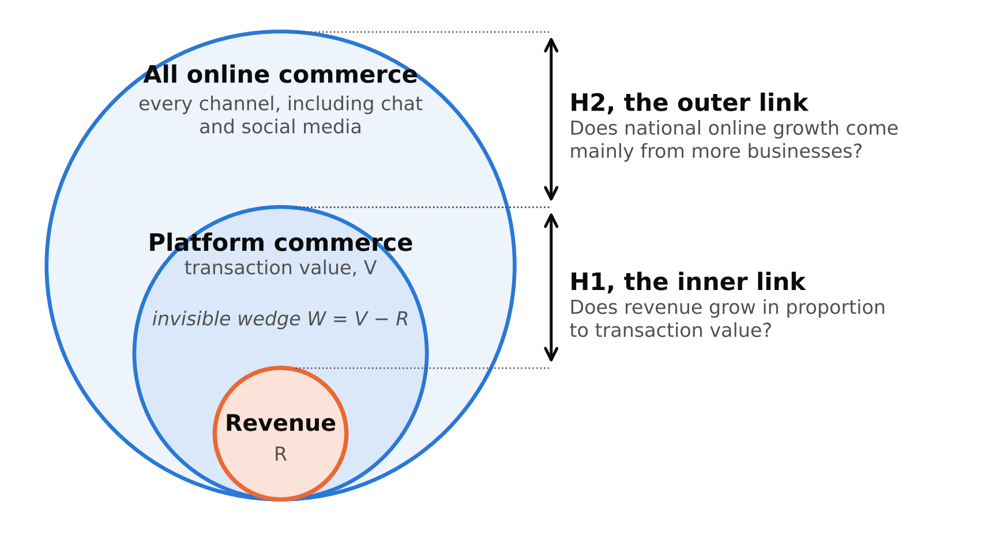

# Chapter 3. Framework and Hypotheses

Platform activity can be observed through several figures, and these figures do not measure the same economic object. Transaction value measures the commerce a platform carries. Revenue measures the part of that commerce the platform keeps. National statistics measure online sales across all sellers, whether or not they use a platform.

The framework tests each figure against the activity it is used to represent, as studies of night-time lights do for national income (Henderson, Storeygard and Weil 2012). It starts from the difference between the value a platform processes and the revenue it recognizes. It then asks whether that relationship stays stable over time, and whether figures from other sources give the same account of online activity. Figure 3.1 shows the structure.

Figure 3.1 places the three quantities inside one another. Revenue sits inside platform commerce, because a platform keeps only part of each sale. Platform commerce sits inside all online commerce, because many sellers trade outside platforms. The first hypothesis, H1, tests the inner link between revenue and platform commerce. The second, H2, tests the outer link between platform commerce and national online commerce.



**Figure 3.1. Three nested quantities and the two links.** Revenue sits inside platform commerce, which sits inside all online commerce. H1 tests the inner link and H2 the outer link.

*Note:* The figure is illustrative, and the sizes are not to scale. The platform circle differs from the marketplace channel in BPS's survey of online sellers.

The research question asks how much activity remains invisible when platforms are measured through revenue, and when that choice changes the conclusion about growth. The literature leaves three parts of it open (Section 2.4). The framework answers each with its own tools:

1. **How large the difference between transaction value and revenue is, and whether it lasts:** three measures, a split of revenue growth, and H1 (Sections 3.2 to 3.4).
2. **Whether the choice of figure changes the conclusion about growth:** H2, the entry test and a comparison of national figures (Sections 3.4 to 3.6).
3. **How far rules built on platform records reach:** how online selling divides between marketplaces and other channels (Section 3.6).

The three objectives set in Chapter 1 sit inside this map. Measuring the wedge and tracing its large moves serve the first question, and comparing platform figures with national and payment figures serves the second. The third question is answered by a further analysis.

## 3.1 Terms and rules for comparison

Table 3.1 defines the terms used throughout the thesis, each once, with the symbol used in the formulas.

**Table 3.1. Terms and symbols**

| Term | Symbol | Meaning |
|---|---|---|
| Transaction value | V | Everything bought through a platform in a period, also called the commerce the platform carries. Companies call it gross merchandise value (GMV), gross transaction value (GTV) or total payment volume (TPV); the thesis treats these as one measure and notes where a company's scope differs. |
| Revenue | R | What the platform recognizes as its own income in its accounts. |
| Take rate | m | Revenue divided by transaction value: the share of each sale that the platform keeps. |
| Customer incentives | | Discounts, vouchers and other promotions that a platform pays for. Accounting rules normally deduct them from revenue, and Tokopedia reports the deduction as a separate line. |
| Fee rate | f | The platform's revenue before customer incentives, divided by transaction value. |
| Incentive rate | s | Customer incentives divided by transaction value. |
| Invisible wedge | W | Transaction value minus revenue: what a revenue figure leaves out. It is defined for one platform. The thesis sums it over three platforms in Indonesia for 2023 and computes no national total. |
| Ecosystem ratio | E | The wedge divided by revenue. It equals one divided by the take rate, minus one. This is the author's own measure, built for this thesis. |
| Growth | g | The change from one year to the next as a share of the first year: 0.09 means 9 percent. |
| Growth divergence | D | Growth of revenue minus growth of transaction value in the same year: 0.62 means 62 percentage points. |
| Online seller | | A business that the national statistics office, BPS, counts as selling online; the text also calls it a seller or a business. The count of online sellers is BPS's estimate of how many there are in a year. |
| First-time entry | | A seller that began selling online in the year being measured. |

Three rules decide which figures can be set against each other. First, transaction value and revenue are paired only when they refer to the same period and the same business. A take rate built from figures of different scope would measure the mismatch, not the platform.

Second, each platform is compared only with itself from one year to the next. Companies define transaction value in their own ways, and a disclosed measure tells less when the way it is computed changes (Givoly, Li, Lourie and Nekrasov 2019). Within one company the definition cancels out of the yearly change, as long as the company keeps it.

Third, companies that mainly sell goods themselves are kept out. Such a company reports the whole sale as revenue, while a platform that only arranges the sale reports its fee (International Accounting Standards Board 2014). The two business models differ in kind (Hagiu and Wright 2015), and their take rates cannot be compared.

Every figure also keeps a label for where it comes from. Figures that companies report are kept apart from figures that the thesis constructs, and both are kept apart from national statistics and payment figures. Chapter 4 applies these rules platform by platform.

## 3.2 Three measures

The invisible wedge measures, in currency, the part of transaction value that lies outside a platform's revenue:

```
W_it = V_it − R_it                                   (1)
```

where V_it is the transaction value of platform i in year t and R_it is the revenue it recognizes for the same year and business. The wedge is not an accounting error, because both amounts may appear in the same company report. It is a measure of transaction value, not of income or value added, so it does not measure missing output.

To compare platforms of different size, the thesis also expresses the wedge relative to revenue, as the ecosystem ratio:

```
E_it = W_it / R_it = 1 / m_it − 1                     (2)
```

where m_it = R_it / V_it is the take rate, the share of each sale that the platform keeps. The ecosystem ratio is the author's own measure, and it restates the take rate. An ecosystem ratio of 9 means that 9 units of transaction value lie outside revenue for every unit recorded as revenue. Equivalently, the platform keeps 10 percent of each sale.

A single ratio does not show whether the relationship holds over time, so the thesis defines growth divergence:

```
D_it = g(R_it) − g(V_it)                              (3)
```

where g(X) is the growth of X from one year to the next, as a share of the first year. A positive D means that revenue grew faster than transaction value, so the take rate rose. A negative D means the reverse. If revenue were a stable proxy for transaction value, D would stay close to zero. Revenue equals the take rate times transaction value, so D can also be written with the take rate alone:

```
D_it = (1 + g(V_it)) × (m_it − m_i,t−1) / m_i,t−1      (4)
```

where m_i,t−1 is the take rate in the earlier year and m_it the take rate in the later year. If the take rate is steady, D is zero and revenue grows exactly as fast as transaction value.

Tokopedia between 2022 and 2023 illustrates the three measures. Its take rate rose from about 1.5 to about 2.5 percent, so it kept about two thirds more of each sale. Its transaction value fell by about 9 percent and its revenue rose by about 53 percent, so D was 0.91 × 0.68 = 0.62, or 62 percentage points. Its wedge stayed at about 98 percent of transaction value and fell with it, by about 10 percent.

The three measures do different jobs. The wedge gives the size of what revenue leaves out, and at a marketplace that keeps a few percent of each sale it is almost all of transaction value. The ecosystem ratio expresses that size relative to revenue. Growth divergence carries the central test: whether revenue and transaction value keep the same relationship from year to year.

The ecosystem ratio also governs how far a change in the take rate moves revenue growth. Equation (4) shows that D is the change in the take rate divided by its starting level.

A platform that keeps 2 percent of each sale has an ecosystem ratio of 49. If its transaction value is flat, a rise in its take rate to 3 percent raises its revenue by 50 percent. A platform that keeps 17 percent has an ecosystem ratio near 5, and a rise to 18 percent raises its revenue by about 6 percent. So a large ecosystem ratio means that ordinary changes in fees or discounts can produce large swings in reported revenue growth.

## 3.3 Tracing a movement

A large divergence calls for an explanation, and the same definitions supply it. Measured in logarithms, the growth of revenue splits exactly into the growth of transaction value and the change in the take rate:

```
Δln R_it = Δln V_it + Δln m_it                        (5)
```

where Δln X is the change in the natural logarithm of X from one year to the next. The first term is the volume effect, more or less commerce. The second is the take-rate effect, a larger or smaller share of each sale. A log change treats a rise and a fall by the same factor as equal in size, so the two effects can be compared directly. The take rate itself has two parts:

```
m_it = f_it − s_it                                    (6)
```

where f_it is the fee rate and s_it the incentive rate, both measured against transaction value. A take rate can rise because a platform charges more or because it spends less on discounts and vouchers. Accounting rules normally deduct such incentives from revenue (International Accounting Standards Board 2014). So a cut in incentives raises revenue even when no fee changes.

Equations (5) and (6) together divide a movement in revenue into more commerce, higher fees and lower incentives. A change in the mix of a company's businesses is a further source, read from its reports where they describe one. The split shows how a movement happened. It does not show why the company chose it, and company explanations are read as reports.

Equation (6) also shows where a rule acts. A cap on commissions acts on the fee rate, and a limit on discounts acts on the incentive rate. Chapter 6 sets Indonesia's recent rules against these parts of the take rate.

## 3.4 Hypotheses

Two hypotheses follow from the research question. H1 asks whether revenue follows the commerce carried within a platform. H2 asks where national online growth comes from, which decides whether the commerce on platforms can stand for national online commerce. Together they test the two links in Figure 3.1. Table 3.2 pairs each hypothesis, and the entry test of Section 3.5, with its main test and with the result that would count against it.

**Table 3.2. Hypotheses, tests and what would count against them**

| Test | What it asks | Main test | What would count against it |
|---|---|---|---|
| H1 | Do revenue and transaction value grow together within a platform? | Size of yearly changes in the take rate, Indonesian and regional platforms against listed platforms abroad | Changes in Indonesia far larger than abroad |
| H2 | Does national e-commerce value grow because of more businesses or because of higher sales per business? | BPS's national e-commerce value split into the number of businesses and sales per business | Higher sales per business accounting for most of the growth |
| Entry test | Does a rise in the count of online sellers come from first-time entry? | Share of 2023 sellers in BPS's survey files who began selling online in 2023 | Fewer new sellers than the rise requires |

The share of transaction value that a platform keeps is not fixed. A platform sets its charges on both sides of the market together, and both the level and the split are choices (Rochet and Tirole 2003). Platforms often hold down the price to one side to draw it in. They can raise that price once both sides have joined (Evans and Schmalensee 2016).

Accounting rules move the share in two ways. The discounts a platform pays for come out of its revenue. A platform that sells goods itself, a different business model (Hagiu and Wright 2015), records more of each sale than one that only arranges it (International Accounting Standards Board 2014). Both can change as a platform changes its business model or scope.

Revenue follows transaction value only while the take rate holds steady, that is, while D stays near zero. In that case revenue would be a workable proxy for the commerce a platform carries, and the ecosystem ratio would not change. The first hypothesis states this case.

> **H1.** Transaction value and revenue recognized by the same platform grow in proportion over time.

Growth rates never match exactly, so H1 is tested by comparison. The test compares the size of yearly changes in the take rate, measured in logs as in equation (5), between two groups. One group is the Indonesian and regional platforms. The other is listed platforms abroad, where revenue and transaction value broadly move together. Changes far larger in Indonesia would count against H1. Chapter 4 describes the two groups and the test.

National e-commerce value can grow in two ways. Existing businesses can sell more, which is the intensive margin. More businesses can sell online, which is the extensive margin. Trade economists split a country's exports in the same way, into more of each good and more kinds of goods (Hummels and Klenow 2005).

The distinction matters for measurement. Growth driven by new sellers can take place in channels that platform accounts do not cover, such as social media and instant messaging, which BPS reports are widely used (BPS 2025a). Platform figures can then miss that growth even when every platform reports accurately.

BPS publishes both the number of businesses selling online, N, and their total online sales value, Y. Since Y equals N times the sales per business, its growth in logarithms splits exactly in two:

```
Δln Y_t = Δln N_t + Δln (Y_t / N_t)                   (7)
```

where the first term is the extensive margin and the second the intensive margin. H2 holds if the first term is more than half of the total. The second hypothesis states the case in which more businesses drive growth.

> **H2.** The growth of national e-commerce value comes mainly from more businesses selling online, and less from higher sales per business.

The H2 split is arithmetic. It does not assign new businesses to channels, and it does not show whether the businesses in the count are new.

## 3.5 The entry test

H2 rests on BPS's count of businesses selling online, and a rise in that count can mean two different things. Either more businesses started selling, or the survey reached businesses that were already selling. A change in how a survey finds its respondents can create a break in a series that looks like real change (van den Brakel, Smith and Compton 2008).

The published figures cannot tell the two apart. The survey can, because it asks every seller in which year it began selling online. The thesis checks what the count contains with a test written down before the survey files were opened.

> **Entry test.** In BPS's survey of online sellers for 2023, at least 21.5 percent of online sellers must report that they began selling online in 2023.

The 21.5 percent threshold comes from arithmetic. The published count of online sellers rose by 27.4 percent in 2023. Suppose every extra seller was new and no seller stopped. Then for every 100 sellers a year earlier there were 127.4, and 27.4 of those were new. New sellers would make up 21.5 percent of all sellers, which is 27.4 divided by 127.4.

Sellers who stopped would have to be replaced as well, which only raises the share needed. The threshold is the smallest share of new sellers that can produce the rise. The test does not test H2 itself. It tests what "more businesses" means.

Sellers' memory works in favour of passing the test. People tend to report past events as more recent than they were (Neter and Waksberg 1964). A seller who began in 2022 but reports 2023 raises the share of new sellers. Recall error of this kind makes the threshold easier to reach, so a share below it is a cautious finding.

If the share of new sellers falls short, part of the rise is something other than first-time entry. Two readings are open. The survey may have reached more of the sellers who were already there. Or sellers may have come back after a pause, since a returning seller keeps an old start year. Small firms that stop are more often young firms with young owners (McKenzie and Paffhausen 2019). So the age of the sellers behind the rise bears on the second reading. Chapter 5 weighs the two readings with that evidence.

## 3.6 Further analyses

Four further analyses complete the framework without forming hypotheses of their own. Each answers a part of the research question that H1, H2 and the entry test leave open. Table 3.3 lists them.

**Table 3.3. Further analyses**

| Analysis | What it asks | Main evidence |
|---|---|---|
| Tracing large movements | What moved revenue when it parted from transaction value? | Equations (5) and (6), applied to company reports |
| Market values | Do markets value growth from more commerce differently from growth in the take rate? | Year-end market values of listed platforms |
| Channels and reach | How much online selling passes through marketplaces, and how far can rules built on platform records reach? | BPS's channel shares and survey files |
| Comparing national figures | Do national figures tell the same story of growth? | BPS, Bank Indonesia, industry estimates and household spending |

Tracing large movements applies the split of Section 3.3. Wherever H1 finds a large change in the take rate, the thesis divides the change in revenue into its parts. It also reads the company's reports for changes in the mix of businesses and in reporting scope.

The market-value analysis asks whether investors, who price revenue (Section 2.1), treat its two sources alike. Equation (5) shows that revenue can grow in two ways, through more commerce or through a larger take rate. Early studies of internet companies found that markets priced measures of web activity beyond reported earnings (Trueman, Wong and Zhang 2000; Rajgopal, Venkatachalam and Kotha 2003).

The two sources of growth need not be worth the same. Growth from the take rate has a limit, because a platform cannot raise its share of each sale without end. A higher price to one side of a platform can also reduce how much that side uses it (Rochet and Tirole 2003).

The thesis relates the yearly change in a platform's market value, MV, to the two sources of revenue growth:

```
Δln MV_it = β_V Δln V_it + β_m Δln m_it + year effect + error      (8)
```

where β_V shows how market value moves with transaction value, and β_m how it moves with the take rate. Two predictions were written down before the market values were collected. The first is that market value moves with transaction value, so β_V is positive. The second is that markets value growth from more commerce more than growth from a higher take rate, so β_V is larger than β_m.

The channel analysis answers the third question of Section 2.4. A rule built on platform records reaches only the sellers whose sales pass through a platform. Research on tax shows that reports from a third party improve compliance where they exist (Kleven et al. 2011).

The reach of a rule built on platform records depends on how online selling divides between marketplaces and channels that no marketplace records, such as messaging apps and social media. The thesis measures that division by sellers and by sales value. It also counts the marketplace sellers who may be large enough to fall under the marketplace tax.

Record keeping is the second part of this analysis. The thesis compares how often marketplace sellers and other sellers keep financial statements. The comparison bears on the information that platform records can add.

The comparison of national figures extends the outer link in Figure 3.1. Platform reports, BPS's survey, Bank Indonesia's statistics and industry estimates count different things. Their values change with the definition used (UNCTAD 2024).

If two national figures move in opposite directions in one year, the conclusion about growth depends on the figure chosen. The thesis compares growth rates, each in its own unit, and levels only after reconciling what each source covers. Household spending is a further point of comparison.
