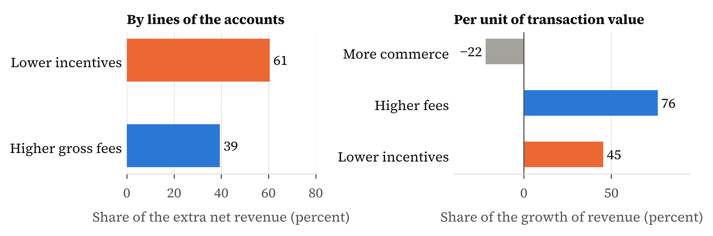
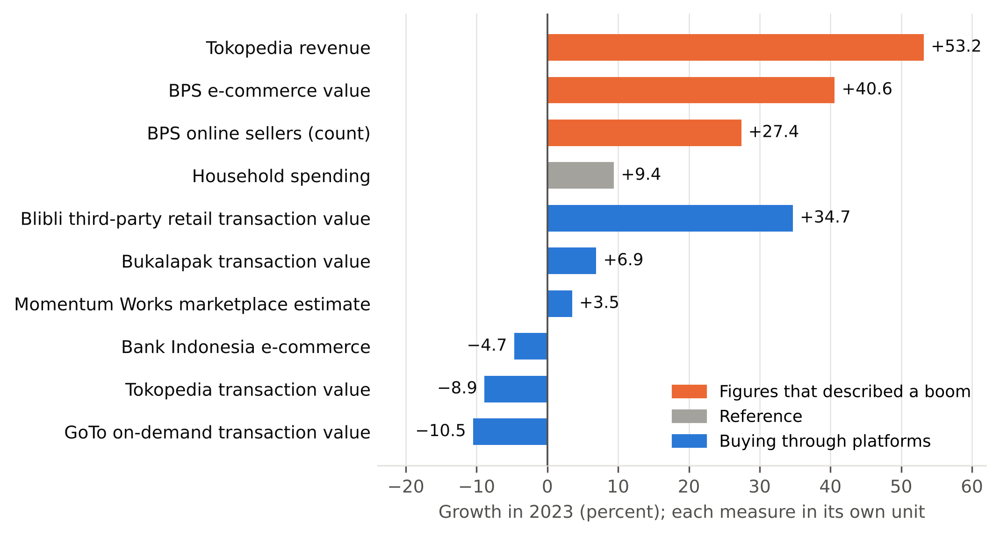
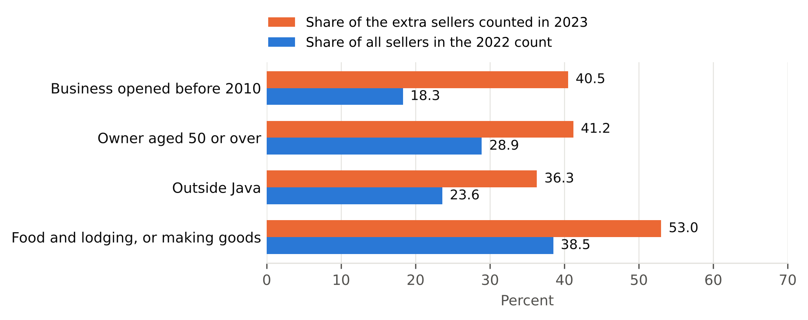
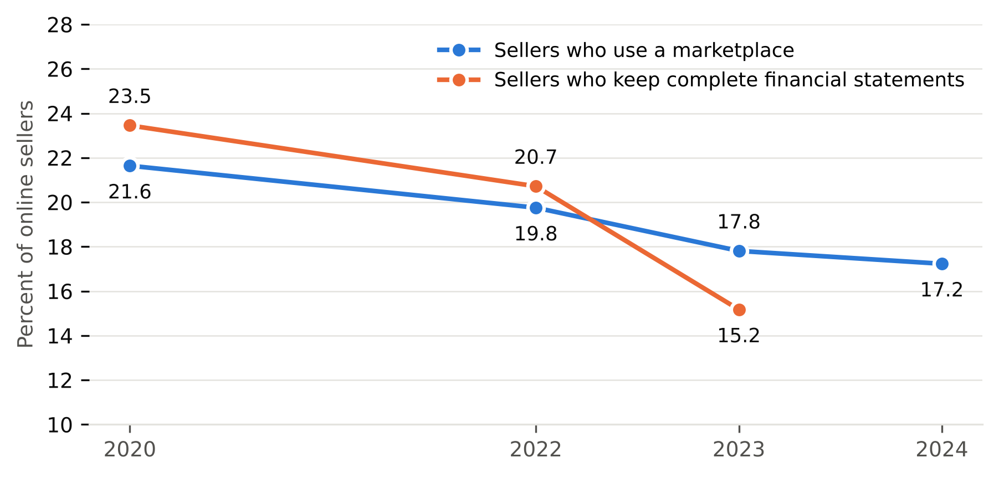

# Chapter 5. Results

The results follow the two links of Figure 3.1. On the inner link, revenue showed a small and unsteady part of the commerce that platforms carried. Platforms changed how much of each sale they kept, and revenue moved with those choices (Sections 5.1 to 5.4). On the outer link, the national count of online sellers rose by 27 percent in 2023. About half of that rise is not explained by sellers entering for the first time. Whether H2 holds depends on how that half is read (Sections 5.5 to 5.10).

Every result in this chapter carries one of the three labels of Section 4.10: registered, exploratory or descriptive. A result given without a label is descriptive. Each section states the label next to the result it reports.

## 5.1 How much revenue leaves out

Revenue showed only a small part of what Indonesia's major platforms carried. In 2023, Tokopedia, Shopee and Grab together carried about US$43 billion of transaction value and kept about US$3 billion as revenue. Revenue was about 7 percent of that commerce, and the invisible wedge was about US$40 billion. The ecosystem ratio was about 13, so almost 13 dollars of commerce passed outside revenue for every dollar the platforms kept. Table 5.1 shows each platform.

**Table 5.1. The invisible wedge of three platforms, 2023 (US$ billion)**

| Platform | Transaction value | Revenue | Wedge | Ecosystem ratio | How it is labelled |
|---|---|---|---|---|---|
| Tokopedia | 16.33 | 0.41 | 15.93 | 39.3 | Both direct segment disclosure |
| Shopee, Indonesia | 21.52 | 2.15 | 19.37 | 9.0 | Transaction value is an outside estimate (Momentum Works); revenue is derived at an assumed take rate of 10 percent |
| Grab, Indonesia | 5.38 | 0.60 | 4.78 | 7.9 | Revenue is a direct country disclosure; transaction value is derived from Grab's company-wide ratio |
| Total | 43.23 | 3.16 | 40.07 | 12.7 | Sum of three platforms, not a national total |

*Note:* Rounded amounts may not add. With Shopee's take rate at 9 or 11 percent, the total wedge is US$40.3 or US$39.9 billion; at Sea's company-wide rate of 11.5 percent, it is US$39.8 billion. Source: company filings; Momentum Works (2024), as quoted by Setyowati (2024); author's calculations.

The three ratios differ because the amounts come from different sources. Tokopedia reports both amounts. Shopee's ratio follows from the assumed take rate, and Grab's is its company-wide ratio, so neither is separate evidence for Indonesia. Blibli and Bukalapak also report both amounts, with ratios of about 43 and 36, close to Tokopedia's. They stay out of the sum because Blibli's figure includes online travel and Bukalapak reports for its whole group.

The size of the wedge does not depend on the assumed rates. A take rate for Shopee between 9 and 11 percent keeps the total near US$40 billion, and dropping any one platform still leaves more than US$20 billion. For platforms that report both amounts, the wedge was 97 to 99 percent of transaction value in every year. It moved almost one for one with the commerce, and Appendix B gives the wedge by platform and year.

Platform commerce is itself only part of online commerce. In BPS's survey, marketplaces carry about a fifth of online sales value (Section 5.9), so platform revenue shows a smaller part still. A small share can still be a fair guide to the commerce, as long as it keeps its size from year to year.

## 5.2 Testing H1

Revenue followed transaction value abroad and did not in Indonesia and the region, so the thesis rejects H1 for the Indonesian and regional platforms. Table 5.2 describes the panel behind the test. The typical Indonesian and regional platform-year has an ecosystem ratio of about 35, against about 5.5 abroad. Transaction value grew by a median of 16 percent a year in both groups, and revenue by 38 percent in Indonesia and the region against 21 percent abroad. The Indonesian and regional platforms are also younger, a median of one year since listing against four.

**Table 5.2. Summary statistics and correlations**

This table reports summary statistics and pairwise correlations for the panel of 213 platform-years used in Sections 5.2 and 5.3, which covers 32 platforms. Panel A gives the number of observations (N), the mean, the median (P50) and the standard deviation (SD) of each variable for the Indonesian and regional platforms and for the foreign platforms. Panel B gives pairwise Pearson correlations for all platforms. Growth rates and the ecosystem ratio are capped at their 5th and 95th percentiles; the wedge and total assets are in US$ million. Appendix A defines the variables. ∗∗∗, ∗∗ and ∗ correspond to statistical significance at the 1%, 5% and 10% levels.

*Panel A. Summary statistics*

| Variable | Indonesian and regional | | | | Foreign | | | |
|---|---:|---:|---:|---:|---:|---:|---:|---:|
| | **N** | **Mean** | **P50** | **SD** | **N** | **Mean** | **P50** | **SD** |
| Wedge, US$ million | 20 | 7,834 | 6,999 | 5,311 | 193 | 50,439 | 3,732 | 142,180 |
| Ecosystem ratio | 20 | 25.08 | 34.66 | 14.95 | 193 | 8.84 | 5.50 | 9.56 |
| Revenue growth, g(R) | 15 | 0.53 | 0.38 | 0.44 | 166 | 0.32 | 0.21 | 0.44 |
| Transaction value growth, g(V) | 15 | 0.22 | 0.16 | 0.34 | 166 | 0.26 | 0.16 | 0.40 |
| Total assets, US$ million | 20 | 4,300 | 2,751 | 3,727 | 182 | 13,252 | 1,461 | 35,325 |
| Years since listing | 20 | 1.10 | 1.00 | 1.12 | 193 | 6.38 | 4.00 | 7.21 |
| GDP growth, percent | 20 | 4.20 | 5.05 | 2.21 | 193 | 3.06 | 2.79 | 3.00 |
| Inflation, percent | 20 | 2.91 | 2.93 | 1.08 | 179 | 8.55 | 2.95 | 21.84 |
| Household spending growth, percent | 20 | 3.77 | 4.95 | 2.45 | 174 | 3.55 | 2.95 | 4.21 |
| Policy rate, percent | 20 | 4.85 | 4.76 | 1.01 | 183 | 6.24 | 3.91 | 12.34 |

*Panel B. Pairwise correlations*

| Variables | (1) | (2) | (3) | (4) | (5) | (6) | (7) | (8) | (9) |
|---|---:|---:|---:|---:|---:|---:|---:|---:|---:|
| (1) ln(Wedge) | 1 |  |  |  |  |  |  |  |  |
| (2) Ecosystem ratio | 0.37∗∗∗ | 1 |  |  |  |  |  |  |  |
| (3) g(R) | 0.13∗ | 0.18∗∗ | 1 |  |  |  |  |  |  |
| (4) g(V) | 0.05 | 0.15∗ | 0.84∗∗∗ | 1 |  |  |  |  |  |
| (5) ln(Assets) | 0.88∗∗∗ | 0.10 | 0.10 | 0.01 | 1 |  |  |  |  |
| (6) ln(1+YearsListed) | 0.44∗∗∗ | -0.20∗∗∗ | -0.30∗∗∗ | -0.35∗∗∗ | 0.46∗∗∗ | 1 |  |  |  |
| (7) IndonesiaRegion | 0.02 | 0.42∗∗∗ | 0.13∗ | -0.03 | 0.04 | -0.27∗∗∗ | 1 |  |  |
| (8) GDPGrowth | 0.10 | 0.23∗∗∗ | 0.23∗∗∗ | 0.21∗∗∗ | 0.06 | -0.11 | 0.11 | 1 |  |
| (9) PolicyRate | -0.02 | -0.06 | 0.01 | 0.02 | -0.09 | -0.04 | -0.04 | -0.14∗∗ | 1 |

*Note:* Inflation and household spending growth are left out of Panel B to fit the page; they correlate 0.80 with the policy rate and 0.92 with GDP growth. The policy rate is missing for Kazakhstan and Nigeria, and some growth and macroeconomic values are missing for the first year of a platform or for 2025. Source: company filings; World Bank; Bank for International Settlements; author's calculations. Exploratory.

Across all platforms, revenue growth and transaction value growth have a correlation of 0.84 (Panel B). The wedge and transaction value correlate at 0.9994 in levels, as they must, because the wedge is transaction value minus revenue and revenue is a small part of it. So the test of H1 uses growth rates.

Table 5.3 tests H1 in growth rates. Abroad, a rise of 1 percentage point in the growth of transaction value goes with a rise of 0.99 points in the growth of revenue (standard error 0.07), which cannot be told from the 1 that proportional growth requires (p = 0.84). The two growth rates correlate at 0.90. In Indonesia and the region the slope is 0.40 (standard error 0.16) and differs from 1 (p = 0.02). The correlation is 0.31, and the constant is 0.44: revenue grew by about 44 percent a year whatever transaction value did. In the regression on all platforms, the slope of the Indonesian and regional group is 0.59 below the foreign slope. The Indonesian and regional result rests on 15 pairs from five platforms, so its standard errors are less reliable than those abroad.

**Table 5.3. Revenue growth and transaction value growth**

This table reports OLS estimates of equation (6). The dependent variable is the growth of revenue, g(R), the simple percentage change from the previous year. Column (1) uses all platforms, with an interaction between transaction value growth and the Indonesia and region dummy, so the coefficient on g(V) in that column is the slope of the foreign platforms. Column (2) uses the 26 foreign platforms with a pair of consecutive years, and column (3) the five Indonesian and regional platforms. Growth rates are capped at their 5th and 95th percentiles. Appendix A defines the variables. Standard errors (in parentheses) are clustered at the platform level. ∗∗∗, ∗∗ and ∗ correspond to statistical significance at the 1%, 5% and 10% levels.

| *Dependent variable* | g(R) | g(R) | g(R) |
|---|---:|---:|---:|
| Sample | All platforms | Foreign | Indonesian and regional |
| | (1) | (2) | (3) |
| g(V) | 0.986∗∗∗ | 0.986∗∗∗ | 0.399∗ |
|  | (0.072) | (0.072) | (0.159) |
| IndonesiaRegion | 0.379∗∗∗ |  |  |
|  | (0.060) |  |  |
| IndonesiaRegion × g(V) | -0.587∗∗∗ |  |  |
|  | (0.158) |  |  |
| Constant | 0.059∗∗∗ | 0.059∗∗∗ | 0.439∗∗∗ |
|  | (0.019) | (0.019) | (0.065) |
| Observations | 181 | 166 | 15 |
| Platforms (clusters) | 31 | 26 | 5 |
| *R*^2^ | 0.750 | 0.802 | 0.094 |
| *p*-value, slope on g(V) equal to 1 | 0.845 | 0.845 | 0.019 |
| Pearson correlation, g(R) and g(V) | 0.843 | 0.896 | 0.307 |

*Note:* The slope on g(V) is 1 if revenue grows in proportion to transaction value. Source: company filings; author's calculations. Exploratory.

The earlier test of the size of take-rate moves points the same way. At the typical Indonesian and regional platform the take rate moved by 22 percent a year, up or down. At the typical foreign platform it moved by 6 percent, so the moves were about 3.6 times as large (Mann–Whitney p = 0.003; shuffling the group labels, p = 0.01). Measured in logs, as in an earlier version of this test, the medians are 0.20 and 0.06 (p = 0.004), and exact versions that list every possible split of the 32 platforms agree (p = 0.004 and 0.021). No single platform carries that result: dropping any one, or treating Tokopedia and GoTo as one company, keeps p at 0.016 or below. Dropping the two largest movers, Blibli and Tokopedia, weakens it to p = 0.058 (Appendix C).

The test of the size of moves was set up after a first, narrower test, so it is exploratory. The narrower test, set before the wider one, compares the three Indonesian marketplaces with the eight foreign platforms chosen first. It points the same way. With one median per platform, the Mann–Whitney test rejects equal moves (p = 0.024). A shuffle of platform labels comes close without passing (p = 0.06), since three platforms give a test little power. In that sample, revenue growth and transaction value growth had a correlation of 0.10 in Indonesia and 0.98 abroad, excluding Sea.

Both tests of the size of moves ask about their size, not their direction, and direction is less telling. Revenue grew faster than transaction value in 13 of the 15 Indonesian and regional pairs, and in two of them the two moved in opposite directions. Abroad, take rates also rose in about two thirds of pairs, but by much less. What sets the Indonesian and regional platforms apart is the size of the moves.

Quarterly pairs do not reject H1 (p = 0.19), contrary to a prediction registered before the test was run. Most of the quarterly Indonesian pairs cover 2023 to 2026, after most of the repricing, while the large moves came between 2022 and 2024. So the rejection of H1 describes that period.

Age does not explain the result. The Indonesian and regional platforms made their largest moves one or two years after listing on the stock market, but foreign platforms did not move their take rates more in their first three years after listing than later (median 0.07 against 0.08 in logs, p = 0.24, an exploratory check), and Table 5.4 shows that years since listing explains neither the wedge nor the ecosystem ratio.

The thin take rate of Indonesian and regional platforms explains much of the threefold difference, an exploratory finding. Measured in percentage points, both groups changed their take rates by about 1 point a year, and the difference between them is nowhere near large enough to count (p = 0.65). The two groups differ in the take rate they start from. The typical Indonesian and regional platform keeps about 1.6 percent of each sale, against about 17 percent abroad. The thinnest take rates belong to the three marketplaces, while Grab and GoTo keep shares closer to those abroad. As Section 3.2 showed, the same 1-point rise then has very different effects. It lifts revenue by more than half at the thinner take rate and by about 6 percent at the thicker one. Figure 5.1 shows the three measures side by side, in its Panels A, B and C. The test shows that take rates moved, but not what the platforms changed to move them.

**Figure 5.1. The thin take rate.** Each dot is one platform's median over its years. Panel A: the share of each sale that the platform keeps, on a log scale. Panel B: the yearly change in that share, in percentage points. Panel C: the same change relative to the share itself, as a simple percentage change. Black bars mark group medians. The foreign group has 26 platforms here and 27 in the main test, because one platform has no pair of usable years for the change in points. Source: company filings; author's calculations. Exploratory.

## 5.3 What explains the wedge and the ecosystem ratio

Size explains the wedge, and pricing explains the ecosystem ratio. Table 5.4 regresses each on the features of the platform and of its home market.

**Table 5.4. What explains the wedge and the ecosystem ratio**

This table reports OLS estimates of equation (7). The dependent variable is the natural logarithm of the wedge in US dollars in columns (1) to (3) and the ecosystem ratio, capped at its 5th and 95th percentiles, in columns (4) to (6). IndonesiaRegion equals one for the Indonesian and regional platforms. Size is total assets in US dollars. The base type is marketplace. Columns (2), (3), (5) and (6) add the GDP growth, inflation, household spending growth and policy rate of the platform's main market, and columns (3) and (6) add year dummies. Appendix A defines the variables. Standard errors (in parentheses) are clustered at the platform level. ∗∗∗, ∗∗ and ∗ correspond to statistical significance at the 1%, 5% and 10% levels. The last row gives the p-value of a wild cluster bootstrap with 2,999 replications for IndonesiaRegion.

| *Dependent variable* | ln(Wedge) | ln(Wedge) | ln(Wedge) | Ecosystem ratio | Ecosystem ratio | Ecosystem ratio |
|---|---:|---:|---:|---:|---:|---:|
| | (1) | (2) | (3) | (4) | (5) | (6) |
| IndonesiaRegion | -0.075 | -0.302 | 0.080 | 15.214∗∗∗ | 12.939∗∗∗ | 17.092∗∗∗ |
|  | (0.361) | (0.349) | (0.396) | (3.857) | (3.290) | (3.168) |
| ln(1+YearsListed) | -0.066 | -0.068 | 0.093 | -2.722 | -2.719∗ | -1.274 |
|  | (0.156) | (0.141) | (0.169) | (1.623) | (1.531) | (1.516) |
| ln(Assets) | 0.898∗∗∗ | 0.917∗∗∗ | 0.900∗∗∗ | 0.016 | -0.281 | -0.621 |
|  | (0.086) | (0.073) | (0.060) | (0.897) | (0.676) | (0.662) |
| OnDemand | -0.950∗∗∗ | -0.975∗∗∗ | -1.011∗∗∗ | -16.597∗∗∗ | -17.876∗∗∗ | -19.787∗∗∗ |
|  | (0.267) | (0.305) | (0.273) | (3.837) | (3.640) | (3.251) |
| Travel | -0.053 | -0.261 | -0.266 | -7.313∗ | -8.346∗∗ | -9.250∗∗ |
|  | (0.346) | (0.397) | (0.317) | (3.795) | (3.937) | (3.429) |
| Freelance | -0.822 | -0.878 | -0.741 | -11.946∗∗∗ | -14.088∗∗∗ | -13.658∗∗∗ |
|  | (0.540) | (0.576) | (0.580) | (3.706) | (3.599) | (3.581) |
| Resale | -0.444 | -0.527 | -0.477 | -8.393∗ | -10.223∗∗ | -10.912∗∗ |
|  | (0.367) | (0.402) | (0.484) | (4.385) | (4.491) | (4.700) |
| GDPGrowth |  | 0.106∗ | 0.148∗∗ |  | 1.301∗∗ | 1.479∗∗ |
|  |  | (0.057) | (0.067) |  | (0.573) | (0.552) |
| Inflation |  | -0.001 | 0.001 |  | -0.018 | -0.006 |
|  |  | (0.003) | (0.003) |  | (0.024) | (0.027) |
| HouseholdGrowth |  | -0.053∗∗ | -0.014 |  | -0.785∗ | -0.687 |
|  |  | (0.025) | (0.031) |  | (0.452) | (0.490) |
| PolicyRate |  | 0.008 | 0.011 |  | -0.033 | -0.005 |
|  |  | (0.007) | (0.007) |  | (0.082) | (0.075) |
| Constant | 2.148∗∗∗ | 1.962∗∗∗ | 2.108∗∗∗ | 18.840∗∗ | 21.744∗∗∗ | 27.343∗∗∗ |
|  | (0.490) | (0.572) | (0.575) | (7.237) | (6.165) | (7.166) |
| Observations | 202 | 178 | 178 | 202 | 178 | 178 |
| Platforms (clusters) | 32 | 30 | 30 | 32 | 30 | 30 |
| *R*^2^ | 0.808 | 0.842 | 0.867 | 0.438 | 0.515 | 0.571 |
| Year dummies | No | No | Yes | No | No | Yes |
| Wild-bootstrap *p*, IndonesiaRegion | 0.848 | 0.475 | 0.866 | 0.031 | 0.039 | 0.005 |

*Note:* The take rate and its parts are not regressors, because the ecosystem ratio is one divided by the take rate, minus one. Source: company filings; SEC filings; World Bank; Bank for International Settlements; author's calculations. Exploratory.

The wedge scales with the size of the platform. A 1 percent rise in total assets goes with a rise of about 0.9 percent in the wedge, and the regressors of column (1) explain 81 percent of its variation. Once size is held fixed, Indonesian and regional platforms do not carry a different wedge. The coefficient on IndonesiaRegion is −0.07 in column (1) and stays between −0.30 and 0.08 in the others, never close to significance. On-demand platforms carry about 60 percent less wedge for their assets than marketplaces do.

The ecosystem ratio is different. The Indonesian and regional platforms have a ratio 13 to 17 points above foreign platforms of the same type, size and age, in markets with the same growth, inflation and interest rates (columns 4 to 6). The foreign mean is about 9. The wild-bootstrap p-values, which allow for the small number of clusters, are between 0.005 and 0.04. Size and age explain little of the ratio. Type explains a good deal: on-demand platforms have ratios 17 to 20 points below marketplaces, which means that they keep a much larger share of each sale, and travel, freelance and resale platforms are 7 to 14 points below. A home market that grows faster has a higher ratio, by about 1.3 to 1.5 points for each point of GDP growth, an exploratory pattern that the thesis does not read as causal.

The result for the Indonesian and regional platforms survives the checks of Appendix C. The coefficient stays between 15 and 18 when each of the five platforms is dropped in turn, and it is 21 without Alibaba, Pinduoduo, Rakuten and Shopify. It is 28.5 when the ratio is not capped (p = 0.008), 17 when a dummy for emerging home markets is added, whose own coefficient is close to zero (0.4, p = 0.94), and 17 without the six platforms whose main market is ambiguous. So the thin take rates of Indonesian and regional platforms are not a general emerging-market pattern. Total assets are those of the whole company, which is larger than the platform business at GoTo, Rakuten and Sea, so size is measured with error, and the result rests on five platforms.

The regression does not say how a platform moved its take rate. Company reports do, for the seven windows traced in Appendix B, where the growth of revenue is split into more commerce, higher fees and lower incentives. Higher fees and lower incentives together outweighed more commerce in every window. Lower incentives were the larger of the two in four windows and higher fees in two. In the seventh, Grab from 2021 to 2024, the two were nearly equal. The windows of one platform overlap, so they are not seven independent cases. Blibli does not report incentives, so its split rests on a proxy, and part of its 2022–23 rise comes from travel and digital products. Bukalapak's reports do not allow the parts to be separated.

Tokopedia can be read in two ways, and both point to pricing. Its incentives fell by about a third in 2023. Counted line by line in its accounts, lower incentives gave about 60 percent of the extra revenue and higher gross fees about 40 percent. That count does not adjust for the fall in transaction value, which lowered both lines. Measured per unit of transaction value, higher fees account for more of the rise in the take rate. The two views differ only on which lever led (Figure 5.2).

**Figure 5.2. Tokopedia, 2022 to 2023: two ways to split the rise in revenue.** Left: the change in net revenue split by the lines of the accounts. Right: the growth of revenue split per unit of transaction value, where a negative share pulled revenue down. Source: GoTo annual report 2023, segment note; author's calculations.

Tokopedia is not the only case of revenue rising while the commerce shrank. From 2024 to 2025, Blibli's transaction value fell by about 2 percent while its revenue rose by about 12 percent. In the windows traced here, revenue growth was not a fair guide to the commerce the platforms carried. Whether markets treated it as one is a separate question.

The ecosystem ratio matters for three groups. For investors, a high ratio means that small changes in fees or discounts produce large swings in revenue growth. At the typical Indonesian and regional ratio of 35, the platform keeps about 2.8 percent of each sale, and a rise of 1 point in the take rate lifts revenue by about 36 percent at constant volume. At the typical foreign ratio of 5.5, the same rise lifts it by 6.5 percent. So a revenue multiple means something different in the two groups, because each unit of revenue stands for 36 units of transaction value in one and 6.5 in the other. Growth that comes from the take rate cannot go on without end, and Section 5.4 shows that markets priced transaction value.

For sellers and drivers, a high ratio means that most of each sale goes to them and not to the platform. A rising take rate means that the platform keeps more of each sale. The take rate rose in 87 percent of the Indonesian and regional pairs, against 65 percent abroad, and at Tokopedia part of the rise came from smaller discounts, which are paid to buyers. Whether that shows market power is a question the thesis cannot answer, because it holds no data on what sellers and drivers paid or could have chosen instead. The pattern is also consistent with platforms that listed in 2021 and 2022 moving from growth to earnings, since their largest moves came one or two years after listing.

For policy, the wedge is the base that revenue-based rules do not reach. A rule that acts on platform revenue acts on about 3 percent of the commerce at a typical Indonesian or regional platform. A cap on commissions acts on the fee rate, and a limit on discounts acts on the incentive rate, the two parts of the take rate in equation (5). Chapter 6 sets each rule against the part it reaches.

## 5.4 What markets valued

Across 28 listed platforms and 138 platform-years, market value moved with transaction value, a registered result. A 1 percent rise in transaction value goes with a rise of about 0.6 percent in market value (β_V in equation (9), p = 0.002). Section 4.5 describes this sample, which differs from the 27 foreign platforms of H1.

The second registered prediction does not hold in the main sample. It expected markets to value growth from a higher take rate less than growth from more commerce. A 1 percent rise in the take rate goes with a rise of about 0.3 percent (β_m), which is too uncertain to tell from zero. The gap between the two estimates is not large enough to count (p = 0.20, or 0.16 with extreme values capped). The test could reliably flag only a gap above about 0.8, so a failed prediction here means the data cannot tell, not that markets value the two sources alike.

A second run adds five segment series, including Grab, GoTo and Sea, and Mercado Libre. There the gap counts (p = 0.004), with about 0.6 for transaction value against about 0.1 for the take rate. But that run sets segment figures against whole-company market values, as the registration warned, so the thesis does not rely on it. The answer depends on which platforms are in the sample.

Market value follows the commerce a platform carries. Early studies found a similar link, with markets pricing measures of web activity beyond earnings (Trueman, Wong and Zhang 2000; Rajgopal, Venkatachalam and Kotha 2003). Here the measure of activity is transaction value, which the platforms report themselves.

How a firm records revenue matters too. After the 2000 crash, revenue explained less of the prices of internet firms that booked the full sale amount as revenue (Davis 2002). The data do not show that markets valued growth from pricing any less. The national figures give a separate view of the same commerce.

## 5.5 The platforms and the sellers in 2023

Buying through platforms did not boom in 2023. Household spending rose by about 9 percent in current prices that year. Of six measures of buying through platforms, five grew more slowly, and three fell. Blibli is the one exception. Figure 5.3 sets the measures side by side, each in its own unit.

The figures that described a boom were of other kinds. Tokopedia's revenue rose by 53 percent and BPS's online sales value by 41 percent, while the buying that platforms carried grew slowly or fell. Figure 5.3 shows the two kinds in different colours.

Sellers' own accounts of their sales show no boom either, a registered result. BPS asks each business how its online sales changed. For businesses already selling, the registered prediction set an upper limit on the median change. The limit was about 10 percent, the published growth in sales per business. The median change was zero.

**Figure 5.3. Growth in 2023 (percent).** Blue bars show measures of buying; orange bars show the figures that described a boom. Each measure is in its own unit. Sources: company reports, Bank Indonesia, Momentum Works and BPS; household spending from national accounts. GoTo's change rests on an estimated 2022 value, and Momentum Works' 3.5 is the author's calculation from its published levels (its 2024 release states 3.7). Appendix E gives the values.

Fewer sellers reported a rise than a year earlier. About a quarter reported a rise and about a third a fall. A year before, more than a third had reported a rise and a quarter a fall. The mean change was about −4 percent. Lack of demand became the main obstacle, named by 41 percent of sellers against 35 percent in 2022.

The published count of online sellers nonetheless rose by 27 percent in 2023. A rise of that size, in a year without a boom in sales, needs explaining.

## 5.6 H2 and the entry test

H2 holds on BPS's published figures, but the registered entry test shows that first-time entry cannot explain the whole rise in the count. From 2022 to 2023, online sales value grew by 41 percent. The number of businesses grew by 27 percent and sales per business by 10 percent, so more businesses account for most of the growth.

H2 holds again from 2023 to 2024. Value grew by 17 percent, the number of businesses by 15 percent and sales per business by 1.5 percent, or by 12 and 4.7 percent on BPS's other count for 2023. The split of equation (8) is arithmetic, and it cannot tell a new seller from one counted for the first time.

The registered entry test separates new sellers from sellers counted for the first time, and it fails. In the survey for 2023 (the 2024 file), about 13 percent of sellers began selling online that year. The test required 21.5 percent. Even with no sellers stopping, that many new sellers would raise the count by at most about 16 percent, against a published rise of 27 percent.

Recall error does not explain the shortfall. As Section 3.5 noted, sellers who report a start date later than the true one make new sellers look more numerous. Such errors push the share toward passing, so the shortfall is, if anything, understated. Part of the 2023 rise in the count is something other than first-time entry, and its size is the next result.

## 5.7 What the rise in the count contains

About half of the 2023 rise in the count is not explained by first-time entry, an exploratory result. Table 5.5 sets out the accounting. In the survey for 2023, sellers who began before 2023 outnumber the whole count for 2022 by about 306 thousand. They make up 37 percent of the rise if no seller stopped, and 56 percent if sellers stopped at about 5 percent a year.

**Table 5.5. The 2023 rise in the count of online sellers (thousands)**

| Part of the rise | If no seller stopped | If sellers stopped at 5 percent a year |
|---|---|---|
| Rise between the weighted totals of the two files | 819 (100%) | 819 (100%) |
| Net entry: sellers who began in 2023, less those who stopped | 513 (63%) | 361 (44%) |
| Earlier sellers newly counted above the whole 2022 count | 306 (37%) | 458 (56%) |

*Note:* BPS's published counts give a rise of 821 thousand (BPS 2025a). Source: BPS survey files, weighted; author's calculations.

The cohort counts show the break directly. A cohort should only shrink between surveys, and the cohorts did so in every interval except 2023. Sellers who began by 2020 fell by about 10 percent between the surveys for 2020 and 2022. In the survey for 2023 they rose by 6 percent.

The count behaved normally again in BPS's published table for 2024. The cohort that began before 2020 shrank by about 10 percent. At least 754 thousand new sellers appeared, more than the rise of 584 thousand.

The break sat in chat and social selling. Among sellers who began by 2022, those using only chat or social media rose by 13 percent, and marketplace users by 0.3 percent. Across the 34 provinces, growth in the count had almost no link to the share of new sellers (a rank correlation of 0.10, on a scale from −1 to 1). It had only a weak link to growth in the sample (0.35).

Sampling noise is very unlikely to explain the break. BPS's published error rates put the usual size of the sampling noise in the national count at about 1.4 percent. The 306 thousand extra sellers are about 4.6 times that noise in the change between the two years. The calculation applies the 2024 edition's error rates to both years and treats the two surveys as independent.

Most of the 2023 rise in sales value cannot be traced to what sellers reported. BPS's figure rose by 41 percent in rupiah, from about US$53 billion to about US$72 billion at each year's exchange rate. The thesis asks how much of that rise the sellers' own answers can account for, by giving each kind of seller its typical size in the 2022 file.

New sellers, sized like those that began in 2022, account for 25 to 30 percent of the rise. The extra earlier sellers, sized like chat and social sellers, account for 15 to 17 percent. The typical seller already online reported no growth (a mean change of about −4 percent, counting each seller once). That leaves 53 to 59 percent with no source in the sellers' answers. A few large sellers growing fast could account for it, but the files cannot show whether they did.

H2 holds on the published series, but it sits right on its threshold once the extra count is read as coverage, an exploratory follow-up. H2's split treats every seller in the count as having entered. Suppose instead that the sellers not explained by entry were reached by wider coverage, and that their sales came with them. With both taken out of the 2023 figures, the number of businesses grows by 17 percent if no seller stopped, against 14 to 15 percent for sales per business, so H2 holds narrowly. If sellers stopped at 5 percent a year, the number of businesses grows by 12 percent and sales per business by about 16 to 17 percent, so H2 fails by a few points. H2 requires the first growth rate to be the larger. Taking out the sellers but keeping their sales gives 17 against 20 percent, and 12 against 25 percent, but that version treats the count and the value unevenly.

The checks point to a survey that reached more chat and social sellers in 2023, the kind of break that Section 3.5 described. The files cannot separate that reading from sellers returning after a pause. Who the extra sellers were helps decide between the two.

## 5.8 Who the extra sellers were

The extra count leaned toward long-running businesses, older owners and places outside Java, an exploratory result. A group's extra count is its 2023 count less its 2022 count grown at the group's own yearly rate from 2020 to 2022 (Section 4.7). The extra sellers total about 450 thousand, close to the 458 thousand in Table 5.5. Figure 5.4 compares each group's share of the extra count with its share of the 2022 count.

**Figure 5.4. Who the extra sellers were.** The extra sellers are the 2023 count above what each group's normal yearly change in 2020 to 2022 would give, about 450 thousand in total. Source: BPS survey files, weighted; author's calculations. Exploratory.

The extra count did not lean toward young businesses. A lean toward men in the raw counts disappears once each group's normal change is taken out. This profile helps test whether the extra sellers were returning after a pause.

Part-year selling argues against returners. A returning seller would usually sell for only part of the year, unless it restarted in January, yet part-year selling fell in 2023. Among sellers who began by 2021, those selling for part of the year fell from about 470 thousand to about 320 thousand. The same fall appears for the groups that began by 2020 and by 2022.

The age profile argues against returners as well. Small firms that stop are more often young firms with young owners (McKenzie and Paffhausen 2019). Returners would then make the extra count lean young. It leaned old.

Returning sellers still cannot be ruled out. Returners equal to 10 to 15 percent of the 2022 count would remove the unexplained part, which is a scenario and not an estimate. The files carry no linked histories, and BPS changed how it asks about months between the rounds. Exits, or a move to full-year selling, could also offset part-year returners. The next two sections turn to where online sellers sell and what records they keep.

## 5.9 Channels and records

Most online selling happens outside marketplaces, and records are thinner there. The path of marketplace use, the value held by sellers without financial statements and the World Bank results for Indonesia were registered. The comparison within the group that began before 2020 is exploratory.

Nearly all online sellers, about 96 percent, use chat or social media. Marketplace use fell every time it was measured, from about 22 percent of sellers in 2020 to about 17 percent in 2024. BPS worded the question slightly differently for 2023 and 2024.

Marketplaces carry only about a fifth of online sales value. The share was 23 to 26 percent in 2022 on the survey files. In BPS's published figures it was 18 percent in 2023 and 16 percent in 2024.

Almost all of the recent growth in value came from outside the marketplaces. From 2023 to 2024, BPS's marketplace value grew by about 1.5 percent and other channels by about 21 percent. BPS's marketplace category is itself broad: 43 percent of its sellers use only Gojek or Grab, and 47 percent use a shopping marketplace.

Records are thinner outside the marketplaces. In 2023, about 29 percent of marketplace sellers kept complete financial statements, against about 12 percent of other sellers. Figure 5.5 shows the share of all sellers who keep them falling. The fall from 2020 to 2022 came while the survey appears to have counted the same kinds of seller. The fall in 2023 may partly reflect the chat-only sellers added to the count.

**Figure 5.5. Marketplace use and financial statements, 2020 to 2024.** Marketplace use for 2020, 2022 and 2023 comes from the survey files and for 2024 from BPS's published figure. Financial statements come from the survey files. BPS worded the marketplace question slightly differently for 2023 and 2024, and the survey has no point for 2021. Source: BPS; author's calculations.

The fall reaches long-running sellers too, an exploratory finding. Among sellers who began before 2020, the share keeping complete statements fell from about 23 percent in 2022 to about 17 percent in 2023.

Sellers without statements hold far less of the value than of the count. On the bracket scenarios of Section 4.8, they held 26 to 40 percent of online value in 2022, against 79 percent of the count.

The validation rule asks the total built from the brackets to lie within half and double BPS's total. The annual reading passes, just inside the limit at about twice BPS's total, while the monthly reading gives about 23 times. The lower brackets alone exceed BPS's total, so the shares are ranges.

One registered prediction on value failed narrowly. It expected the value share of sellers without statements to fall by no more than 5 points between 2020 and 2022. The share fell by 5.8 points on the main version and by 3.3 points on a second version.

World Bank surveys of Indonesian firms show the same thin records. In six Indonesian cities, 27 percent of unregistered firms use social media with their customers. Among those, 70 percent keep no written records, and their median sales are about US$4,000 a year. A registered prediction that their mean sales would stay below about US$6,600 failed, at about US$7,300.

Among formal firms, about 40 percent in Indonesia have neither a website nor online tax filing. That is the highest share of seven countries, against about 9 percent in Malaysia and in Thailand, a descriptive comparison.

The split by channel is the starting point for the third question of Section 2.4, because a rule built on platform records reaches only the marketplace part. Chapter 6 measures that reach. The same split also shows where the national figures disagree, which is the next section.

## 5.10 Why the national figures disagree

The national figures agree that growth was small only where they cover the same sellers, and they do not agree on scale. In 2023, Bank Indonesia's e-commerce figure fell by about 5 percent while BPS's rose by about 41 percent. That is the disagreement Chapter 1 introduced, and the third objective asks what lies behind it.

Where Bank Indonesia's figure and BPS's cover the same ground, the growth is small. From 2022 to 2023, BPS's own marketplace slice grew by about 0.2 percent in the middle scenario, and by 0.2 to 13 percent across the scenarios. From 2023 to 2024 it grew by about 1.5 percent. Most of the disagreement sits outside the marketplaces, among the sellers that only BPS reaches.

A registered test on size gives a mixed answer. It predicted that the part of BPS's marketplace sales that went to final consumers in 2022 would fall below Bank Indonesia's figure. The prediction holds in the low and middle scenarios, at 0.16 and 0.68 times Bank Indonesia's figure. It fails in the high one, at 1.62 times.

In 2024 the figures divide by coverage. Those that cover mainly platforms grew by 5 to 7 percent, and BPS's grew by about 17 percent. The adjacent figures of Appendix A point the same way as BPS but do not measure Indonesian e-commerce. Parcels shipped in Southeast Asia grew by about 25 percent, and the tax on foreign digital services by about 25 percent.

Payment figures grew faster than any of these from 2023 to 2024. E-money shopping grew by about 30 percent, mobile-banking purchases by 83 percent and payments through the Quick Response Code Indonesian Standard (QRIS) by 187 percent. They are context only, because they include in-person payments and the switch away from cash.

Levels cannot be reconciled. In 2024, BPS put online sales at about US$81 billion and Bank Indonesia at about US$31 billion.

In 2023, BPS's marketplace slice was about US$13 billion, against about US$38 billion for Tokopedia and the Shopee estimate together. In 2024 it was less than a quarter of Momentum Works' marketplace estimate of about US$57 billion (Setyowati 2025).

Platform figures and the seller survey count different things. Platform transaction value includes shipping, digital goods, travel and offline sales that a seller survey does not count in the same way. The counts of sellers differ too. Tokopedia alone reported more than 14 million merchants in 2023 (GoTo Gojek Tokopedia 2024b). The survey files put marketplace sellers at about 0.7 million that year, on the author's calculation.

Platform commerce does not always keep pace with household spending. In each of the four quarters to mid-2026, GoTo's on-demand transaction value grew more slowly than household spending. In the last, it grew by 2 percent against 8 percent, while its revenue grew by about 20 percent. Grab's and Shopee's figures grew faster, but they cover the region.

The results answer the research question at two levels. On the inner link, revenue showed a small part of the commerce and stopped being a fair guide when the take rate moved. On the outer link, the 2023 rise in the count of sellers was only partly first-time entry. The figures disagree most where only the survey looks. Chapter 6 turns to the rules that Indonesia is writing.
